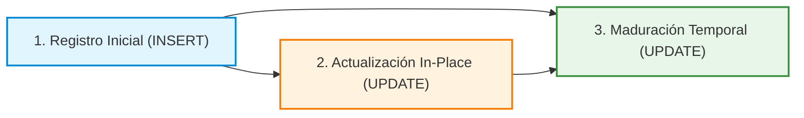
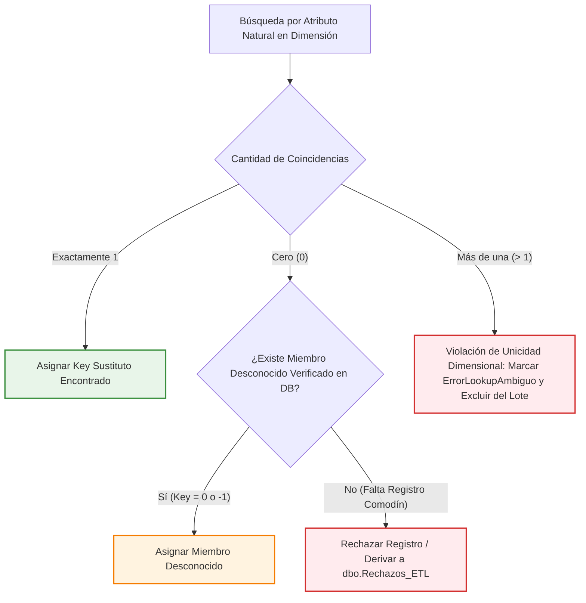

# NEXOSALUD — DISEÑO TÉCNICO DEL ETL DE HECHOS BUYER Y LEAD H3
## Especificación de Arquitectura de Carga, Mapeo Campo a Campo, Resolución Dimensional, Pseudocódigo Algorítmico y Pruebas Diseñadas
**Proyecto:** NexoSalud (Plataforma de Inteligencia de Negocios Odontológica — Clínica Luxedent, Trujillo)  
**Metodología:** IMPULSE (Fases: BUYER y LEAD)  
**Titular del Rol:** Mario Antonio Martinez Dominguez (Integrante 3 — ETL BUYER y LEAD, Embudo y Calidad)  
**Responsable de Ejecución Técnica:** Jesús Daniel Ordóñez Ugarte (Integrante 4 — asumiendo la ejecución técnica de BUYER/LEAD según el intercambio de responsabilidades comunicado entre integrantes)  
**Ubicación del Documento:** [Entregables/14. Diseno_ETL_hechos_buyer_lead_h3.md](14.%20Diseno_ETL_hechos_buyer_lead_h3.md)  
**Documento Contractual Base:** [Entregables/12. Contrato_y_dependencias_h3_mario.md](12.%20Contrato_y_dependencias_h3_mario.md)  
**Capa de Extracción (Staging):** [Entregables/13. Staging_buyer_lead_h3.sql](13.%20Staging_buyer_lead_h3.sql) y [Entregables/13. Guia_staging_buyer_lead_h3.md](13.%20Guia_staging_buyer_lead_h3.md)  
**Modelo Dimensional de Destino (H2):** [Entregables/6. Modelo_dimensional_arquitectura_h2.md](6.%20Modelo_dimensional_arquitectura_h2.md), [Entregables/7. Diccionario_mapeo_oltp_mart_h2.md](7.%20Diccionario_mapeo_oltp_mart_h2.md), [Entregables/8. DDL_modelo_dimensional_mart_h2.sql](8.%20DDL_modelo_dimensional_mart_h2.sql) y [Entregables/9. Poblacion_dimensiones_conformadas_h2.sql](9.%20Poblacion_dimensiones_conformadas_h2.sql)  
**Repositorio del Sistema Operativo de Referencia:** Commit [`95471c30799c639c05218af2f6eb6a78bd25ba56`](https://github.com/tommy260803/Proyecto-IN-Odontolog-a-/tree/95471c30799c639c05218af2f6eb6a78bd25ba56) (`backend/prisma/schema.prisma` y `backend/src/routes/report.routes.ts`)  
**Fecha de Emisión:** Octubre de 2026 (Diseño Técnico Consolidado y Coherente)  

---

## 1. Alcance, Granos y Arquitectura de Hechos

El presente entregable define el **diseño técnico y la especificación algorítmica para la futura implementación de las cargas ETL** correspondientes a Captación (**BUYER**) y Negociación Comercial (**LEAD**). Este diseño materializa los acuerdos del [Entregable 12](12.%20Contrato_y_dependencias_h3_mario.md) y se nutre directamente de la capa desacoplada de staging provista en el [Entregable 13](13.%20Staging_buyer_lead_h3.sql), sin alterar silenciosamente el contrato ni forzar modificaciones estructurales no aprobadas sobre el modelo dimensional de Marck ([Entregables 6 a 9](8.%20DDL_modelo_dimensional_mart_h2.sql)).

### 1.1 Definición de Tablas de Hechos y Granos Atómicos

| Entidad de Hechos | Grano Atómico Inequívoco | Clave Natural de Idempotencia | Clave Sustituta del Hecho | Propósito Analítico Primario |
| :--- | :--- | :--- | :--- | :--- |
| **`dbo.Fact_CaptacionBuyer`** | **Exactamente 1 fila por persona registrada** en el sistema transaccional (`id_persona`). | `id_persona_origen INT NOT NULL UNIQUE` | `KeyFactBuyer BIGINT IDENTITY(1,1)` | Seguimiento de volumen de captación, contactabilidad técnica, costos devengados y conversión global a lead en cohorte madura. |
| **`dbo.Fact_NegociacionLead`** | **Exactamente 1 fila por solicitud formal de atención** registrada en el sistema (`id_solicitud`). | `id_solicitud_origen INT NOT NULL UNIQUE` | `KeyFactLead BIGINT IDENTITY(1,1)` | Medición de velocidad y SLA de primera respuesta útil ($\le 900$ s), tasa de conversión a reserva en 14 días y descarte por abandono. |

* **Identificadores Degenerados de Auditoría y Cruce:** En `Fact_NegociacionLead` se incluye la columna `id_persona_origen INT NOT NULL` como atributo degenerado de auditoría para permitir el cruce y análisis de recurrencia con `Fact_CaptacionBuyer` sin forzar uniones complejas a través de dimensiones socioeconómicas.

### 1.2 Distinción Metodológica: Registro Inicial, Actualización In-Place y Maduración de Cohortes

Para evitar distorsiones en las series temporales, el pipeline distingue formalmente tres eventos del ciclo de vida de los datos:

1. **Registro Inicial (INSERT):**
   * Ocurre cuando un `id_persona` o `id_solicitud` aparece por primera vez en el staging y no existe en la tabla de hechos correspondiente.
   * Se evalúan las condiciones y dimensiones vigentes al `@InstanteEvaluacion` y se inserta la fila con `BatchId` y timestamp de carga.
2. **Actualización de la Fila (*In-Place UPSERT*):**
   * Ocurre cuando un registro preexistente cambia de estado en el sistema operativo (ej. una persona registra su primera solicitud posterior al registro; una solicitud pasa de `'En Negociacion'` a `'Confirmada'`, `'Cancelada'`, `'Abandonada'` o `'Perdida'`; o se asocia una reserva confirmada).
   * La fila de hechos se actualiza en el lugar (*in-place*) para reflejar la situación operativa más reciente.
3. **Maduración de Cohortes por Paso del Tiempo (UPDATE Temporal):**
   * Ocurre cuando transcurre el tiempo analítico y la solicitud o persona cumple la ventana de maduración de 14 días continuos ($\text{fecha\_evento} \le \text{DATEADD(day, -14, @InstanteEvaluacion)}$).
   * **Este cambio se produce aun cuando el registro transaccional en el origen OLTP no haya sufrido ninguna modificación física**. Las banderas de cohorte se actualizan determinísticamente (`CohorteInmadura` pasa de 1 a 0, y `LeadsCohorteEvaluable` pasa de 0 a 1).

### 1.3 Límites Arquitecturales: UPSERT Mutable vs. Historial Inmutable

> [!WARNING]
> **El UPSERT sobre una Fila Mutable NO es un Historial Inmutable:**  
> La actualización en el lugar (*in-place*) sobrescribe las medidas y atributos del registro previo. Si una solicitud estuvo en negociación durante 5 días y posteriormente se canceló o abandonó, la fila final reflejará el estado terminal, perdiendo la visibilidad de que en una fecha intermedia estuvo activa.  
> * **Snapshots Periódicos (Evolución Futura):** Si la clínica requiere análisis retrospectivo exacto a cualquier fecha pasada (*as-was analysis*), se requerirá desplegar tablas independientes de snapshots periódicos (ej. `Fact_SnapshotMensual_Lead`) o implementar SCD Tipo 2 bi-temporal. Dichas tablas no forman parte del entregable actual y se mantienen como dependencias de diseño futuro.  
> * **Límite Estructural del Origen:** Se hace constar que ningún mecanismo analítico en el Mart puede reconstruir estados históricos pasados si el motor operacional `[NexoSaludDB]` los sobrescribió físicamente sin conservar una bitácora transaccional histórica o un mecanismo de Change Data Capture (CDC).

---

## 2. Mapeo Exhaustivo de Campos desde Staging y Consultas Adicionales

A continuación se detalla la matriz campo a campo para cada columna de destino definida en el [Entregable 12](12.%20Contrato_y_dependencias_h3_mario.md). Cada mapeo utiliza **exclusivamente columnas reales expuestas por las vistas de staging del [Entregable 13](13.%20Staging_buyer_lead_h3.sql)** o especifica con precisión la consulta complementaria requerida al OLTP, sin inventar atributos no proyectados ni inferencias no validadas.

### 2.1 Mapeo de `dbo.Fact_CaptacionBuyer` (Grano: 1 Fila por Persona)

| Columna Destino | Tipo Destino | Columna en `staging.stg_Personas` / Fuente | Transformación y Regla Exacta | Tratamiento de NULL | Dependencia / Estado | Caso de Aceptación |
| :--- | :--- | :--- | :--- | :--- | :--- | :--- |
| **`KeyFactBuyer`** | `BIGINT IDENTITY` | Generada por motor Mart | `IDENTITY(1,1)` autoincremental de la tabla de hechos. | No aplica (NOT NULL) | Despliegue de tabla en Mart | Generación secuencial unívoca. |
| **`id_persona_origen`** | `INT` | `stg.id_persona` | Proyección directa: `stg.id_persona`. | No nulo en origen | Ninguna | `UQ_Fact_CaptacionBuyer_Origen` validada (0 duplicados). |
| **`KeyTiempoRegistro`** | `INT` | `stg.fecha_registro` | Lookup en `dbo.Dim_Tiempo` por atributo natural: `id_fecha = CAST(stg.fecha_registro AS DATE)`. | No nulo en origen | `Dim_Tiempo` poblada | Fecha `2026-09-01` resuelve a su `KeyTiempo`. |
| **`KeyTiempoConversion`** | `INT` | Subconsulta de primera solicitud de la persona en `stg_Solicitudes` | Si la persona formalizó solicitud en o después de `fecha_registro` y antes de `@InstanteEvaluacion`: lookup en `Dim_Tiempo` por `CAST(primera_fecha_solicitud AS DATE)`. Si no convirtió: miembro `0`. | Si no convirtió $\to$ miembro desconocido `0` (requiere miembro `0` verificado en `Dim_Tiempo`) | `Dim_Tiempo` con miembro `0` verificado | Persona no convertida obtiene `0`; convertida obtiene `KeyTiempo` de su solicitud. |
| **`KeyCanal`** | `INT` | `stg.id_canal_origen` | Lookup en `dbo.Dim_Canal` por atributo natural: `id_canal = stg.id_canal_origen`. | Si `id_canal_origen IS NULL` $\to$ miembro desconocido `0` verificado | `Dim_Canal` con miembro `0` | Canal 1 resuelve a su clave; canal ausente asigna `0` verificado. |
| **`KeyFuente`** | `INT` | `stg.id_campana_origen` | **Búsqueda Concreta según DDL 8:** En Marck ([Entregable 8](8.%20DDL_modelo_dimensional_mart_h2.sql)), `Dim_Fuente` contiene `id_campana INT NULL` e `id_fuente INT NULL` (no contiene `id_canal`). La búsqueda de la fuente de la persona se realiza mediante: `Dim_Fuente.id_campana = stg.id_campana_origen`. Si `id_campana_origen IS NULL` o no coincide: miembro desconocido `0` verificado. | Si NULL o no coincide $\to$ miembro `0` verificado | `Dim_Fuente` con miembro `0` | Campaña 10 resuelve a su `KeyFuente`. |
| **`KeyCampana`** | `INT` | `stg.id_campana_origen` | **Brecha H2 Bloqueante:** `Dim_Campana` no fue creada en el DDL de Marck ([Entregable 8](8.%20DDL_modelo_dimensional_mart_h2.sql)). El contrato 12 definió `KeyCampana INT NOT NULL DEFAULT 0` con FK activa a `Dim_Campana`. La ausencia de esta tabla bloquea físicamente la ejecución contractual. No se persisten claves 0 sin dimensión ni se suprimen FKs en el flujo autorizado; se mantiene como brecha bloqueada pendiente de acuerdo colegiado. | Bloqueado por ausencia física de tabla | Decisión colegiada con Marck | La prevalidación aborta hasta desplegar dimensión o enmendar contrato. |
| **`KeySede`** | `INT` | No disponible en `stg_Personas` | **Sin inferencia inventada:** La captación inicial de una persona en canales digitales u orgánicos no define una sede fija. Se asigna estrictamente el **miembro desconocido verificado (`KeySede = 0`)**. Queda expresamente prohibido asignar `KeySede = 1` por defecto o inferir sedes por zona de residencia sin regla colegiada aprobada. | Si no hay sede asignada en registro $\to$ miembro desconocido `0` verificado | Catálogo `Dim_Sede` con miembro `0` verificado | Persona sin sede obtiene `0`, nunca sede forzada. |
| **`KeyPersona`** | `INT` | `stg.id_persona` | **Brecha H2 Bloqueante:** `Dim_Persona` conformada no existe en Marck ([Entregable 8](8.%20DDL_modelo_dimensional_mart_h2.sql)); solo existe `Dim_TipoPersona`. No debe equipararse `Dim_Persona` con `Dim_TipoPersona` ni el `id_persona` de OLTP con una clave sustituta. La ausencia de la tabla bloquea la FK contractual. Se mantiene como brecha bloqueada pendiente de acuerdo colegiado. | Bloqueado por ausencia física de tabla | Decisión colegiada con Marck | La prevalidación aborta hasta desplegar dimensión o enmendar contrato. |
| **`KeyEstadoRegistro`** | `INT` | `stg.estado_calidad_norm`, `stg.autoriza_contacto_original` | Lookup en `dbo.Dim_EstadoRegistro`: `EstadoCalidad = stg.estado_calidad_norm AND AutorizacionContacto = (CASE WHEN stg.autoriza_contacto_original = 1 THEN 'SI' ELSE 'NO' END)`. | Si no coincide $\to$ miembro desconocido `0` verificado | `Dim_EstadoRegistro` poblada | 'Valido' y 'SI' resuelve a su clave correspondiente. |
| **`ContactosRegistrados`** | `INT` | N/A | Constante: `1` (por grano atómico). | Nunca NULL | Ninguna | `SUM(ContactosRegistrados) = COUNT(*)`. |
| **`ContactosUtilizables`** | `INT` | `stg.es_contacto_utilizable_tecnico`, `stg.autoriza_contacto_original` | `CASE WHEN stg.es_contacto_utilizable_tecnico = 1 AND stg.autoriza_contacto_original = 1 THEN 1 ELSE 0 END`. | Si falta autorización o formato $\to$ `0` | Ninguna | Solo contactos con formato válido y autorización legal suman 1. |
| **`ContactosElegiblesB1`** | `INT` | `stg.fecha_registro` + ContactosUtilizables | `CASE WHEN ContactosUtilizables = 1 AND stg.fecha_registro <= DATEADD(day, -14, @InstanteEvaluacion) THEN 1 ELSE 0 END`. | `0` para inmaduros | Parámetro `@InstanteEvaluacion` | Registro utilizable con $\ge 14$ días vale 1; inmaduro vale 0. |
| **`ConversionesALead14Dias`**| `INT` | ContactosElegiblesB1 + Conversión | `CASE WHEN ContactosElegiblesB1 = 1 AND primera_fecha_solicitud IS NOT NULL AND primera_fecha_solicitud >= stg.fecha_registro AND primera_fecha_solicitud < @InstanteEvaluacion AND primera_fecha_solicitud <= DATEADD(day, 14, stg.fecha_registro) THEN 1 ELSE 0 END`. | `0` si no convirtió en 14d o es inmaduro | Misma cohorte madura que denominador | Solo registros elegibles maduros que convirtieron en $\le 14$ días exactos suman 1. |
| **`ConversionesALead`** | `INT` | Fecha primera solicitud | `CASE WHEN primera_fecha_solicitud IS NOT NULL AND primera_fecha_solicitud >= stg.fecha_registro AND primera_fecha_solicitud < @InstanteEvaluacion THEN 1 ELSE 0 END`. | `0` si no convirtió | Ninguna | Métrica operativa de conversión histórica total antes del corte. |
| **`SegundosConversion`** | `BIGINT` | `stg.fecha_registro`, primera solicitud | Si convirtió válidamente antes del corte: `DATEDIFF_BIG(second, stg.fecha_registro, primera_fecha_solicitud)`. Se especifica `DATEDIFF_BIG` para evitar desbordamiento aritmético de `DATEDIFF` estándar sobre el tipo de destino `BIGINT`. Si no convirtió: `NULL`. | `NULL` si no convirtió | Ninguna | Duración exacta en segundos (NULL si no convirtió). |
| **`TiempoConversionDias`** | `INT` | `stg.fecha_registro`, primera solicitud | Si convirtió válidamente antes del corte: `DATEDIFF(day, stg.fecha_registro, primera_fecha_solicitud)`. Si no convirtió: `NULL`. | `NULL` si no convirtió | Ninguna | Días enteros para consumo ejecutivo en `report.routes.ts`. |
| **`CostoAtribuidoCaptacion`** | `DECIMAL(10,2)` | Sin fuente de gastos en OLTP | **Sin fuente inventada:** En `[NexoSaludDB]` no existe una tabla de gastos de marketing ni bitácora de costos devengados. Mientras no exista una fuente de gastos acreditada y una política de prorrateo validada: **se asigna estrictamente `NULL`**. La persona conserva su fila única sin duplicarse. | Siempre `NULL` en esta versión | Fuente publicitaria externa | Costo no disponible queda en `NULL`. |
| **`EstadoDisponibilidadCosto`**| `VARCHAR(30)` | Disponibilidad de gasto | Al no existir fuente de gastos operativa, se fija en: `'PendienteConciliacion'`. | NOT NULL (`'PendienteConciliacion'`) | Política de costos con sponsor | Cobertura reportada como pendiente. |
| **`BatchId`** | `VARCHAR(50)` | Parámetro ETL | Identificador unívoco del lote de ejecución. | NOT NULL | Pipeline ejecutor | Permite trazabilidad y auditoría de la ejecución. |
| **`FechaCarga`** | `DATETIME2(7)` | Función de sistema | `GETDATE()` en el instante de inserción/actualización. | NOT NULL | Ninguna | Auditoría temporal de persistencia analítica. |
| **`UsuarioCarga`** | `VARCHAR(50)` | Función de sistema | `SYSTEM_USER` de la sesión de base de datos. | NOT NULL | Ninguna | Identificación del actor o servicio de ejecución. |

---

### 2.2 Mapeo de `dbo.Fact_NegociacionLead` (Grano: 1 Fila por Solicitud)

| Columna Destino | Tipo Destino | Columna en `staging.stg_Solicitudes` / Fuente | Transformación y Regla Exacta | Tratamiento de NULL | Dependencia / Estado | Caso de Aceptación |
| :--- | :--- | :--- | :--- | :--- | :--- | :--- |
| **`KeyFactLead`** | `BIGINT IDENTITY` | Generada por motor Mart | `IDENTITY(1,1)` autoincremental de la tabla de hechos. | No aplica (NOT NULL) | Despliegue de tabla en Mart | Generación secuencial unívoca. |
| **`id_solicitud_origen`** | `INT` | `stg.id_solicitud` | Proyección directa: `stg.id_solicitud`. | No nulo en origen | Ninguna | `UQ_Fact_NegociacionLead_Origen` validada (0 duplicados). |
| **`id_persona_origen`** | `INT` | `stg.id_persona` | Proyección degenerada directa: `stg.id_persona`. | No nulo en origen | Ninguna | Cruce directo con `Fact_CaptacionBuyer`. |
| **`KeyTiempoSolicitud`** | `INT` | `stg.fecha_solicitud` | Lookup en `dbo.Dim_Tiempo` por atributo natural: `id_fecha = CAST(stg.fecha_solicitud AS DATE)`. | No nulo en origen | `Dim_Tiempo` poblada | Fecha `2026-09-02` resuelve a su `KeyTiempo`. |
| **`KeyTiempoReserva`** | `INT` | Instante de hito de conversión derivado (`fecha_hito_conversion`) | Si existe hito alcanzado antes del corte: lookup en `Dim_Tiempo` por `CAST(fecha_hito_conversion AS DATE)`. De lo contrario: miembro desconocido `0`. **Propuesta Contractual Pendiente:** El contrato 12 definió este campo como fecha de reserva. Si se adopta el hito por confirmación explícita y se utiliza `fecha_confirmacion`, este cambio de semántica requiere acuerdo formal. | Si no convirtió antes del corte $\to$ miembro `0` verificado | `Dim_Tiempo` con miembro `0` verificado | Solicitud sin conversión asigna `0`; con conversión asigna su `KeyTiempo`. |
| **`KeySede`** | `INT` | **Consulta complementaria a OLTP** (`Opciones` $\bowtie$ `Disponibilidad`) antes del corte | `stg_Solicitudes` expone sólo agregados. Para sede se requiere consulta a OLTP: primera opción ofrecida antes del corte (`fecha_ofrecida < @InstanteEvaluacion`) $\to$ `Disponibilidad.id_sede`. Lookup en `dbo.Dim_Sede` por `id_sede`. Si no hay opciones ofrecidas antes del corte: miembro desconocido verificado (`KeySede = 0`). Queda terminantemente prohibido forzar `KeySede = 1` o inferir sedes por zona. | Si no hay sede asociada $\to$ miembro desconocido `0` verificado | Catálogo `Dim_Sede` con miembro `0` verificado; consulta OLTP complementaria | Solicitud con opción en California resuelve a su clave; sin opción obtiene `0`. |
| **`KeyServicio`** | `INT` | `stg.id_servicio_solicitado` | Lookup en `dbo.Dim_Servicio` por atributo natural: `id_servicio = stg.id_servicio_solicitado`. | Si es NULL $\to$ miembro desconocido `0` verificado | `Dim_Servicio` poblada con miembro `0` verificado | Servicio de Ortodoncia resuelve a su `KeyServicio`; ausente resuelve a `0`. |
| **`KeyProfesional`** | `INT` | **Consulta complementaria a OLTP** (`Opciones` $\bowtie$ `Disponibilidad`) antes del corte | `stg_Solicitudes` no expone profesional. Se requiere consulta a OLTP: primera opción ofrecida antes del corte $\to$ `Disponibilidad.id_profesional`. Lookup en `dbo.Dim_Profesional` por `id_profesional`. Si no hay profesional: miembro desconocido verificado (`KeyProfesional = 0`). | Si no hay profesional $\to$ miembro desconocido `0` verificado | `Dim_Profesional` con miembro `0` verificado; consulta OLTP complementaria | Profesional asignado resuelve a su clave; sin asignar obtiene `0`. |
| **`KeyNegociador`** | `INT` | Atribución de interacciones / Usuario | Lookup en `dbo.Dim_Negociador` por `id_usuario_operador` de la primera interacción útil atribuida de forma determinista antes del corte. Si no existe interacción atribuida: miembro desconocido verificado (`KeyNegociador = 0`). | Si no hay usuario trazable $\to$ miembro `0` verificado | `Dim_Negociador` con miembro `0` verificado | Usuario operador resuelve a su clave; sin respuesta obtiene `0`. |
| **`KeyPersona`** | `INT` | `stg.id_persona` | **Brecha H2 Bloqueante:** `Dim_Persona` conformada no existe en Marck. Se mantiene como brecha bloqueada pendiente de acuerdo colegiado. | Bloqueado por ausencia física de tabla | Decisión colegiada con Marck | La prevalidación aborta hasta desplegar dimensión o enmendar contrato. |
| **`SolicitudesRegistradas`**| `INT` | N/A | Constante: `1` (por grano atómico). | Nunca NULL | Ninguna | `SUM(SolicitudesRegistradas) = COUNT(*)`. |
| **`LeadsCohorteEvaluable`** | `INT` | `stg.fecha_solicitud` | `CASE WHEN stg.fecha_solicitud <= DATEADD(day, -14, @InstanteEvaluacion) THEN 1 ELSE 0 END`. | `0` para inmaduras | Parámetro `@InstanteEvaluacion` | Denominador de L1: 1 si tiene $\ge 14$ días cumplidos al corte. |
| **`CohorteInmadura`** | `INT` | `stg.fecha_solicitud` | `CASE WHEN stg.fecha_solicitud > DATEADD(day, -14, @InstanteEvaluacion) THEN 1 ELSE 0 END`. | `0` para maduras | Parámetro `@InstanteEvaluacion` | Solicitudes que permanecen en ventana de maduración temporal. |
| **`LeadsConvertidosPayer14Dias`**| `INT` | LeadsCohorteEvaluable + Hito Conversión | `CASE WHEN LeadsCohorteEvaluable = 1 AND fecha_hito_conversion IS NOT NULL AND fecha_hito_conversion >= stg.fecha_solicitud AND fecha_hito_conversion < @InstanteEvaluacion AND fecha_hito_conversion <= DATEADD(day, 14, stg.fecha_solicitud) THEN 1 ELSE 0 END`. | `0` si no convirtió en 14d o es inmaduro | Misma cohorte madura que denominador | Numerador de L1: solo solicitudes de cohorte evaluable convertidas en $\le 14$ días continuos exactos ($336$ h). |
| **`LeadsConvertidosPayerTotal`**| `INT` | Indicador unificado de hito $H$ | Se fija en $H$, donde $H = 1$ si existe hito válido antes del corte; de lo contrario $0$. Depende estrictamente del cumplimiento del hito, no del estado actual. | `0` si no convirtió antes del corte | Ninguna | Métrica operativa de conversión comercial acumulada antes del corte. |
| **`LeadsAbandonados`** | `INT` | `stg.estado_solicitud_norm` | `CASE WHEN stg.estado_solicitud_norm = 'Abandonada' THEN 1 ELSE 0 END`. | `0` si no abandonó | Ninguna | Solicitudes cuyo resultado operativo terminal es abandono. |
| **`LeadsEnNegociacion`** | `INT` | `stg.estado_solicitud_norm` + Hito $H$ | `CASE WHEN stg.estado_solicitud_norm IN ('Abierta', 'En Negociacion', 'Reserva') AND H = 0 THEN 1 ELSE 0 END`. | Nunca NULL | Ninguna | Solicitudes estrictamente activas sin hito alcanzado. |
| **`LeadsResultadoFinal`** | `INT` | `stg.estado_solicitud_norm` + Hito $H$ | `CASE WHEN H = 1 OR stg.estado_solicitud_norm IN ('Confirmada', 'Convertida', 'Abandonada', 'Cancelada', 'Descartada', 'Perdida') THEN 1 ELSE 0 END`. | Nunca NULL | Requerido por `report.routes.ts` | Denominador de L3: cerradas (Convertidas + Abandonadas + Canceladas + Descartadas + Perdidas). |
| **`LeadsRequierenRespuesta`**| `INT` | N/A | Constante: `1` (denominador base de L2). | Nunca NULL | Ninguna | Universo de solicitudes que demandan atención. |
| **`LeadsRespuestaUtil15Min`**| `INT` | EstadoRespuestaSLA + Segundos | `CASE WHEN EstadoRespuestaSLA = 'Acreditada' AND SegundosPrimeraRespuesta <= 900 THEN 1 ELSE 0 END`. Si `AtribucionAmbigua = 1`, se fija forzosamente en `0`. | `0` si no cumplió o fue ambigua | Calendario hábil de prueba | Numerador oficial de L2: respuesta útil acreditada en $\le 900$ s hábiles. |
| **`SegundosPrimeraRespuesta`**| `INT` | Cómputo hábil solicitud $\to$ respuesta | Duración exacta en segundos hábiles transcurridos hasta la primera respuesta útil acreditada sin ambigüedad antes del corte. Si hay ambigüedad o no hay respuesta: `NULL`. | `NULL` si no hay respuesta acreditada o es ambigua | Calendario hábil de prueba | Precisión en segundos hábiles para dirimir umbral de 900 s. |
| **`MinutosPrimeraRespuesta`** | `INT` | Derivado de Segundos | `CASE WHEN SegundosPrimeraRespuesta IS NOT NULL THEN CAST(CEILING(SegundosPrimeraRespuesta / 60.0) AS INT) ELSE NULL END`. | `NULL` si no hay respuesta acreditada o es ambigua | Ninguna | Minutos para visualización ejecutiva en reportes. |
| **`EstadoRespuestaSLA`** | `VARCHAR(30)` | Evaluación de SLA | Precedencia de estados: `'Acreditada'`, `'Incumplida'`, `'PendienteDentroSLA'`, `'EvidenciaInsuficiente'`. Si hay ambigüedad: `'EvidenciaInsuficiente'`. | NOT NULL (`'PendienteDentroSLA'` por defecto) | Reglas SLA Sección 4 | Clasificación transparente de atención al cliente. |
| **`AtribucionHeuristica`** | `BIT` | Algoritmo de atribución | `1` si la respuesta se asoció por inferencia temporal de interacciones; `0` si proviene de telemetría directa explícita del canal. | NOT NULL (`0` por defecto) | Pipeline de atribución | Transparencia de inferencia estadística vs vínculo explícito. |
| **`AtribucionAmbigua`** | `BIT` | Algoritmo de atribución | `1` si existieron múltiples solicitudes concurrentes o interacciones simultáneas candidatas sin desempate único; de lo contrario `0`. | NOT NULL (`0` por defecto) | Pipeline de atribución | Control de calidad de la inferencia. |
| **`PrecioCotizado`** | `DECIMAL(10,2)` | Recálculo de opciones antes del corte | Si 1 opción seleccionada antes del corte $\to$ precio de esa opción. Si 0 seleccionadas y hay opciones ofrecidas $\to$ precio de la primera opción ofrecida cronológicamente. Si múltiples seleccionadas o sin opciones $\to$ `NULL`. **Aclaración:** `fecha_ofrecida` permite filtrar la oferta, pero `seleccionada` es un atributo mutable en OLTP sin fecha histórica acreditada de selección. | `NULL` si no cotizó o es ambiguo | Recálculo temporal en Fase 2 | Medida económica de negociación al corte. |
| **`BatchId`** | `VARCHAR(50)` | Parámetro ETL | Identificador unívoco del lote de ejecución. | NOT NULL | Pipeline ejecutor | Permite trazabilidad y auditoría de la ejecución. |
| **`FechaCarga`** | `DATETIME2(7)` | Función de sistema | `GETDATE()` en el instante de inserción/actualización. | NOT NULL | Ninguna | Auditoría temporal de persistencia analítica. |
| **`UsuarioCarga`** | `VARCHAR(50)` | Función de sistema | `SYSTEM_USER` de la sesión de base de datos. | NOT NULL | Ninguna | Identificación del actor o servicio de ejecución. |

---

## 3. Resolución Dimensional y Tratamiento de Coincidencias

### 3.1 Preservación de Claves Sustitutas `IDENTITY` y Ausencia de `UNIQUE` / `NOT NULL` en DDL 8

En el modelo dimensional de Marck ([Entregable 8](8.%20DDL_modelo_dimensional_mart_h2.sql)), dimensiones como `Dim_Tiempo` y `Dim_Hora` fueron creadas con claves primarias autoincrementales:
* `Dim_Tiempo`: `KeyTiempo INT IDENTITY(1,1) PRIMARY KEY`, con columna `id_fecha DATE NOT NULL`. **Se hace constar expresamente que el DDL 8 no declara una restricción `UNIQUE` sobre `id_fecha`**.
* `Dim_Hora`: `KeyHora INT IDENTITY(1,1) PRIMARY KEY`, con columnas `id_hora INT NOT NULL`, `Turno VARCHAR(50)`, `Hora INT`, `Minuto INT`. **Se hace constar expresamente que el DDL 8 no declara `Hora` ni `Minuto` como `NOT NULL`** (ambas columnas son anulables).

Dado que la unicidad física no está impuesta por el motor en `id_fecha` ni la nulabilidad en `Hora`/`Minuto`, **la política de búsqueda debe verificar programáticamente la unicidad de cada coincidencia antes de asignar claves**.

### 3.2 Política Exhaustiva de Búsqueda Dimensional (0, 1 y Varias Coincidencias)

Queda **expresamente prohibido resolver búsquedas ambiguas mediante `TOP 1 ... ORDER BY Key ASC`**, ya que seleccionar arbitrariamente una clave sustituta enmascara inconsistencias en las dimensiones conformadas. Para cada búsqueda se establece la siguiente regla uniforme:

1. **Exactamente 1 Coincidencia:** Se asigna el `Key` sustituto devuelto por la dimensión.
2. **Cero (0) Coincidencias:**
   * Si el atributo de origen venía en `NULL` (ej. solicitud sin servicio o sin profesional asignado), o si venía un código no catalogado en la dimensión:
     * **Si la dimensión existe físicamente y su miembro desconocido (`Key = 0` o `Key = -1` para hora) ha sido verificado:** Se asigna dicho miembro desconocido. **Nunca se asignan valores centinela como `-999`**.
     * **Si la dimensión no existe o su registro comodín no existe físicamente en la base de datos:** Queda prohibido forzar `Key = 0` (lo cual causaría una violación de clave foránea `FOREIGN KEY` o dejaría una clave huérfana). El registro se deriva a la tabla de excepciones `dbo.Rechazos_ETL_Lead` con estado `EstadoValidacion = 'PendienteDimensionH2'`, impidiendo que la carga falle abruptamente o persista inconsistencias.
3. **Más de una (> 1) Coincidencias (Ambigüedad):**
   * Representa una corrupción o duplicación de claves de negocio en la dimensión conformada.
   * El registro no debe asignarse al azar con `TOP 1`.
   * El registro se marca con `EstadoValidacion = 'ErrorLookupAmbiguo'`, se excluye del lote de persistencia, se genera una alerta en `dbo.Log_Ejecucion_ETL` y se envía a la tabla de rechazos para corrección previa de la dimensión en H2.
4. **Prevalidación Bloqueante:** Si una dimensión conformada requerida no existe físicamente en el catálogo de base de datos, el procedimiento aborta inmediatamente en la Fase 1.
5. **Evaluación de Coincidencias con `COALESCE`:** En consultas de búsqueda agregada (`LEFT JOIN`), se debe evaluar explícitamente:
   $$\text{CantidadCoincidencias} = \text{COALESCE(lkp.Coincidencias, 0)}$$
   distinguiendo inequívocamente la ausencia de coincidencias ($0$) de la ambigüedad ($> 1$).

### 3.3 Tratamiento de Brechas Dimensionales: `Dim_Persona` y `Dim_Campana`

* **`Dim_Persona` (Conformada para BUYER y LEAD):**
  * **Interfaz Requerida:** Clave sustituta `KeyPersona INT IDENTITY(1,1) PRIMARY KEY` (con miembro `0` verificado) y clave natural `id_persona INT NOT NULL UNIQUE`. Atributos propuestos: `NombreCompleto VARCHAR(150)`, `DocumentoIdentidad VARCHAR(20)`, etc.
  * **Regla de Resolución:** Buscar en `dbo.Dim_Persona` por `id_persona = tmp.id_persona`. Si coincidencias $= 1 \to$ asignar `KeyPersona`; si $= 0 \to 0$ verificado; si $> 1 \to \text{'ErrorLookupAmbiguo'}$.
  * **Bloqueo Contractual:** En H2 ([Entregable 8](8.%20DDL_modelo_dimensional_mart_h2.sql)) solo existe `Dim_TipoPersona`. La ausencia física de `Dim_Persona` bloquea la restricción `FOREIGN KEY` exigida por el contrato 12. No se persisten claves 0 sin dimensión ni se suprimen FKs en el flujo autorizado; la prevalidación aborta la ejecución hasta que se formalice el acuerdo con Marck.
* **`Dim_Campana` (Para BUYER):**
  * **Interfaz Requerida:** Clave sustituta `KeyCampana INT IDENTITY(1,1) PRIMARY KEY` (con miembro `0` verificado) y clave natural `id_campana INT NOT NULL UNIQUE`.
  * **Regla de Resolución:** Buscar en `dbo.Dim_Campana` por `id_campana = tmp.id_campana_origen`. Si coincide $1 \to \text{KeyCampana}$; si $= 0 \to 0$ verificado; si $> 1 \to \text{'ErrorLookupAmbiguo'}$.
  * **Bloqueo Contractual:** En H2 las campañas están absorbidas en `Dim_Fuente`. La ausencia de `Dim_Campana` bloquea la FK contractual del contrato 12, manteniendo la ejecución bloqueada en prevalidación.

---

## 4. Reglas Temporales, Estados Comerciales y Atribución Determinista

### 4.1 Definición Rigurosa del Corte Temporal

Para evitar errores de redondeo o pérdida de eventos ocurridos en el último segundo del día de evaluación, el corte temporal se define con la siguiente convención matemática y operacional:
* Se recibe el parámetro `@FechaCorte DATE` (ejemplo: `'2026-09-30'`).
* Se calcula el instante de corte como el **inicio exclusivo del día siguiente**:
  $$\text{@InstanteEvaluacion} = \text{DATEADD(day, 1, CAST(@FechaCorte AS DATETIME2(0)))} \quad (\text{'2026-10-01 00:00:00'})$$
* **Intervalo de Inclusión Semiabierto:** Todo evento o estado considerado en la carga debe satisfacer estrictamente:
  $$\text{fecha\_evento} < \text{@InstanteEvaluacion}$$
* Se prohíbe formalmente describir el corte como "el último milisegundo" (ej. `23:59:59.999`), evitando los problemas conocidos de truncamiento y redondeo de `DATETIME` en SQL Server.

### 4.2 Cronología Estricta, Recálculo de Opciones y Derivación de Hitos de Conversión

Toda conversión válida (de Persona a Solicitud, o de Solicitud a Reserva) debe respetar de forma obligatoria la siguiente secuencia cronológica:
$$\text{fecha\_solicitud} \le \text{fecha\_hito\_conversion} < \text{@InstanteEvaluacion}$$

* **Anomalía Cronológica:** Si en el origen transaccional se detecta `fecha_solicitud < fecha_registro` o `fecha_reserva < fecha_solicitud`, el registro se clasifica como anomalía de datos (`EstadoValidacion = 'AnomaliaCronologica'`) y la conversión no se acredita.
* **Aplicación Universal del Corte a Fuentes Relacionadas:**
  * Solicitudes: `fecha_solicitud < @InstanteEvaluacion`.
  * Opciones: `fecha_ofrecida < @InstanteEvaluacion`.
  * Reservas: `fecha_reserva < @InstanteEvaluacion`.
  * Confirmaciones: `fecha_confirmacion < @InstanteEvaluacion` (exigiendo $\text{fecha\_solicitud} \le \text{fecha\_reserva} \le \text{fecha\_confirmacion}$).
  * Interacciones: `fecha_hora < @InstanteEvaluacion`.
* **Recálculo de Precios y Opciones Anteriores al Corte:**
  * No deben reutilizarse agregados actuales de staging si estos contienen opciones ofrecidas o seleccionadas con posterioridad al corte.
  * El precio cotizado se recalcula sobre las opciones anteriores a `@InstanteEvaluacion`:
    1. Si existe exactamente 1 opción seleccionada antes del corte $\to$ `precio_ofrecido` de esa opción.
    2. Si existen 0 opciones seleccionadas pero hay opciones ofrecidas antes del corte $\to$ `primer_precio_ofrecido` (de la primera opción cronológica ofrecida antes del corte).
    3. Si existen múltiples opciones seleccionadas o ninguna opción ofrecida antes del corte $\to$ `NULL`.
  * **Aclaración Crítica de Mutabilidad:** `fecha_ofrecida` permite filtrar objetivamente la oferta anterior al corte, pero `seleccionada` es un atributo booleano mutable en OLTP sin timestamp histórico de selección. No se afirma reconstruir cuándo se seleccionó una opción; se evalúa su estado al momento de extracción sobre el universo de opciones ofrecidas antes del corte.
* **Derivación de Hitos de Conversión Separados:**
  * **Hito CreacionReserva:** Se evalúa la primera reserva válida de la solicitud ordenada estrictamente por `fecha_reserva ASC, id_reserva ASC`.
    $$\text{fecha\_hito\_conversion} = \text{primera\_fecha\_reserva} \quad (\text{donde } \text{fecha\_solicitud} \le \text{fecha\_reserva} < \text{@InstanteEvaluacion})$$
  * **Hito ConfirmacionReserva:** Se evalúa la primera confirmación válida **entre todas las reservas asociadas a la solicitud**, ordenada por `fecha_confirmacion ASC, id_reserva ASC` (no limitándose a la primera reserva creada).
    $$\text{fecha\_hito\_conversion} = \text{primera\_fecha\_confirmacion} \quad (\text{donde } \text{confirmacion\_explicita} = 1, \text{ y } \text{fecha\_solicitud} \le \text{fecha\_reserva} \le \text{fecha\_confirmacion} < \text{@InstanteEvaluacion})$$
  * **Hito PagoValidado:** **Explícitamente bloqueado** en esta versión, dado que la vista de staging 13 no expone datos de cobranza de PAYER.
* **Semántica Contractual de `KeyTiempoReserva`:** El contrato 12 fijó `KeyTiempoReserva` como la fecha de reserva. Si se adopta el hito de confirmación y se almacena `fecha_confirmacion`, se deja expresamente documentado que requiere acuerdo colegiado para ajustar formalmente la semántica de la columna.

### 4.3 Clasificación Unificada de Estados Comerciales

Para evitar clasificaciones genéricas mediante `NOT IN` que erróneamente agrupen estados desconocidos o perdidos en negociación, se establece una **matriz única exhaustiva basada estrictamente en `estado_solicitud_norm`** del staging y en la variable booleana de hito de conversión $H$:

$$H = 1 \iff \text{existe un hito de conversión válido según la configuración, con cronología válida y anterior al corte; de lo contrario } 0.$$

| `estado_solicitud_norm` (Staging 13) | `estado_original` (OLTP) | Categoría Comercial Actual (`ResultadoComercialActual`) | `LeadsConvertidosPayerTotal` | `LeadsEnNegociacion` | `LeadsAbandonados` | `LeadsResultadoFinal` |
| :--- | :--- | :--- | :---: | :---: | :---: | :---: |
| **`'Abierta'`** | ABIERTA, NUEVO | Si $H = 1 \to$ `'ConvertidoActivo'`; si $H = 0 \to$ `'EnNegociacion'` | **H** | **1 - H** | 0 | **H** |
| **`'En Negociacion'`** | EN NEGOCIACIÓN | Si $H = 1 \to$ `'ConvertidoActivo'`; si $H = 0 \to$ `'EnNegociacion'` | **H** | **1 - H** | 0 | **H** |
| **`'Reserva'`** | RESERVA, PRE-RESERVA | Si $H = 1 \to$ `'ConvertidoActivo'`; si $H = 0 \to$ `'EnNegociacion'` | **H** | **1 - H** | 0 | **H** |
| **`'Confirmada'`** | CONFIRMADA, CONFIRMADO | `'ConvertidoActivo'` *(espera $H = 1$ en configuración coherente)* | **H** | 0 | 0 | **1** |
| **`'Convertida'`** | CONVERTIDA, TRATAMIENTO | `'ConvertidoActivo'` *(espera $H = 1$ en configuración coherente)* | **H** | 0 | 0 | **1** |
| **`'Abandonada'`** | ABANDONADA, SIN RESPUESTA | `'Abandonada'` *(abandono terminal)* | **H** | 0 | **1** | **1** |
| **`'Cancelada'`** | CANCELADA, CANCELADO | `'Cancelada'` *(cancelación terminal)* | **H** | 0 | 0 | **1** |
| **`'Descartada'`** | DESCARTADA, DUPLICADO | `'Descartada'` *(descarte terminal)* | **H** | 0 | 0 | **1** |
| **`'Perdida'`** | PERDIDA, COMPETENCIA | `'Perdida'` *(pérdida terminal)* | **H** | 0 | 0 | **1** |
| **`'Desconocido'`** | Cualquier otro texto o NULL | `'Desconocido'` *(anomalía operacional)* | **H** | 0 | 0 | **H** *(si cerró por hito)* |

* **Separación entre Conversión Histórica y Resultado Comercial Actual:**
  * Si un paciente reservó dentro de los 14 días cumpliendo el hito de conversión ($H = 1$), pero semanas después canceló la cita o abandonó la atención:
    * El hito histórico permanece intacto: `LeadsConvertidosPayerTotal = 1` y `LeadsConvertidosPayer14Dias = 1`.
    * El resultado comercial terminal refleja el cierre: `LeadsResultadoFinal = 1`.
    * La categoría operativa actual es única y excluyente: `ResultadoComercialActual = 'Cancelada'` o `'Abandonada'`.
  * `LeadsConvertidosPayerTotal` depende estrictamente del cumplimiento del hito $H$ antes del corte, no de si el estado operativo actual es Confirmada o Convertida. Las diferencias semánticas respecto al Contrato 12 se documentan como propuesta formal pendiente de aprobación.

### 4.4 Atribución Temporal Determinista de Interacciones y SLA L2

Dado que en `[NexoSaludDB]` la tabla `Interacciones` cuelga de `Personas` y no de `Solicitudes`, la vinculación se realiza mediante un **algoritmo determinista de atribución temporal con consumo exclusivo**, rotulado explícitamente como **inferencia de negocio y no como vínculo transaccional garantizado**:

1. **Uso Exclusivo de Columnas Existentes y Límites de Telemetría:**
   * Se utilizan únicamente columnas reales de `staging.stg_Interacciones`: `id_interaccion`, `id_persona`, `id_canal`, `id_fuente`, `id_usuario_operador`, `fecha_hora_interaccion`, `tipo_interaccion_norm`, `es_respuesta_util`, `tiene_resultado_registrado`, `resultado_categoria_norm`.
   * **Limitación Explícita:** El origen no cuenta con campos de dirección (`inbound`/`outbound`) ni estado de telemetría activa. La presencia de `id_usuario_operador` no garantiza por sí sola que el mensaje haya sido una respuesta saliente de staff (pudo ser una llamada entrante registrada por recepción). La utilidad se evalúa según `es_respuesta_util = 1`.
2. **Validación de `fecha_primera_respuesta`:** Si `stg_Solicitudes.fecha_primera_respuesta` está presente, debe validar cronología (`>= fecha_solicitud` y `< @InstanteEvaluacion`). No obstante, en OLTP es una marca temporal sin bitácora de mensajes ni evidencia adjunta de utilidad; por tanto, no se considera automáticamente como respuesta útil acreditada sin validación explícita.
3. **Algoritmo Global de Atribución 1:1 por Persona (Evaluando TODAS las Solicitudes):**
   * El algoritmo evalúa **todas las solicitudes con `fecha_solicitud < @InstanteEvaluacion`**, independientemente de su estado actual (abiertas, convertidas, canceladas, abandonadas, etc.), pues el cierre comercial posterior no elimina la necesidad de medir la velocidad de primera atención.
   * **Inicialización y Conservación Monótona de Ambigüedad:**
     * `AtribucionAmbigua = 0` se inicializa **una sola vez por solicitud al comenzar el cálculo completo del lote**.
     * Durante ese cálculo, la marca **solo puede pasar monótonamente de 0 a 1** (una vez marcada en 1, nunca se restablece a 0).
     * Una interacción posterior con una única candidata **no elimina una ambigüedad previa sobre cuál fue la primera respuesta**.
     * Una nueva ejecución del ETL puede recalcular desde cero con la evidencia disponible; la conservación monótona descrita aplica durante cada cálculo completo del lote.
   * Por cada persona registrada:
     1. Listar todas sus solicitudes ordenadas por: `fecha_solicitud ASC, id_solicitud ASC`.
     2. Listar todas sus interacciones útiles (`es_respuesta_util = 1`) fechadas antes del corte, ordenadas por: `fecha_hora_interaccion ASC, id_interaccion ASC`.
     3. Para cada interacción candidata $I$:
        * Identificar solicitudes sin responder que cumplan $\text{S.fecha\_solicitud} \le \text{I.fecha\_hora\_interaccion} < \text{@InstanteEvaluacion}$.
        * **Consumo Exclusivo y Propagación de Ambigüedad:** Cada interacción se consume como máximo **una vez**. Una solicitud recibe como máximo **una primera respuesta**.
        * Si califica exactamente 1 solicitud $\to$ atribuir $I$, marcar $I$ como consumida. Si la solicitud ya tenía `AtribucionAmbigua = 1` por una interacción concurrente previa, **conserva su marca en 1**; si no, permanece en 0.
        * Si califican $\ge 2$ solicitudes (ventanas superpuestas): **marcar obligatoriamente `AtribucionAmbigua = 1` en TODAS las solicitudes candidatas concurrentes antes de consumir la interacción**. Atribuir $I$ a la solicitud más antigua por desempate técnico para agotar el mensaje y marcar $I$ como consumida, pero **conservar visible la marca de ambigüedad en ambas solicitudes**. El desempate técnico no borra la incertidumbre.
4. **Precedencia Inequívoca de Estados SLA L2:**
   * **Atribución Ambigua (`AtribucionAmbigua = 1`):**
     $$\text{EstadoRespuestaSLA} = \text{'EvidenciaInsuficiente'}, \quad \text{LeadsRespuestaUtil15Min} = 0, \quad \text{SegundosPrimeraRespuesta} = \text{NULL}$$
     *(La duración inferida se conserva únicamente a nivel de auditoría como `SegundosInferidosDiagnostico`, pero el campo contractual queda NULL al no haber certeza de a qué solicitud correspondió la atención)*.
   * **Respuesta Útil Acreditada sin Ambigüedad (`AtribucionAmbigua = 0`):**
     * Si $\text{SegundosPrimeraRespuesta} \le 900 \to \text{EstadoRespuestaSLA} = \text{'Acreditada'}, \text{LeadsRespuestaUtil15Min} = 1$.
     * Si $\text{SegundosPrimeraRespuesta} > 900 \to \text{EstadoRespuestaSLA} = \text{'Incumplida'}, \text{LeadsRespuestaUtil15Min} = 0$.
   * **Sin Respuesta Acreditada ni Ambigüedad:**
     * Si la ventana de 900 s hábiles aún no venció respecto al corte $\to \text{'PendienteDentroSLA'}, \text{Segundos} = \text{NULL}, \text{LeadsRespuestaUtil15Min} = 0$.
     * Si la ventana de 900 s hábiles venció al corte sin telemetría suficiente $\to \text{'EvidenciaInsuficiente'}, \text{Segundos} = \text{NULL}, \text{LeadsRespuestaUtil15Min} = 0$. **La falta de evidencia nunca acredita incumplimiento**.

---

## 5. Especificación Algorítmica del Flujo de Carga (BUYER y LEAD)

> [!NOTE]
> **Naturaleza del Flujo:**  
> Esta sección presenta la **especificación algorítmica modular y rigurosa** para las cargas ETL de BUYER y LEAD. Se definen entradas, salidas, invariantes, comprobaciones de cardinalidad y lógica de persistencia atómica protegida, evitando la simulación de procedimientos SQL precompilados.

### 5.1 Principio Operacional: Reprocesamiento Completo de Diferencias

* **Retiro del Incremental de 30 Días:** Al no existir mecanismos fiables de detección de cambios en entidades secundarias (opciones, cancelaciones tardías), se define para la versión 1 el **reprocesamiento completo de todos los registros anteriores al corte (`fecha_evento < @InstanteEvaluacion`)**, con actualización física únicamente de las diferencias detectadas mediante comparación segura ante `NULL`.
* Esto garantiza la cobertura de cambios tardíos y la maduración temporal de cohortes sin requerir parámetros no implementados.

---

### 5.2 Algoritmo 1: Carga de `dbo.Fact_CaptacionBuyer`

#### Parámetros e Invariantes
* **Entradas:** `@FechaCorte DATE`, `@BatchId VARCHAR(50)`.
* **Salidas:** `@Insertados INT`, `@Actualizados INT`, `@SinCambio INT`, `@Rechazados INT`, `@Pendientes INT`.
* **Invariante de Grano:** Exactamente **1 fila intermedia por `id_persona`**. Queda matemáticamente prohibida cualquier multiplicación por cruces con solicitudes o gastos.
* **Comprobación de Cardinalidad Previa:** Se valida que $\text{COUNT(DISTINCT id\_persona)} = \text{COUNT(*)}$ en la tabla intermedia.

#### Paso 1: Prevalidaciones y Verificación Bloqueante
1. Validar que `@FechaCorte` y `@BatchId` no sean nulos.
2. Calcular `@InstanteEvaluacion = DATEADD(day, 1, CAST(@FechaCorte AS DATETIME2(0)))`.
3. **Verificación de Dimensiones Requeridas y Miembros Desconocidos:**
   * Comprobar existencia física de `Dim_Tiempo`, `Dim_Canal`, `Dim_Fuente`, `Dim_Sede`, `Dim_EstadoRegistro`.
   * Comprobar que cada una cuente con su miembro desconocido verificado (`Key = 0`).
   * **Control de Brechas:** Comprobar la existencia física de `Dim_Persona` y `Dim_Campana`. Si no existen físicamente, **el procedimiento aborta la ejecución**, ya que el contrato 12 exige claves foráneas activas hacia dichas dimensiones.

#### Paso 2: Extracción y Enriquecimiento Escalar (1:1 Estricto)
Por cada persona en `staging.stg_Personas` con `fecha_registro < @InstanteEvaluacion`:
1. Proyectar `id_persona`, `fecha_registro`, `id_canal_origen`, `id_campana_origen`, `estado_calidad_norm`, `autoriza_contacto_original`, `es_contacto_utilizable_tecnico`.
2. **Primera Solicitud (Agregado Escalar):** Obtener mediante subconsulta escalar la menor `fecha_solicitud` en `staging.stg_Solicitudes` donde:
   $$\text{s.id\_persona} = \text{p.id\_persona} \quad \text{AND} \quad \text{s.fecha\_solicitud} \ge \text{p.fecha\_registro} \quad \text{AND} \quad \text{s.fecha\_solicitud} < \text{@InstanteEvaluacion}$$
3. **Costos Devengados:** Al no existir fuente de gastos operativa en OLTP, asignar:
   $$\text{CostoAtribuidoCaptacion} = \text{NULL}, \quad \text{EstadoDisponibilidadCosto} = \text{'PendienteConciliacion'}$$
4. **Cálculo de Medidas de Cohorte:**
   * $\text{ContactosRegistrados} = 1$.
   * $\text{ContactosUtilizables} = 1$ si $\text{es\_contacto\_utilizable\_tecnico} = 1 \text{ y } \text{autoriza\_contacto\_original} = 1$; de lo contrario $0$.
   * $\text{ContactosElegiblesB1} = 1$ si $\text{ContactosUtilizables} = 1 \text{ y } \text{fecha\_registro} \le \text{DATEADD(day, -14, @InstanteEvaluacion)}$; de lo contrario $0$.
   * $\text{ConversionesALead14Dias} = 1$ si $\text{ContactosElegiblesB1} = 1 \text{ y primera solicitud válida} \le \text{DATEADD(day, 14, fecha\_registro)}$; de lo contrario $0$.
   * $\text{ConversionesALead} = 1$ si existe primera solicitud válida antes del corte; de lo contrario $0$.
   * $\text{SegundosConversion} = \text{DATEDIFF\_BIG(second, p.fecha\_registro, sol.primera\_fecha\_solicitud)}$ si hubo conversión; de lo contrario `NULL`.
   * $\text{TiempoConversionDias} = \text{DATEDIFF(day, p.fecha\_registro, sol.primera\_fecha\_solicitud)}$ si hubo conversión; de lo contrario `NULL`.

#### Paso 3: Resolución Dimensional y Manejo de Coincidencias
1. **`KeyTiempoRegistro`:** Buscar en `Dim_Tiempo` por `id_fecha = CAST(fecha_registro AS DATE)`. Si coincidencias $= 1 \to$ asignar `KeyTiempo`. Si coincidencias $> 1 \to$ marcar `EstadoValidacion = 'ErrorLookupAmbiguo'`.
2. **`KeyTiempoConversion`:** Si $\text{ConversionesALead} = 0 \to 0$. Si $= 1 \to$ buscar por `CAST(primera_solicitud AS DATE)`. Coincidencia única $\to$ asignar; duplicada $\to$ marcar error.
3. **`KeyCanal`:** Buscar en `Dim_Canal` por `id_canal = id_canal_origen`. Si es NULL $\to 0$. Coincidencia única $\to$ asignar; ausente $\to 0$; duplicada $\to$ error.
4. **`KeyFuente`:** Buscar en `Dim_Fuente` por `id_campana = id_campana_origen`. Si es NULL $\to 0$. Coincidencia única $\to$ asignar; ausente $\to 0$; duplicada $\to$ error.
5. **`KeyEstadoRegistro`:** Buscar en `Dim_EstadoRegistro` por `EstadoCalidad = estado_calidad_norm AND AutorizacionContacto = ('SI'/'NO')`. Coincidencia única $\to$ asignar; ausente $\to 0$; duplicada $\to$ error.
6. **`KeySede`:** Asignar estrictamente `0` verificado (sin inferencias por zona).
7. **Resolución de Brechas (`KeyPersona` y `KeyCampana`):** Aplicar la interfaz especificada en la Sección 3.3. Si no existen físicamente las tablas, la prevalidación abortó; si existen, buscar por `id_persona` e `id_campana` respectivamente bajo la política de 0, 1 y $> 1$ coincidencias.

#### Paso 4: Clasificación Protegida y Persistencia Atómica Transaccional
Para garantizar que la clasificación de acciones no opere sobre una lectura desprotegida del destino sujeta a condiciones de carrera, se establece el siguiente orden estricto de ejecución:

1. **Preparación y Validación Previa en Tablas Intermedias:** Completar la extracción, enriquecimiento y resolución dimensional descritos en los Pasos 2 y 3 exclusivamente sobre tablas intermedias, sin interactuar aún con `Fact_CaptacionBuyer`.
2. **Inicio de la Transacción Atómica:** Ejecutar `BEGIN TRANSACTION`.
3. **Adquisición de Protección de Concurrencia Concreta:**
   * Como propuesta de diseño técnico, se adquiere un bloqueo exclusivo de aplicación a nivel de procedimiento y tabla destino mediante `sp_getapplock` asociado a la transacción:
     $$\text{sp\_getapplock } (\text{@Resource} = \text{'ETL\_Lock\_Fact\_CaptacionBuyer'}, \text{@LockMode} = \text{'Exclusive'}, \text{@LockOwner} = \text{'Transaction'}, \text{@LockTimeout} = 30000)$$
   * **Comprobación del Resultado de Adquisición:** Si el código de retorno es $< 0$ (timeout o error de adquisición), el procedimiento aborta controladamente ejecutando `ROLLBACK TRANSACTION`, lanza una excepción y no realiza ninguna lectura ni persistencia parcial.
   * Todos los ejecutores de esta carga deben respetar el mismo recurso de aplicación. Las restricciones `UNIQUE` (`UQ_Fact_CaptacionBuyer_Origen`) se mantienen como defensa adicional a nivel de motor. *(Aclaración: Este mecanismo se establece como propuesta de diseño técnico y no se presenta como probado físicamente en producción)*.
4. **Clasificación Disjunta de Filas Dentro de la Protección:**
   * Bajo el bloqueo exclusivo adquirido, consultar `Fact_CaptacionBuyer` para clasificar cada fila intermedia **exactamente en una de 5 categorías excluyentes (`ClasificacionAccion`)**:
     * `'Rechazada'`: Filas con anomalías cronológicas o `EstadoValidacion = 'ErrorLookupAmbiguo'`.
     * `'Pendiente'`: Filas bloqueadas por dependencias dimensionales externas no satisfechas.
     * `'Insertar'`: Filas válidas que no existen previamente en `Fact_CaptacionBuyer`.
     * `'Actualizar'`: Filas válidas que ya existen en destino y presentan al menos una diferencia en medidas, claves o atributos mutables (incluyendo correcciones en `fecha_registro` que actualizan `KeyTiempoRegistro`).
     * `'SinCambio'`: Filas válidas que ya existen en destino y no presentan ninguna diferencia en ningún campo.
5. **Cálculo de Contadores Disjuntos:**
   $$\text{@Insertados} = \text{COUNT(*) WHERE ClasificacionAccion = 'Insertar'}$$
   $$\text{@Actualizados} = \text{COUNT(*) WHERE ClasificacionAccion = 'Actualizar'}$$
   $$\text{@SinCambio} = \text{COUNT(*) WHERE ClasificacionAccion = 'SinCambio'}$$
   $$\text{@Rechazados} = \text{COUNT(*) WHERE ClasificacionAccion = 'Rechazada'}$$
   $$\text{@Pendientes} = \text{COUNT(*) WHERE ClasificacionAccion = 'Pendiente'}$$
   $$\text{TotalIntermedio} = \text{@Insertados} + \text{@Actualizados} + \text{@SinCambio} + \text{@Rechazados} + \text{@Pendientes}$$
6. **Ejecución de Persistencia:**
   * Ejecutar `UPDATE` únicamente sobre las filas con `ClasificacionAccion = 'Actualizar'`.
   * Ejecutar `INSERT` únicamente sobre las filas con `ClasificacionAccion = 'Insertar'`.
   * Insertar registros rechazados en `dbo.Rechazos_ETL_Buyer`.
7. **Confirmación Transaccional y Distinción de Resultados:**
   * Ejecutar `COMMIT TRANSACTION`, liberando automáticamente el bloqueo de aplicación.
   * **Distinción Crítica entre Contadores Calculados y Confirmados:** Si ocurre un error o la transacción se revierte (`ROLLBACK`), **los contadores confirmados son estrictamente 0** para insertados y actualizados. Una transacción revertida no debe reportar filas como exitosamente persistidas. Errores capturables en `TRY/CATCH` se registran en `dbo.Log_Ejecucion_ETL`. Caídas abruptas de conexión son gestionadas y reportadas por el orquestador externo.

---

### 5.3 Algoritmo 2: Carga de `dbo.Fact_NegociacionLead`

#### Parámetros e Invariantes
* **Entradas:** `@FechaCorte DATE`, `@BatchId VARCHAR(50)`, `@ConfigHitoConversion VARCHAR(30)`.
* **Salidas:** `@Insertados INT`, `@Actualizados INT`, `@SinCambio INT`, `@Rechazados INT`, `@Pendientes INT`.
* **Invariante de Grano:** Exactamente **1 fila intermedia por `id_solicitud`**. Ningún enriquecimiento ni cruce con interacciones u opciones puede multiplicar solicitudes.

#### Paso 1: Prevalidaciones y Control de Hitos
1. Validar parámetros. Si `@ConfigHitoConversion = 'PagoValidado'`, abortar informando que la opción está bloqueada en staging 13.
2. Calcular `@InstanteEvaluacion = DATEADD(day, 1, CAST(@FechaCorte AS DATETIME2(0)))`.
3. Comprobar existencia física de `Dim_Tiempo`, `Dim_Sede`, `Dim_Servicio`, `Dim_Profesional`, `Dim_Negociador` y sus miembros 0.
4. Comprobar `Dim_Persona`. Si no existe físicamente, abortar la ejecución conforme al contrato 12.

#### Paso 2: Recálculo Escalar de Opciones y Reservas Anteriores al Corte
Por cada solicitud en `staging.stg_Solicitudes` con `fecha_solicitud < @InstanteEvaluacion`:
1. **Opciones y Sede/Profesional:** Consultar en OLTP las opciones ofrecidas con `fecha_ofrecida < @InstanteEvaluacion`:
   * Identificar la primera opción cronológica (`ORDER BY fecha_ofrecida ASC, id_opcion ASC`) para extraer `id_sede` e `id_profesional` desde `Disponibilidad`.
   * Recalcular `precio_cotizado`: si exactamente 1 opción ofrecida antes del corte tiene `seleccionada = 1` $\to$ precio de esa opción; si 0 seleccionadas y hay opciones $\to$ precio de la primera opción; si múltiples seleccionadas o sin opciones $\to$ `NULL`.
2. **Derivación de Hito de Conversión (`fecha_hito_conversion`):**
   * Si `@ConfigHitoConversion = 'CreacionReserva'`: buscar la primera reserva con $\text{fecha\_solicitud} \le \text{fecha\_reserva} < \text{@InstanteEvaluacion}$ (`ORDER BY fecha_reserva ASC, id_reserva ASC`).
   * Si `@ConfigHitoConversion = 'ConfirmacionReserva'`: buscar la primera confirmación entre todas las reservas de la solicitud con $\text{confirmacion\_explicita} = 1$ y $\text{fecha\_solicitud} \le \text{fecha\_reserva} \le \text{fecha\_confirmacion} < \text{@InstanteEvaluacion}$ (`ORDER BY fecha_confirmacion ASC, id_reserva ASC`).
   * Definir variable booleana $H = 1$ si se encontró hito válido; de lo contrario $0$.

#### Paso 3: Algoritmo Global de Atribución de Interacciones 1:1
Por cada persona que posee solicitudes registradas antes del corte (incluyendo solicitudes actualmente cerradas):
1. **Inicialización Monótona:** `AtribucionAmbigua = 0` se inicializa **una sola vez por solicitud al comenzar el cálculo completo del lote**. Durante ese cálculo, la marca solo puede pasar de 0 a 1 (nunca se restablece a 0).
2. Listar todas sus solicitudes ordenadas por `fecha_solicitud ASC, id_solicitud ASC`.
3. Listar todas sus interacciones con `es_respuesta_util = 1` y `fecha_hora_interaccion < @InstanteEvaluacion`, ordenadas por `fecha_hora_interaccion ASC, id_interaccion ASC`.
4. Para cada interacción $I$:
   * Identificar solicitudes sin responder con $\text{fecha\_solicitud} \le \text{I.fecha\_hora\_interaccion}$.
   * Si califica exactamente 1 solicitud $\to$ atribuir $I$, marcar $I$ como consumida. Si la solicitud ya tenía `AtribucionAmbigua = 1` por concurrencia previa, conserva su valor 1; si no, permanece en 0.
   * Si califican $\ge 2$ solicitudes (ventanas superpuestas): **marcar obligatoriamente `AtribucionAmbigua = 1` en TODAS las solicitudes candidatas concurrentes**. Atribuir $I$ a la solicitud más antigua por desempate técnico para agotar el mensaje y marcar $I$ como consumida, pero **conservar visible la marca de ambigüedad en ambas solicitudes**. Una interacción posterior con una única candidata no elimina la ambigüedad previa sobre la primera respuesta.
5. **Cálculo de SLA L2:**
   * Si `AtribucionAmbigua = 1`:
     $$\text{EstadoRespuestaSLA} = \text{'EvidenciaInsuficiente'}, \quad \text{LeadsRespuestaUtil15Min} = 0, \quad \text{SegundosPrimeraRespuesta} = \text{NULL}$$
     *(Se registra `SegundosInferidosDiagnostico` para fines estadísticos, pero el campo contractual queda NULL)*.
   * Si tiene interacción atribuida con `AtribucionAmbigua = 0`:
     * Calcular segundos hábiles mediante `dbo.fn_CalcularSegundosHabiles`.
     * Si $\le 900 \to \text{EstadoRespuestaSLA} = \text{'Acreditada'}, \text{LeadsRespuestaUtil15Min} = 1$.
     * Si $> 900 \to \text{EstadoRespuestaSLA} = \text{'Incumplida'}, \text{LeadsRespuestaUtil15Min} = 0$.
   * Si no tiene interacción atribuida: si la ventana hábil aún no venció al `@InstanteEvaluacion` $\to \text{'PendienteDentroSLA'}$; si venció $\to \text{'EvidenciaInsuficiente'}$.

#### Paso 4: Medidas Comerciales y Resolución Dimensional
1. **Medidas de Negociación y Cierre:**
   * $\text{SolicitudesRegistradas} = 1$.
   * $\text{LeadsCohorteEvaluable} = 1$ si $\text{fecha\_solicitud} \le \text{DATEADD(day, -14, @InstanteEvaluacion)}$; de lo contrario $0$.
   * $\text{CohorteInmadura} = 1 - \text{LeadsCohorteEvaluable}$.
   * $\text{LeadsConvertidosPayer14Dias} = 1$ si $\text{LeadsCohorteEvaluable} = 1 \text{ y } H = 1 \text{ y } \text{fecha\_hito\_conversion} \le \text{DATEADD(day, 14, fecha\_solicitud)}$; de lo contrario $0$.
   * $\text{LeadsConvertidosPayerTotal} = H$.
   * $\text{LeadsAbandonados} = 1$ si $\text{estado\_solicitud\_norm} = \text{'Abandonada'}$; de lo contrario $0$.
   * $\text{LeadsEnNegociacion} = 1$ si $\text{estado\_solicitud\_norm} \in (\text{'Abierta'}, \text{'En Negociacion'}, \text{'Reserva'}) \text{ y } H = 0$; de lo contrario $0$.
   * $\text{LeadsResultadoFinal} = 1$ si $H = 1 \text{ o } \text{estado\_solicitud\_norm} \in (\text{'Confirmada'}, \text{'Convertida'}, \text{'Abandonada'}, \text{'Cancelada'}, \text{'Descartada'}, \text{'Perdida'})$; de lo contrario $0$.
2. **Búsquedas Dimensionales (0, 1, >1 Coincidencias):**
   * `KeyTiempoSolicitud`, `KeyTiempoReserva`, `KeySede`, `KeyServicio`, `KeyProfesional`, `KeyNegociador`.
   * Coincidencia única $\to$ asignar clave sustituta. Cero coincidencias $\to$ asignar `0` verificado (nunca `-999`). Multiplicidad ($> 1$) $\to$ marcar `ErrorLookupAmbiguo`, derivar a `dbo.Rechazos_ETL_Lead` y excluir de persistencia.
   * `KeyPersona`: resolver según interfaz 3.3 si la dimensión existe; si no, abortó en prevalidación.

#### Paso 5: Clasificación Protegida y Persistencia Atómica Transaccional
1. **Preparación Previa en Tablas Intermedias:** Validar que los datos de solicitudes, opciones, hito $H$ y SLA estén consolidados en `#Stg_Lead_Intermedio`.
2. **Inicio de la Transacción Atómica:** Ejecutar `BEGIN TRANSACTION`.
3. **Adquisición de Protección de Concurrencia Concreta:**
   * Adquirir bloqueo exclusivo de aplicación:
     $$\text{sp\_getapplock } (\text{@Resource} = \text{'ETL\_Lock\_Fact\_NegociacionLead'}, \text{@LockMode} = \text{'Exclusive'}, \text{@LockOwner} = \text{'Transaction'}, \text{@LockTimeout} = 30000)$$
   * Comprobar código de retorno: si es $< 0$ (timeout o error), ejecutar `ROLLBACK TRANSACTION`, lanzar excepción y abortar controladamente sin persistencia parcial.
4. **Clasificación Disjunta de Filas Dentro de la Protección:**
   * Bajo el bloqueo exclusivo adquirido, consultar `Fact_NegociacionLead` para clasificar cada fila intermedia exactamente en:
     `'Rechazada'`, `'Pendiente'`, `'Insertar'`, `'Actualizar'` o `'SinCambio'`.
   * Si en OLTP se corrigió `fecha_solicitud` o se reasignó `id_persona`, la fila existente clasifica como `'Actualizar'` para sincronizar sus claves. Si el cambio viola la cronología ($\text{fecha\_solicitud} > \text{fecha\_reserva}$), clasifica como `'Rechazada'`.
5. **Derivación Directa de Contadores:**
   $$\text{@Insertados} = \text{COUNT(*) WHERE ClasificacionAccion = 'Insertar'}$$
   $$\text{@Actualizados} = \text{COUNT(*) WHERE ClasificacionAccion = 'Actualizar'}$$
   $$\text{@SinCambio} = \text{COUNT(*) WHERE ClasificacionAccion = 'SinCambio'}$$
   $$\text{@Rechazados} = \text{COUNT(*) WHERE ClasificacionAccion = 'Rechazada'}$$
   $$\text{@Pendientes} = \text{COUNT(*) WHERE ClasificacionAccion = 'Pendiente'}$$
   $$\text{TotalIntermedio} = \text{@Insertados} + \text{@Actualizados} + \text{@SinCambio} + \text{@Rechazados} + \text{@Pendientes}$$
6. **Ejecución de Persistencia:**
   * Ejecutar `UPDATE` únicamente sobre las filas `'Actualizar'`.
   * Ejecutar `INSERT` únicamente sobre las filas `'Insertar'`.
   * Insertar registros rechazados en `dbo.Rechazos_ETL_Lead`.
7. **Confirmación Transaccional y Distinción de Resultados:**
   * Ejecutar `COMMIT TRANSACTION`, liberando el bloqueo de aplicación.
   * **Distinción Crítica:** Si ocurre `ROLLBACK`, los contadores confirmados son estrictamente 0. No se reportan inserciones ni actualizaciones confirmadas ante transacciones fallidas.

---

### 5.4 Interfaces de Objetos Auxiliares Pendientes de Creación

Para asegurar la transparencia operativa, se hace constar que los siguientes objetos auxiliares **no existen actualmente en la base de datos y deberán ser creados como parte de la fase de implementación**:

1. **`dbo.Log_Ejecucion_ETL`:**
   * Esquema propuesto: `(LogId BIGINT IDENTITY PRIMARY KEY, Procedimiento VARCHAR(100), BatchId VARCHAR(50), TipoEvento VARCHAR(30), Mensaje VARCHAR(MAX), LineaError INT, FechaRegistro DATETIME2 DEFAULT GETDATE())`.
2. **`dbo.Rechazos_ETL_Buyer` y `dbo.Rechazos_ETL_Lead`:**
   * Esquema propuesto: `(RechazoId BIGINT IDENTITY PRIMARY KEY, EntidadOrigenId INT, MotivoRechazo VARCHAR(150), BatchId VARCHAR(50), FechaRechazo DATETIME2 DEFAULT GETDATE())`.
3. **`dbo.fn_CalcularSegundosHabiles`:**
   * Función escalar o inline propuesta para computar la duración neta en segundos hábiles entre dos marcas temporales descontando noches, domingos y feriados según el calendario oficial aprobado por el sponsor.

---

## 6. Compatibilidad con Reportes y Prevención de Multiplicación de Filas

### 6.1 Análisis de Consumo en `backend/src/routes/report.routes.ts`

El código del repositorio transaccional del sistema expone tres endpoints analíticos principales que interactúan con las métricas de BUYER y LEAD:

1. **`/api/reports/status`:** Consulta el volumen general de contactos y solicitudes.
2. **`/api/reports/executive/buyer`:**
   * Agregaciones requeridas: `SUM(ContactosRegistrados)`, `SUM(ContactosUtilizables)`, `SUM(ConversionesALead)`, `AVG(TiempoConversionDias)`, `SUM(CostoAtribuidoCaptacion)`.
   * **Compatibilidad:** Todas las columnas requeridas forman parte del grano atómico de `Fact_CaptacionBuyer`. La métrica `ConversionesALead` permite el cálculo de conversión operativa general, mientras que `ConversionesALead14Dias` sostiene la tasa oficial B1 de cohorte madura.
   * **Adaptación Frontend/Backend Requerida:** La interfaz debe incorporar la visualización del porcentaje de cobertura de costos (`EstadoDisponibilidadCosto = 'Conciliado'`) para no reportar costos globales subestimados cuando existan canales con costos pendientes de conciliación.
3. **`/api/reports/executive/lead`:**
   * Agregaciones requeridas: `SUM(LeadsCohorteEvaluable)`, `SUM(LeadsConvertidosPayer14Dias)`, `SUM(LeadsRequierenRespuesta)`, `SUM(LeadsRespuestaUtil15Min)`, `SUM(LeadsResultadoFinal)`, `SUM(LeadsAbandonados)`.
   * **Compatibilidad:** La inclusión explícita de `LeadsResultadoFinal` en `Fact_NegociacionLead` garantiza el denominador exacto exigido por el endpoint para calcular la tasa de abandono L3 ($\frac{\text{LeadsAbandonados}}{\text{LeadsResultadoFinal}}$) sin provocar divisiones por cero ni mezclar solicitudes aún en negociación.

### 6.2 Prevención de Multiplicación de Filas (*Fan-Out*) en Cruces Dimensionales

* En consultas analíticas agrupadas por canal, campaña o sede, la unión entre `Fact_CaptacionBuyer` / `Fact_NegociacionLead` y sus respectivas dimensiones se realiza **estrictamente de muchos a uno ($N:1$) a través de las claves primarias subrogadas de las dimensiones (`KeyCanal`, `KeySede`, etc.)**.
* Al estar garantizada la unicidad de las dimensiones y el grano atómico unívoco de las tablas de hechos mediante sus restricciones `UNIQUE` (`UQ_Fact_CaptacionBuyer_Origen` y `UQ_Fact_NegociacionLead_Origen`), **queda descartada la multiplicación de filas (*fan-out*) en cualquier nivel de agregación**.

---

## 7. Batería Completa de Pruebas Diseñadas (14 Escenarios Técnicos)

> [!NOTE]
> **Estado de la Batería de Pruebas:**  
> Las siguientes pruebas se encuentran **completamente diseñadas y especificadas**, listas para su materialización en scripts de prueba automatizados. En cumplimiento de las restricciones del proyecto, **no han sido ejecutadas contra bases de producción ni tablas definitivas de hechos**.

### Caso T1: Primera Carga y Repetición Idéntica (Idempotencia)
* **Entrada:** Lote de staging inicial con 10 personas y 13 solicitudes evaluadas con corte `@FechaCorte = '2026-09-30'`.
* **Ejecución 1:** Primera carga ejecutada.
  * *Resultado Esperado:* `@Insertados = 10` en Buyer, `@Insertados = 13` en Lead, `@Actualizados = 0`, `@SinCambio = 0`, `@Rechazados = 0`, `@Pendientes = 0`.
* **Ejecución 2:** Repetición idéntica inmediata con los mismos parámetros y fuente intacta.
  * *Resultado Esperado:* `@Insertados = 0`, `@Actualizados = 0`, `@SinCambio = 10` en Buyer y `13` en Lead, `@Rechazados = 0`, `@Pendientes = 0`. Cero duplicados en tablas de hechos.

### Caso T2: Actualización In-Place de Calidad, Autorización y Estado Registral
* **Entrada:** Persona `id_persona = 3` tenía `estado_calidad_original = 'Incompleto'` y `autoriza_contacto_original = 0` (`ContactosUtilizables = 0`). El paciente subsana sus datos (`estado_calidad_norm = 'Valido'`, `autoriza_contacto_original = 1`).
* **Ejecución:** Reprocesamiento completo de diferencias.
  * *Resultado Esperado:* `Fact_CaptacionBuyer` no inserta nueva fila. Clasifica como `'Actualizar'` bajo protección de bloqueo y modifica la fila existente: `ContactosUtilizables` pasa de 0 a 1; `KeyEstadoRegistro` se actualiza a la clave correspondiente en `Dim_EstadoRegistro`. `@Actualizados = 1`, `@Insertados = 0`, `@SinCambio = 9`.

### Caso T3: Costos sin Multiplicación de Personas
* **Entrada:** Contacto registrado en campaña digital. Se recibe archivo complementario con múltiples registros de gasto para esa misma campaña.
* **Ejecución:** Carga de hechos Buyer.
  * *Resultado Esperado:* Al no existir fuente de gastos operativa en OLTP ni prorrateo validado, la persona se procesa con `CostoAtribuidoCaptacion = NULL` y `EstadoDisponibilidadCosto = 'PendienteConciliacion'`. La presencia de múltiples partidas en fuentes externas **no multiplica la fila de la persona** (se preserva exactamente 1 fila en `Fact_CaptacionBuyer`).

### Caso T4: Hito de Conversión con Primera Reserva Pendiente y Segunda Confirmada
* **Entrada:** Solicitud `id_solicitud = 4` genera una reserva inicial $R_1$ el `2026-09-05` (que queda pendiente y nunca se confirma). Posteriormente genera una segunda reserva $R_2$ el `2026-09-10`, la cual recibe confirmación explícita el `2026-09-11`.
* **Resultados Diferenciados Según Parámetro `@ConfigHitoConversion`:**
  * **Si `@ConfigHitoConversion = 'CreacionReserva'`:** La conversión toma la primera reserva creada ($R_1$ al `2026-09-05`), marcando $H = 1$, `LeadsConvertidosPayerTotal = 1`.
  * **Si `@ConfigHitoConversion = 'ConfirmacionReserva'`:** La conversión evalúa la primera confirmación válida entre todas las reservas ($R_2$ confirmada el `2026-09-11`). `fecha_hito_conversion` toma el `2026-09-11`, $H = 1$, y `KeyTiempoReserva` resuelve a dicha fecha.
  * **Confirmación Exactamente en el Corte:** Si una confirmación ocurre exactamente a las `2026-10-01 00:00:00.000` (`@InstanteEvaluacion`), queda **excluida** por el intervalo semiabierto y no acredita conversión en ese lote ($H = 0$).

### Caso T5: Maduración Temporal de Cohorte sin Cambios en Origen
* **Entrada:** Solicitud ingresada el `2026-09-20`. En el origen transaccional no sufre modificaciones físicas.
* **Ejecución A (`@FechaCorte = '2026-09-25'`):** Han transcurrido 5 días ($< 14$).
  * *Resultado Esperado:* `CohorteInmadura = 1`, `LeadsCohorteEvaluable = 0`, `LeadsConvertidosPayer14Dias = 0`.
* **Ejecución B (`@FechaCorte = '2026-10-10'`):** Han transcurrido 20 días ($\ge 14$). Origen OLTP estático.
  * *Resultado Esperado:* Al correr con corte al 10 de octubre bajo reprocesamiento de diferencias, la fila clasifica como `'Actualizar'` bajo protección y se modifica determinísticamente: `CohorteInmadura = 0`, `LeadsCohorteEvaluable = 1`. Si convirtió antes de los 14 días, `LeadsConvertidosPayer14Dias` pasa a 1.

### Caso T6: Cronología Anómala y Evento Exactamente en el Corte
* **Entrada:**
  * Caso A: Solicitud con `fecha_solicitud = '2026-09-10'`, pero `primera_fecha_reserva = '2026-09-08'` (reserva anterior a la solicitud).
  * Caso B: Solicitud con evento fechado exactamente en `@InstanteEvaluacion = '2026-10-01 00:00:00.000'`.
* **Resultado Esperado:**
  * Caso A: Se detecta la anomalía cronológica. Fila intermedia clasifica como `'Rechazada'`, no se acredita conversión ($H = 0$), se deriva a `dbo.Rechazos_ETL_Lead` y `@Rechazados` se incrementa en 1.
  * Caso B: Por el intervalo semiabierto estricto (`< @InstanteEvaluacion`), el evento ocurrido en el instante exacto del corte queda **excluido** de la carga actual y se incluirá en el corte siguiente.

### Caso T7: Evaluación de Límites de la Ventana de 14 Días (336 Horas Exactas)
* **Entrada:** Solicitud registrada el `2026-09-01 10:00:00`.
  * Solicitud 1: Hito registrado el `2026-09-15 09:59:00` (335 horas 59 minutos).
  * Solicitud 2: Hito registrado exactamente el `2026-09-15 10:00:00` (336 horas exactas).
  * Solicitud 3: Hito registrado el `2026-09-15 10:00:01` (336 horas y 1 segundo).
* **Resultado Esperado:**
  * Solicitud 1: `LeadsConvertidosPayer14Dias = 1` (dentro de ventana).
  * Solicitud 2: `LeadsConvertidosPayer14Dias = 1` (en el límite exacto continuo de 14 días / 336 h).
  * Solicitud 3: `LeadsConvertidosPayer14Dias = 0` (excedió el límite por 1 segundo). `LeadsConvertidosPayerTotal = 1` (conversión tardía acumulada).

### Caso T8: Evaluación de SLA L2 con Calendario Hábil de Prueba
* **Entrada:** Calendario de prueba configurado (Lunes a Viernes 08:00 a 18:00, Sábado 08:00 a 13:00). Solicitud ingresada el Viernes a las 17:55:00 (quedan 5 minutos hábiles = 300 s para el cierre del día).
  * Caso A: Respuesta emitida el Sábado a las 08:09:59 (300 s del viernes + 599 s del sábado = 899 s hábiles).
  * Caso B: Respuesta emitida el Sábado a las 08:10:00 (300 s + 600 s = 900 s hábiles exactos).
  * Caso C: Respuesta emitida el Sábado a las 08:10:01 (300 s + 601 s = 901 s hábiles).
* **Resultado Esperado:**
  * Caso A: `SegundosPrimeraRespuesta = 899`, `EstadoRespuestaSLA = 'Acreditada'`, `LeadsRespuestaUtil15Min = 1`.
  * Caso B: `SegundosPrimeraRespuesta = 900`, `EstadoRespuestaSLA = 'Acreditada'`, `LeadsRespuestaUtil15Min = 1` (cumple límite exacto de 15 minutos hábiles).
  * Caso C: `SegundosPrimeraRespuesta = 901`, `EstadoRespuestaSLA = 'Incumplida'`, `LeadsRespuestaUtil15Min = 0` (incumplimiento por 1 segundo hábil).

### Caso T9: Reserva Histórica Seguida de Abandono o Cancelación
* **Entrada:** Solicitud que convirtió a reserva a los 3 días de emitida ($H = 1$, `LeadsConvertidosPayer14Dias = 1`). Posteriormente el paciente cancela el tratamiento o abandona la comunicación (`estado_solicitud_norm = 'Abandonada'`).
* **Resultado Esperado:**
  * `LeadsConvertidosPayer14Dias = 1` y `LeadsConvertidosPayerTotal = 1` ($H = 1$ histórico preservado).
  * `LeadsAbandonados = 1`.
  * `LeadsEnNegociacion = 0`.
  * `ResultadoComercialActual = 'Abandonada'`.
  * `LeadsResultadoFinal = 1` (solicitud cerrada en el resultado comercial final).

### Caso T10: Clasificación de Estados 'Perdida' y No Catalogados
* **Entrada:** Solicitud con estado operacional `'Perdida'` (sin hito de reserva, $H = 0$) y otra con estado desconocido `'EnRevisionEspecial'` ($H = 0$).
* **Resultado Esperado:**
  * Estado `'Perdida'`: `LeadsConvertidosPayerTotal = 0`, `LeadsEnNegociacion = 0`, `LeadsResultadoFinal = 1`, `ResultadoComercialActual = 'Perdida'`. No se fuerza indebidamente a negociación abierta.
  * Estado no catalogado: `LeadsConvertidosPayerTotal = 0`, `LeadsEnNegociacion = 0`, `LeadsResultadoFinal = 0`, `ResultadoComercialActual = 'Desconocido'`. Fila intermedia clasifica como `'Rechazada'` / advertencia funcional.

### Caso T11: Resolución Dimensional: Coincidencia Única, Búsqueda sin Coincidencia y Duplicada
* **Entrada:**
  * Caso A: Búsqueda de `id_servicio_solicitado` no catalogado cuando `Dim_Servicio` tiene miembro `Key = 0` verificado.
  * Caso B: Búsqueda en una dimensión donde por error de mantenimiento existen dos filas con el mismo atributo natural.
* **Resultado Esperado:**
  * Caso A: Asigna `KeyServicio = 0`. Fila válida persistida. **Nunca produce valores centinela `-999`**.
  * Caso B: Se detecta multiplicidad (>1 coincidencias). **No se aplica `TOP 1`**. El registro se marca con `EstadoValidacion = 'ErrorLookupAmbiguo'`, clasifica como `'Rechazada'`, se deriva a `dbo.Rechazos_ETL_Lead` y se alerta en la bitácora.

### Caso T12: Atribución de Interacciones: Conservación de Ambigüedad entre Múltiples Solicitudes
* **Entrada:** Persona registra Solicitud $S_1$ a las 10:00 y Solicitud $S_2$ a las 10:05. El operador emite Interacción útil $I_1$ a las 10:06 e Interacción útil $I_2$ a las 10:07.
* **Resultado Esperado:**
  * $I_1$ califica simultáneamente para $S_1$ y $S_2$ (ventanas superpuestas sin responder). **Ambas solicitudes pasan monótonamente a `AtribucionAmbigua = 1`**.
  * Por desempate técnico, $I_1$ se consume para $S_1$ a fin de agotar el mensaje.
  * Al evaluar $I_2$, solo $S_2$ queda disponible como candidata sin respuesta atribuida y consume $I_2$.
  * **Sin embargo, la asignación posterior de $I_2$ NO elimina la ambigüedad previa de $S_2$** (pues existió incertidumbre real sobre si $I_1$ correspondió a $S_2$).
  * En consecuencia, tanto $S_1$ como $S_2$ conservan `AtribucionAmbigua = 1` y se fijan en:
    $$\text{EstadoRespuestaSLA} = \text{'EvidenciaInsuficiente'}, \quad \text{SegundosPrimeraRespuesta} = \text{NULL}, \quad \text{LeadsRespuestaUtil15Min} = 0$$
  * Se preserva `SegundosInferidosDiagnostico` para fines de auditoría interna, pero **el SLA contractual queda estrictamente no acreditado en ambas solicitudes**.

### Caso T13: Dimensiones Requeridas Ausentes y Cargas Concurrentes Protegidas
* **Entrada:**
  * Escenario A: Intento de ejecución cuando `Dim_Persona` no existe en Mart.
  * Escenario B: Dos procesos (Proceso 1 y Proceso 2) intentan cargar el mismo corte `@FechaCorte = '2026-09-30'` concurrentemente.
* **Resultado Esperado:**
  * Escenario A: La prevalidación de la Fase 1 detecta la ausencia física de la dimensión y **aborta la ejecución completa sin realizar ninguna carga parcial**.
  * Escenario B:
    * El Proceso 1 inicia transacción y adquiere con éxito el bloqueo exclusivo de aplicación (`sp_getapplock`).
    * El Proceso 2 inicia transacción e intenta adquirir el mismo bloqueo; entra en espera (bloqueo en cola) **antes de consultar el destino y antes de clasificar sus acciones**.
    * El Proceso 1 clasifica sus filas, calcula contadores (`@Insertados = 13`, `@Actualizados = 0`, `@SinCambio = 0`), persiste en destino y ejecuta `COMMIT TRANSACTION`, liberando el bloqueo de aplicación.
    * El Proceso 2 adquiere el bloqueo liberado y **clasifica sus filas contra el destino ya actualizado por el Proceso 1**. Encuentra que todos los registros ya existen y no tienen diferencias:
      $$\text{@Insertados} = 0, \quad \text{@Actualizados} = 0, \quad \text{@SinCambio} = 13, \quad \text{@Rechazados} = 0, \quad \text{@Pendientes} = 0$$
    * Cero nuevas inserciones, cero actualizaciones, cero duplicados.
    * **Fallo de Adquisición de Bloqueo (Timeout):** Si transcurren 30 segundos sin adquirir el bloqueo (`@ResLock < 0`), el Proceso 2 aborta controladamente mediante `ROLLBACK TRANSACTION` sin persistencia parcial. Una transacción revertida reporta 0 filas confirmadas.

### Caso T14: Error Transaccional y Reversión Atómica
* **Entrada:** Error forzado de base de datos (desconexión o interrupción inducida) a mitad del bucle de inserción.
* **Resultado Esperado:** La transacción activa se cancela inmediatamente mediante `ROLLBACK TRANSACTION`. Cero filas parciales quedan insertadas o modificadas. Si el error es capturable en sesión, se registra en `dbo.Log_Ejecucion_ETL`. Si ocurre desconexión abrupta, la sesión se aborta y el registro de alerta es gestionado por el orquestador externo. Los contadores confirmados son 0 y la tabla de hechos permanece íntegra.

---

## 8. Sincronización del Cierre y Matriz de Estado

Para delimitar con precisión el estado del proyecto y facilitar la transición al desarrollo físico, se sintetiza el diseño en cinco categorías de gestión técnica:

| Categoría de Gestión | Elementos Comprendidos | Estado Técnico |
| :--- | :--- | :--- |
| **1. Diseño Técnico Definido** | • Granos atómicos: 1 fila por persona (Buyer) y 1 fila por solicitud (Lead). • Mapeo exhaustivo campo a campo basado en vistas reales de staging y consultas adicionales. • Resolución dimensional por atributos naturales para preservar claves `IDENTITY` de H2. • Regla de búsqueda estricta (0, 1 y >1 coincidencias) sin resolución arbitraria con `TOP 1`. • Intervalo de corte semiabierto (`< @InstanteEvaluacion`) y exclusión de horas límite ambiguas. • Recálculo de precios de opciones y reservas estrictamente antes del corte. • Derivación de instante de hito de conversión unificado ($H$) distinguiendo creación de reserva de confirmación explícita. • Matriz unificada de estados comerciales basada en `estado_solicitud_norm` y variable $H$. • Algoritmo global de atribución 1:1 con conservación monótona de ambigüedad (`0 \to 1`) y SLA con `EvidenciaInsuficiente`. • Clasificación disjunta previa protegida mediante bloqueo exclusivo de aplicación (`sp_getapplock`) dentro de la transacción. • Especificación algorítmica modular para `Fact_CaptacionBuyer` y `Fact_NegociacionLead`. | **ESPECIFICADO Y CONSISTENTE** |
| **2. Propuestas Pendientes de Acuerdo Colegiado** | • **Hito de Conversión Lead:** Formalizar con Daniel (PAYER) y Mario si la conversión a payer se fija a la creación de reserva o a su confirmación explícita (pago validado bloqueado en staging 13). • **Ajuste Semántico de `KeyTiempoReserva`:** Acordar si `KeyTiempoReserva` almacena la fecha de confirmación cuando se active dicho hito. • **Brechas H2 (`Dim_Persona` y `Dim_Campana`):** Formalizar con Marck si se crearán físicamente dichas tablas o si se formaliza su retiro del contrato dimensional ([Entregable 12](file:///c:/Users/Daniel/Downloads/nexosalud-docs/Entregables/12.%20Contrato_y_dependencias_h3_mario.md)). • **Horario Hábil Oficial:** Validar con el sponsor de negocio el calendario laboral oficial de Clínica Luxedent para el cálculo del SLA en segundos (KPI L2). • **Homologación de Convención Horaria:** Confirmar con infraestructura si las marcas de tiempo se almacenan en UTC o en hora local de Trujillo (PET / UTC-5). | **PENDIENTE DE COORDINACIÓN EXTERNA** |
| **3. Dependencias Físicas para Ejecutar** | • Despliegue efectivo de las dimensiones conformadas de H2 en `[NexoSalud_Mart]`. • Verificación física del sembrado de los miembros desconocidos (`Key = 0` o `-1`) en todas las dimensiones de destino. • Creación física de las tablas de hechos con sus restricciones `UNIQUE` e índices clustered. • Creación de las tablas de auditoría `dbo.Rechazos_ETL_Buyer` y `dbo.Rechazos_ETL_Lead`, y de bitácora `dbo.Log_Ejecucion_ETL`. | **PENDIENTE DE DESPLIEGUE H2** |
| **4. Código que Puede Prepararse de Forma Autónoma** | • Procedimientos almacenados definitivos de carga basados en el pseudocódigo de la Sección 5. • Función auxiliar para cálculo de segundos hábiles (`fn_CalcularSegundosHabiles`). • Scripts de despliegue de las tablas de bitácora y rechazos. • Suites de prueba automatizada correspondientes a los 14 casos diseñados en la Sección 7. | **LISTO PARA CODIFICAR** |
| **5. Validaciones Diseñadas Todavía No Ejecutadas** | • Batería de pruebas técnicas y de regresión (Casos T1 a T14). • Validación de concurrencia bajo condiciones de carga real y pruebas de bloqueo `sp_getapplock`. • Verificación de rendimiento y tiempos de respuesta en el recálculo de cohortes sobre grandes volúmenes. | **DISEÑADAS (NO EJECUTADAS)** |

---
*Fin del Documento Técnico — Entregable 14 (Hito H3 / Fase 2 — Diseño ETL Consolidado, Riguroso y Coherente).*
