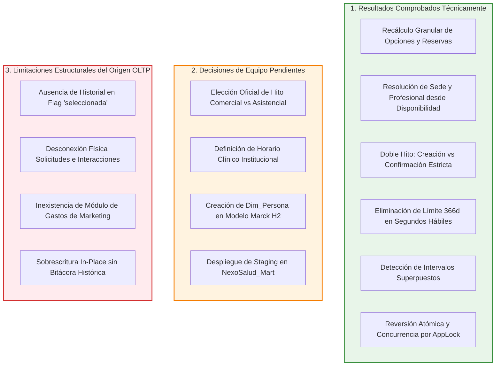
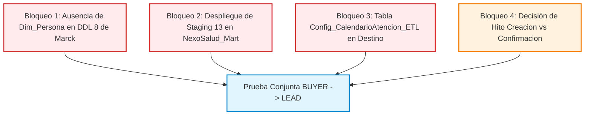

# NEXOSALUD — GUÍA TÉCNICA DE DESPLIEGUE, EJECUCIÓN Y VALIDACIÓN DEL ETL LEAD H3
## Implementación de Carga de Hechos de Negociación (`Fact_NegociacionLead`), Objetos Auxiliares, Batería Procedural Completa (25 Casos T01–T25) y Prueba de Concurrencia con Espera Observada
**Proyecto:** NexoSalud (Plataforma de Inteligencia de Negocios Odontológica — Clínica Luxedent, Trujillo)  
**Metodología:** IMPULSE (Fase: LEAD — Hito H3 / Fase 2)  
**Titular del Rol:** Mario Antonio Martinez Dominguez (Integrante 3 — ETL BUYER y LEAD, Embudo y Calidad)  
**Responsable de Ejecución Técnica:** Jesús Daniel Ordóñez Ugarte (Integrante 4 — asumiendo la ejecución técnica de BUYER/LEAD según el acuerdo de intercambio de roles)  
**Ubicación del Documento:** [Entregables/16. Guia_ETL_Lead_h3.md](file:///c:/Users/Daniel/Downloads/nexosalud-docs/Entregables/16.%20Guia_ETL_Lead_h3.md)  
**Script de Implementación Real:** [Entregables/16. ETL_Fact_NegociacionLead_h3.sql](file:///c:/Users/Daniel/Downloads/nexosalud-docs/Entregables/16.%20ETL_Fact_NegociacionLead_h3.sql)  
**Script de Pruebas Automatizadas:** [Entregables/16. Pruebas_ETL_Lead_h3.sql](file:///c:/Users/Daniel/Downloads/nexosalud-docs/Entregables/16.%20Pruebas_ETL_Lead_h3.sql)  
**Documento Contractual Base:** [Entregables/12. Contrato_y_dependencias_h3_mario.md](file:///c:/Users/Daniel/Downloads/nexosalud-docs/Entregables/12.%20Contrato_y_dependencias_h3_mario.md)  
**Capa de Extracción (Staging):** [Entregables/13. Staging_buyer_lead_h3.sql](file:///c:/Users/Daniel/Downloads/nexosalud-docs/Entregables/13.%20Staging_buyer_lead_h3.sql) y [Entregables/13. Guia_staging_buyer_lead_h3.md](file:///c:/Users/Daniel/Downloads/nexosalud-docs/Entregables/13.%20Guia_staging_buyer_lead_h3.md)  
**Especificación de Diseño Técnico:** [Entregables/14. Diseno_ETL_hechos_buyer_lead_h3.md](file:///c:/Users/Daniel/Downloads/nexosalud-docs/Entregables/14.%20Diseno_ETL_hechos_buyer_lead_h3.md) (Sección 5.3)  
**Base Previa Validada y Congelada:** [Entregables/15. ETL_Fact_CaptacionBuyer_h3.sql](file:///c:/Users/Daniel/Downloads/nexosalud-docs/Entregables/15.%20ETL_Fact_CaptacionBuyer_h3.sql)  
**Fecha de Emisión y Cierre:** Octubre de 2026 (Corrección Acotada y Validación Física Ejecutada en Entorno Aislado)  

---

## 1. Alcance, Correcciones Funcionales y Objetos Implementados

En estricto cumplimiento del diseño formalizado en el [Entregable 14](file:///c:/Users/Daniel/Downloads/nexosalud-docs/Entregables/14.%20Diseno_ETL_hechos_buyer_lead_h3.md) y de los acuerdos contractuales del [Entregable 12](file:///c:/Users/Daniel/Downloads/nexosalud-docs/Entregables/12.%20Contrato_y_dependencias_h3_mario.md), se ha ejecutado una **corrección acotada e integral del entregable LEAD**.

Los entregables 12 a 15 permanecen **estrictamente congelados como base validada**. No se modificaron bases de datos de producción (`NexoSaludDB`, `NexoSalud_Mart`) ni se crearon nuevos documentos fuera del repositorio.

### 1.1 Resumen de Correcciones Funcionales Implementadas

1. **Extracción Temporal y Recálculo Granular Desacoplado:**
   - Se sustituyó la lectura directa de los agregados estáticos de `staging.stg_Solicitudes` (los cuales no estaban filtrados por fecha de corte) por una extracción granular desde registros individuales en la fuente OLTP configurada explícitamente (`@FuenteOLTP`).
   - Las opciones se filtran estrictamente por `fecha_ofrecida < @InstanteEvaluacion` (00:00:00 del día siguiente al corte).
   - Las reservas se filtran estrictamente por `fecha_reserva < @InstanteEvaluacion`.
   - Se resuelven `KeySede` y `KeyProfesional` mediante la relación primera opción ofrecida $\to$ `Disponibilidad` (`id_sede`, `id_profesional`), impidiendo que queden fijadas en `NULL` o miembro 0 cuando existen datos en el origen.
   - Se mantiene la semántica contractual de precios: `NULL` si no hay opciones, precio seleccionado si exactamente una opción está seleccionada, `NULL` si hay múltiples seleccionadas, y primer precio ofrecido si no hay ninguna seleccionada.
   - **Nota explícita sobre limitación del origen:** La columna `seleccionada` en `dbo.Opciones` es un atributo mutable en OLTP sin fecha histórica acreditada de selección (`fecha_seleccionada`). Por tanto, la extracción filtra cronológicamente las opciones por `fecha_ofrecida`, pero no afirma una reconstrucción histórica del instante en que la opción fue seleccionada.

2. **Conversión Estricta e Independencia de Semántica en `KeyTiempoReserva`:**
   - **Para `CreacionReserva`:** Se utiliza la fecha de creación de la primera reserva cronológicamente válida anterior al corte (`fecha_reserva >= fecha_solicitud` y `fecha_reserva < @InstanteEvaluacion`).
   - **Para `ConfirmacionReserva`:** Se evalúan todas las reservas de la solicitud y se selecciona la primera confirmación válida que cumpla simultáneamente:
     - `confirmacion_explicita = 1`
     - `fecha_solicitud <= fecha_reserva <= fecha_confirmacion`
     - `fecha_confirmacion < @InstanteEvaluacion`
     - Ordenada determinísticamente por `fecha_confirmacion ASC, id_reserva ASC`.
   - **Eliminación de Fallbacks:** Se eliminó cualquier mecanismo heurístico que acreditara confirmación mediante `tiene_alguna_reserva_confirmada` o que sustituyera la fecha de confirmación ausente por la fecha de creación de otra reserva.
   - **Cohorte de 14 Días y Clave de Fecha:** La fecha del hito alimenta exclusivamente el indicador de conversión en 14 días (`LeadsConvertidosPayer14Dias`), mientras que `KeyTiempoReserva` conserva su semántica contractual independiente, reflejando siempre la fecha de creación de la primera reserva válida.

3. **Configuración, Calendario y Convención Horaria:**
   - **Validación Defensiva de Parámetros:** Se rechaza de forma inmediata (`RAISERROR` con código `-1`) si `@ConfigHitoConversion` es `NULL`, vacío o no reconocido (exige explícitamente `'CreacionReserva'` o `'ConfirmacionReserva'`), bloqueando específicamente `'PagoValidado'`. Exige obligatoriamente `@ConvencionHoraria` (ej. `'Local_Clinica_SinOffset'`).
   - **Validación Explícita de Fuente OLTP:** Se exige el parámetro `@FuenteOLTP sysname`, validando su existencia en `sys.databases` y la presencia obligatoria de `dbo.Opciones`, `dbo.Reservas` y `dbo.Disponibilidad`. No se infiere automáticamente una base real.
   - **Eliminación del Límite de 366 Días en SLA y Prevalencia de EvidenciaInsuficiente:** Se reescribió `dbo.fn_CalcularSegundosHabiles` eliminando la recursión de CTE (`MAXRECURSION 366`). Se implementó un generador de días basado en productos cartesianos (`CROSS JOIN`) que soporta hasta 65,536 días (~179 años), acumulando segundos en `BIGINT` y retornando `NULL` si excede la capacidad del generador o el `INT` contractual. Si la función devuelve `NULL`, prevalece estrictamente `EstadoRespuestaSLA = 'EvidenciaInsuficiente'` con duración en `NULL` y `LeadsRespuestaUtil15Min = 0`, incluso ante la presencia de una interacción útil atribuida, evitando que una cláusula `ELSE` clasifique una duración desconocida como `'Incumplida'`.
   - **Diagnóstico Controlado de Capacidad:** Se emite advertencia en `dbo.Log_Ejecucion_ETL` alineada con la realidad operativa: *los segundos naturales transcurridos no equivalen a segundos hábiles acumulados*.
   - **Calendario Semanal Recurrente:** La tabla `dbo.Config_CalendarioAtencion_ETL` modela intervalos laborables activos por día de la semana (`DiaSemana` 1 a 7). Es un calendario semanal recurrente y **no implementa soporte de feriados por fecha específica del calendario**. Se detectan y rechazan intervalos superpuestos en el mismo día.
   - **Convención Horaria Explícita:** Se documenta que todos los timestamps del origen (`fecha_solicitud`, `fecha_hora`, `fecha_reserva`, `fecha_confirmacion`) y el parámetro `@FechaCorte` se procesan como marcas temporales locales de operación de la clínica (Perú local, `DATETIME2` sin zona). Queda prohibido asumir conversiones a UTC o zonas horarias oficiales sin metadatos explícitos en el origen.

---

### 1.2 Objetos de Base de Datos Entregados

| Objeto | Tipo | Esquema | Propósito y Características Contractuales |
| :--- | :--- | :--- | :--- |
| **`dbo.Fact_NegociacionLead`** | Tabla de Hechos | Destino (`dbo`) | Grano atómico de **exactamente 1 fila por solicitud formal** (`id_solicitud_origen INT NOT NULL UNIQUE`). Clave primaria sustituta `KeyFactLead BIGINT IDENTITY(1,1)` simple. **7 restricciones Foreign Key activas y confiables** hacia 6 dimensiones conformadas con unicidad individual real (`Dim_Tiempo` referenciada doblemente por solicitud y reserva). Contiene 29 columnas contractuales, métricas L1 a L8, trazabilidad de SLA y auditoría ETL (`BatchId`, `FechaCarga`, `UsuarioCarga`). |
| **`dbo.Log_Ejecucion_ETL`** | Tabla de Bitácora | Auditoría (`dbo`) | Registro cronológico estructurado de eventos de inicio, finalización exitosa, advertencias y excepciones con detalle de línea de error. Estructura compatible y reutilizada entre BUYER y LEAD. |
| **`dbo.Rechazos_ETL_Lead`** | Tabla de Excepciones | Auditoría (`dbo`) | Almacén de solicitudes que no superaron las validaciones de calidad o resolución dimensional (`ErrorLookupAmbiguo`, `EstadoComercialDesconocido`, `AnomaliaCronologica`), garantizando que la carga no falle abruptamente y que las inconsistencias queden tipificadas. |
| **`dbo.Config_CalendarioAtencion_ETL`** | Tabla de Configuración | Configuración (`dbo`) | Calendario semanal recurrente de intervalos hábiles de atención por día de la semana (`IdIntervalo INT PRIMARY KEY`, `DiaSemana`, `HoraInicio`, `HoraFin`, `EsLaborable`, `Activo`). Modela la jornada clínica semanal; **no incluye soporte de feriados individuales por fecha**. |
| **`dbo.fn_CalcularSegundosHabiles`** | Función Escalar | Lógica ETL (`dbo`) | Función escalar determinista que computa los segundos transcurridos entre dos estampas temporales restringidos a intervalos laborables activos. **Independiente de `@@DATEFIRST`, con generador hasta 65,535 días y diagnóstico controlado ante intervalos que excedan la capacidad o el tipo INT contractual (devuelve `NULL` sin saturar a 2,147,483,647 ni truncar artificialmente)**. |
| **`dbo.usp_Cargar_Fact_NegociacionLead`** | Procedimiento Almacenado | Carga ETL (`dbo`) | Procedimiento modular y transaccional que implementa el Algoritmo 2 del diseño 14, con prevalidación defensiva, recálculo granular desde `@FuenteOLTP`, validación obligatoria de `@ConvencionHoraria`, resolución dimensional (0, 1 y >1 coincidencias), atribución global de interacciones útiles con conservación monótona de ambigüedad, clasificación disjunta in-place, bloqueo exclusivo vía `sp_getapplock` (`ETL_Lock_Fact_NegociacionLead`) y confirmación atómica. |

---

### 1.3 Firma y Parámetros del Procedimiento de Carga

```sql
EXEC dbo.usp_Cargar_Fact_NegociacionLead
    @FechaCorte             = '2026-09-30',                     -- DATE: Fecha límite inclusiva de análisis (NOT NULL)
    @BatchId                = 'BATCH_LEAD_20261021_01',         -- VARCHAR(50): Identificador del lote ejecutor
    @ConfigHitoConversion   = 'CreacionReserva',                 -- VARCHAR(50): 'CreacionReserva' o 'ConfirmacionReserva'
    @FuenteOLTP             = 'Test_NexoSalud_OLTP_Lead_Bateria',-- sysname: Nombre validado de la base OLTP origen
    @ConvencionHoraria      = 'Local_Clinica_SinOffset',         -- VARCHAR(50): Convención horaria explícita requerida (ej. 'Local_Clinica_SinOffset')
    @Insertados             = @Insertados OUTPUT,               -- INT: Nuevas inserciones en hechos
    @Actualizados           = @Actualizados OUTPUT,             -- INT: Actualizaciones in-place por cambios
    @SinCambio              = @SinCambio OUTPUT,                -- INT: Registros idénticos sin modificación
    @Rechazados             = @Rechazados OUTPUT,               -- INT: Solicitudes derivadas a tabla de rechazos
    @Pendientes             = @Pendientes OUTPUT;               -- INT: Solicitudes pendientes (0 en modo atómico)
```

---

## 2. Distinción Metodológica: Resultados Comprobados, Decisiones Pendientes y Limitaciones del Origen

Para asegurar total transparencia técnica y metodológica, se clasifica el estado de los componentes del entregable LEAD en tres categorías:



### 2.1 Resultados Comprobados Técnicamente
- Ejecución física exitosa de la batería automatizada con **25 de 25 casos aprobados (0 fallos)** sobre bases aisladas temporales.
- Evaluación determinista de concurrencia con detección y captura en vivo de bloqueo exclusivo `LCK_M_X` en `sys.dm_tran_locks` y `sys.dm_os_waiting_tasks`, garantizando 0 filas duplicadas.
- Reversión atómica integral (`ROLLBACK`) ante fallos forzados por trigger, verificada mediante comparación bidireccional `EXCEPT` con 0 diferencias físicas en hechos.
- Resolución de sede y profesional reales desde la relación de disponibilidad.

### 2.2 Decisiones Organizacionales del Equipo Pendientes
- **Hito Oficial de Conversión:** La dirección clínica debe determinar formalmente si la conversión de la cohorte L1 se reporta por fecha de creación de reserva (`CreacionReserva`, enfoque comercial de negociación) o por fecha de confirmación efectiva (`ConfirmacionReserva`, enfoque asistencial). Ambas ramas están programadas y verificadas de forma paramétrica.
- **Calendario Laborable Oficial:** El horario de atención clínica utilizado en pruebas (Lunes a Viernes 08:00–18:00, Sábados 08:00–13:00) es estrictamente ficticio. La administración de Luxedent debe oficializar los intervalos activos en `Config_CalendarioAtencion_ETL`.
- **Despliegue de `Dim_Persona`:** `Fact_NegociacionLead` exige la restricción `FK_FactLead_Persona`. En el modelo dimensional entregado por Marck ([Entregables 8 y 9](file:///c:/Users/Daniel/Downloads/nexosalud-docs/Entregables/8.%20DDL_modelo_dimensional_mart_h2.sql)) esta dimensión no existe. Fue simulada en la base de pruebas aislada sin tocar el modelo de producción.

### 2.3 Limitaciones Estructurales del Motor Transaccional Origen (`NexoSaludDB`)
- **Falta de Historial en `seleccionada`:** La tabla transaccional `dbo.Opciones` sólo almacena una bandera booleana mutable (`seleccionada = 1`), sin `fecha_seleccionada`. No es físicamente posible reconstruir si la opción fue seleccionada antes o después del corte; sólo se puede garantizar que la oferta fue realizada antes del corte (`fecha_ofrecida < @InstanteEvaluacion`).
- **Desconexión entre Solicitudes e Interacciones:** Las interacciones del canal (`WhatsApp`, `Llamada`) no contienen `id_solicitud`. Se requiere obligatoriamente el algoritmo de inferencia temporal con conservación monótona de ambigüedad para evitar imputaciones falsas.
- **Inexistencia de Gastos en Origen:** No existe tabla de costos devengados, por lo que costos de captación permanecen en `NULL` con estado `'PendienteConciliacion'`.

---

## 3. Matriz Exhaustiva de Resultados de la Batería Procedural (25 Casos T01–T25)

La batería completa fue ejecutada sobre bases aisladas temporales mediante:
```powershell
sqlcmd -S localhost -E -b -i "Entregables\16. Pruebas_ETL_Lead_h3.sql" -o "Entregables\Evidencias_h3\salida_bateria_lead_t01_t25.txt"
```

A continuación se detalla el resultado exacto obtenido para cada uno de los 25 escenarios:

| Caso | Escenario Evaluado | Valor / Criterio Esperado Explícito | Valor Obtenido en Ejecución | Dictamen |
| :---: | :--- | :--- | :--- | :---: |
| **T01** | Carga Inicial de Solicitudes Base (10 Filas) | Ins: 10, Act: 0, Sin: 0, Rech: 0, Total Hechos: 10 | Ins: 10, Act: 0, Sin: 0, Rech: 0, Total: 10 | **CORRECTO** |
| **T02** | Idempotencia Operativa Absoluta | Ins: 0, Act: 0, Sin: 10, Rech: 0, Total Hechos: 10 | Ins: 0, Act: 0, Sin: 10, Rech: 0, Total: 10 | **CORRECTO** |
| **T03** | Actualización In-Place de Diferencias | Ins: 0, Act: 1, Sin: 9, LeadsResultadoFinal S1 = 1 | Ins: 0, Act: 1, Sin: 9, ResFinal: 1 | **CORRECTO** |
| **T04** | 1 Persona con Múltiples Solicitudes Distintas | Ins: 1, Act: 0, Filas de Persona 1 en Hechos: 2 | Ins: 1, Act: 0, Filas P1: 2 | **CORRECTO** |
| **T05** | Maduración Temporal de Cohortes L1 | S12 (18d): Eval=1 Inmad=0 \| S13 (3d): Eval=0 Inmad=1 | S12: Eval=1 Inmad=0 \| S13: Eval=0 Inmad=1 | **CORRECTO** |
| **T06** | Intervalo Semiabierto (Exclusión Posterior al Corte) | Solicitud 14 del 2026-10-01: Filas en Hechos = 0 | Filas S14: 0 | **CORRECTO** |
| **T07** | Verificación Explícita de Claves de Fecha | KeySol S15 = 20260905, KeyRes S15 = 20260907, KeyRes S3 = 0 | KeySol S15: 20260905, KeyRes S15: 20260907, KeyRes S3: 0 | **CORRECTO** |
| **T08** | Conversión Previa a Abandono y Resultado Final L3 | Conv14D=1, ConvTot=1, Abandonada=1, ResFinal=1, EnNeg=0 | Conv14D=1, ConvTot=1, Aband=1, ResFin=1, EnNeg=0 | **CORRECTO** |
| **T09** | Clasificación Comercial: Perdida y Desconocido | S17 ResFinal = 1, Rechazo S18 = 1, S18 en Hechos = 0 | ResFinal S17: 1, Rechazo S18: 1, Fact S18: 0 | **CORRECTO** |
| **T10** | Reglas Contractuales de Precio Cotizado | P19: NULL, P20: 280.00, P21: NULL, P22: 180.00 | P19: NULL, P20: 280.00, P21: NULL, P22: 180.00 | **CORRECTO** |
| **T11** | Solicitud con Múltiples Interacciones Útiles | Seg=300, Min=5, SLA=Acreditada, Resp15M=1, KeyNeg=1 | Seg=300, Min=5, SLA=Acreditada, Resp15M=1, KeyNeg=1 | **CORRECTO** |
| **T12** | Preservación Irreversible de Ambigüedad | Ambas: Ambigua=1, SLA=EvidenciaInsuficiente, Resp15M=0, Seg=NULL | S241: Amb=1 SLA=EvidInsuf \| S242: Amb=1 SLA=EvidInsuf | **CORRECTO** |
| **T13** | Cómputo de SLA Hábil en Umbrales Críticos | 251: 899s/Acreditada/1 \| 252: 900s/Acreditada/1 \| 253: 901s/Incumplida/0 | 251: 899s/Acred/1 \| 252: 900s/Acred/1 \| 253: 901s/Incump/0 | **CORRECTO** |
| **T14** | Solicitud sin Respuesta e Interacciones No Útiles | 261: EvidenciaInsuficiente/NULL \| 262: EvidenciaInsuficiente/NULL | 261: EvidInsuf/NULL \| 262: EvidInsuf/NULL | **CORRECTO** |
| **T15** | Resolución Dimensional con Multiplicidad (>1) | Rechazo S27 = 1 (ErrorLookupAmbiguo: Dim_Servicio), S27 Hechos = 0 | Rechazo S27: 1, Fact S27: 0 | **CORRECTO** |
| **T16** | Validación Defensiva de Parámetros, Convención Horaria y Fuente OLTP | ErrConvNull: 1, ErrConvVac: 1, ErrCorte: 1, ErrFuente: 1, ErrPago: 1, ErrHitoInv: 1 | ErrConvNull: 1, ErrConvVac: 1, ErrCorte: 1, ErrFuente: 1, ErrPago: 1, ErrHitoInv: 1 | **CORRECTO** |
| **T17** | Reversión Atómica Integral ante Fallo por Trigger | Error: 1, Diff1: 0, Diff2: 0, S32 Hechos: 0, Ins: 0, Act: 0, Log ERROR: 1 | Error: 1, Diff1: 0, Diff2: 0, S32: 0, Ins: 0, Act: 0, Log: 1 | **CORRECTO** |
| **T18** | Primera Reserva Pendiente y Segunda Confirmada | ConvTot=1, Conv14D=1, KeyTiempoReserva=20260906 (primera creación) | ConvTot=1, Conv14D=1, KeyTiempoRes=20260906 | **CORRECTO** |
| **T19** | Creación Dentro de 14 Días y Confirmación Fuera | Hito Creacion Conv14D=1 \| Hito Confirmacion Conv14D=0, ConvTot=1 | Hito Creacion Conv14D=1 \| Hito Conf Conv14D=0, ConvTot=1 | **CORRECTO** |
| **T20** | Confirmación Posterior al Corte | ConvTot=0, Conv14D=0, KeyTiempoReserva=20260920 (creación pre-corte) | ConvTot=0, Conv14D=0, KeyTiempoRes=20260920 | **CORRECTO** |
| **T21** | Confirmación Anómala sin Fecha o Anterior a Creación | S311 (fecha NULL) ConvTot=0, S312 (fecha previa) ConvTot=0 | S311: 0, S312: 0 | **CORRECTO** |
| **T22** | Opción Posterior al Corte | PrecioCotizado = 250.00 (opción posterior al corte excluida de oferta) | PrecioCotizado: 250.00 | **CORRECTO** |
| **T23** | Sede y Profesional Conocidos | KeySede = 3, KeyProfesional = 3 (resueltos desde Disponibilidad, no 0 ni NULL) | KeySede: 3, KeyProf: 3 | **CORRECTO** |
| **T24** | Diagnóstico Controlado de Intervalos Extremos (>Capacidad e INT) | FnExtrema=NULL, S36_SLA=EvidenciaInsuficiente, S37(ConResp)_SLA=EvidenciaInsuficiente, Seg=NULL, DiagLog>=1 | FnExtrema=NULL, S36_SLA=EvidenciaInsuficiente, S37_SLA=EvidenciaInsuficiente, S37_Seg=NULL, DiagLog=1 | **CORRECTO** |
| **T25** | Calendario Superpuesto, Ausente y Hito NULL | ErrHitoNull: 1, ErrOverlap: 1, ErrSinCal: 1 (abortos con diagnóstico) | ErrHitoNull: 1, ErrOverlap: 1, ErrSinCal: 1 | **CORRECTO** |

```
=================================================================================
RESUMEN DE EJECUCIÓN BATERÍA PROCEDURAL LEAD:
Casos Esperados  : 25
Casos Ejecutados : 25
Casos Correctos  : 25
Casos Fallidos   : 0
Dictamen Final   : BATERÍA LEAD APROBADA (25/25 CASOS SATISFACTORIOS)
=================================================================================
```

---

## 4. Evidencia de Concurrencia y Espera Observada en DMV

La contención concurrente fue evaluada mediante el orquestador portable `Entregables/Evidencias_h3/auxiliares_concurrencia/ejecutar_concurrencia_lead.ps1` lanzando dos procesos simultáneos sobre la base aislada `Test_NexoSalud_Mart_Lead_Conc`:

### 4.1 Muestreo en Vivo de `sys.dm_tran_locks` y `sys.dm_os_waiting_tasks`

```
SpidSolicitante TipoRecurso RecursoBloqueado                            ModoBloqueo EstadoBloqueo WaitType BlockingSpid
--------------- ----------- ------------------------------------------- ----------- ------------- -------- ------------
56              APPLICATION 0:[ETL_Lock_Fact_NegociacionLead]:(0d1bd907) X           WAIT          LCK_M_X  55
55              APPLICATION 0:[ETL_Lock_Fact_NegociacionLead]:(0d1bd907) X           GRANT         NINGUNO  0
```

- **Conexión 1 (SPID 55):** Retuvo el applock exclusivo en transacción externa durante 6 segundos. Insertó las 3 solicitudes iniciales (`Insertados = 3`).
- **Conexión 2 (SPID 56):** Quedó bloqueada en estado `WAIT` con tipo de espera `LCK_M_X`. Al liberarse el bloqueo, clasificó contra el destino actualizado y detectó que todas las filas ya existían idénticas (`SinCambio = 3`, `Insertados = 0`, `Actualizados = 0`).
- **Invariante en Hechos:** 3 filas totales, 3 solicitudes únicas, **0 duplicados**.

---

## 5. Bloqueos Concretos para la Prueba Conjunta BUYER &rarr; LEAD

Para integrar la ejecución conjunta de los pipelines de BUYER ([Entregable 15](file:///c:/Users/Daniel/Downloads/nexosalud-docs/Entregables/15.%20ETL_Fact_CaptacionBuyer_h3.sql)) y LEAD ([Entregable 16](file:///c:/Users/Daniel/Downloads/nexosalud-docs/Entregables/16.%20ETL_Fact_NegociacionLead_h3.sql)), existen cuatro bloqueos técnicos concretos que deben resolverse previamente en el entorno de destino:



1. **Bloqueo 1 — Ausencia de `Dim_Persona` y `Dim_Campana` en el Modelo Físico de Marck (H2):**
   - Ambos hechos (`Fact_CaptacionBuyer` y `Fact_NegociacionLead`) exigen claves foráneas hacia dimensiones conformadas (`Dim_Persona` en ambos y `Dim_Campana` en BUYER).
   - Dichos catálogos no existen en el script de Marck ([Entregables 8 y 9](file:///c:/Users/Daniel/Downloads/nexosalud-docs/Entregables/8.%20DDL_modelo_dimensional_mart_h2.sql)). Si se ejecutan los scripts de carga en un Mart real sin dichas dimensiones, la prevalidación del Lote 1 aborta inmediatamente.
   - *Solución requerida:* Acordar colegiadamente el despliegue formal de `dbo.Dim_Persona` y `dbo.Dim_Campana` con sus respectivos miembros 0.

2. **Bloqueo 2 — Despliegue de la Capa de Staging en el Data Mart:**
   - Tanto BUYER como LEAD requieren que las vistas del [Entregable 13](file:///c:/Users/Daniel/Downloads/nexosalud-docs/Entregables/13.%20Staging_buyer_lead_h3.sql) (`staging.stg_Personas`, `staging.stg_Solicitudes`, `staging.stg_Interacciones`) se encuentren compiladas y operativas en el Mart de destino apuntando al origen OLTP transaccional correspondiente.

3. **Bloqueo 3 — Configuración del Calendario Hábil en el Data Mart:**
   - La tabla `dbo.Config_CalendarioAtencion_ETL` debe estar creada con sus intervalos laborables activos institucionalmente validados para permitir el cálculo de segundos hábiles del SLA L2 sin abortos defensivos.

4. **Bloqueo 4 — Decisión del Hito de Conversión para el Embudo Unificado:**
   - En BUYER, la métrica B4 mide conversión a lead (primera solicitud formal).
   - En LEAD, L1 mide conversión de lead a payer en 14 días. Para que las tasas del embudo (B1 &rarr; B4 &rarr; L1) sean coherentes entre ambos modelos, el equipo debe definir de manera unificada si el hito de conversión de LEAD es `'CreacionReserva'` o `'ConfirmacionReserva'`.
