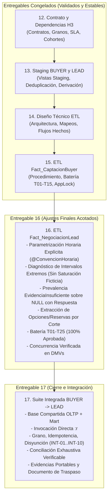
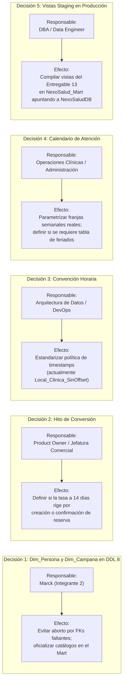

# NEXOSALUD — CIERRE TÉCNICO Y TRASPASO DEL ROL DE MARIO (HITO H3)
## Informe Final de Integración BUYER $\to$ LEAD, Baterías de Pruebas Automatizadas, Decisiones Institucionales Pendientes y Guía de Traspaso Operativo
**Proyecto:** NexoSalud (Plataforma de Inteligencia de Negocios Odontológica — Clínica Luxedent, Trujillo)  
**Metodología:** IMPULSE (Hito H3: Hechos Comerciales BUYER y LEAD)  
**Titular del Rol:** Mario Antonio Martinez Dominguez (Integrante 3 — ETL Hechos Comerciales, Calidad y Embudo)  
**Responsable de Ejecución Técnica:** Jesús Daniel Ordóñez Ugarte (Integrante 4 — asumiendo la ejecución técnica de BUYER/LEAD según el acuerdo de intercambio de roles)  
**Ubicación del Documento:** [Entregables/17. Cierre_y_traspaso_Mario_h3.md](file:///c:/Users/Daniel/Downloads/nexosalud-docs/Entregables/17.%20Cierre_y_traspaso_Mario_h3.md)  
**Script Integrado de Validación:** [Entregables/17. Pruebas_integradas_BUYER_LEAD_h3.sql](file:///c:/Users/Daniel/Downloads/nexosalud-docs/Entregables/17.%20Pruebas_integradas_BUYER_LEAD_h3.sql)  
**Repositorio de Evidencias y Auxiliares:** [Entregables/Evidencias_h3/](file:///c:/Users/Daniel/Downloads/nexosalud-docs/Entregables/Evidencias_h3/)  
**Fecha de Emisión y Cierre:** Octubre de 2026 (Validación Física Ejecutada en Entornos Aislados de Base de Datos)  

---

## 1. Resumen Ejecutivo y Dictamen Técnico

El presente documento constituye el **informe de cierre técnico y traspaso formal del hito H3** correspondiente a las responsabilidades asignadas al rol de Mario (Ingeniero de Datos / Especialista ETL de Hechos Comerciales: Buyer y Lead).

El proceso de desarrollo, depuración y verificación técnica se ha ejecutado bajo un estricto principio de **aislamiento de entornos, reproducibilidad procedural y respeto al alcance formalizado**:
1. Los entregables fundacionales **12 (Contrato de Datos), 13 (Capa Staging), 14 (Diseño Técnico ETL) y 15 (Implementación y Pruebas BUYER)** se han mantenido **estrictamente congelados**.
2. El entregable **16 (ETL LEAD, Batería T01–T25 y Guía Operativa)** fue ajustado en sus aspectos finales acotados: parametrización explícita obligatoria de la convención horaria (`@ConvencionHoraria`), prevalencia estricta de `EvidenciaInsuficiente` con duración en `NULL` ante funciones hábiles nulas (incluso ante respuestas útiles atribuidas, evitando que un `ELSE` clasifique como `'Incumplida'`), diagnóstico controlado que aclara que *los segundos naturales transcurridos no equivalen a segundos hábiles acumulados*, y extracción temporal desacoplada de opciones/reservas filtradas por fecha de corte.
3. Se construyó y ejecutó exitosamente el entregable **17 (Prueba Integrada BUYER $\to$ LEAD)**, desplegando un único OLTP de prueba y un único Data Mart de prueba compartidos, invocando directamente las implementaciones reales de los procedimientos [15. ETL_Fact_CaptacionBuyer_h3.sql](file:///c:/Users/Daniel/Downloads/nexosalud-docs/Entregables/15.%20ETL_Fact_CaptacionBuyer_h3.sql) y [16. ETL_Fact_NegociacionLead_h3.sql](file:///c:/Users/Daniel/Downloads/nexosalud-docs/Entregables/16.%20ETL_Fact_NegociacionLead_h3.sql) mediante el comando `:r` de SQLCMD, sin copias de código ni reimplementaciones locales.

> [!IMPORTANT]
> **DICTAMEN TÉCNICO DE PRUEBAS EN BASES AISLADAS:**  
> **INTEGRACIÓN TÉCNICA BUYER $\to$ LEAD APROBADA EN ENTORNO DE PRUEBAS.**  
> Las baterías se mantienen rigurosamente separadas y conciliadas con sus archivos fuentes reales:
> - **Batería Procedural BUYER actual (`15. Pruebas_ETL_Buyer_h3.sql`):** 15 casos esperados, 15 ejecutados, **15 aprobados, 0 fallidos**.
> - **Prevalidación Negativa BUYER contra archivo real (PREVAL-01 a PREVAL-04):** 4 escenarios evaluados, **4 aprobados, 0 fallidos** (auxiliar final con comprobación previa sin eliminación preventiva, captura de exit code y diagnósticos, y limpieza exclusiva de bases propias).
> - **Concurrencia BUYER (Histórica):** 1 traza histórica verificada con exclusión mutua (`sp_getapplock`) y 0 duplicados.
> - **Batería Procedural LEAD actual (`16. Pruebas_ETL_Lead_h3.sql`):** 25 casos esperados, 25 ejecutados, **25 aprobados, 0 fallidos**.
> - **Concurrencia LEAD (Auxiliar Actual):** 1 prueba ejecutada físicamente con el auxiliar corregido (captura y propagación de códigos de salida de trabajos en segundo plano, espera requerida `LCK_M_X` observada en vivo en DMVs, 3 insertados en conn 1, 0 insertados y 3 sin cambio en conn 2, y **0 duplicados**).
> - **Prueba Integrada BUYER $\to$ LEAD (`17. Pruebas_integradas_BUYER_LEAD_h3.sql`):** 10 casos esperados, 10 ejecutados, **10 aprobados, 0 fallidos**.
> - **Estado de las Bases de Datos:** Todas las bases temporales fueron eliminadas limpiamente tras la ejecución. Las bases reales de producción (`NexoSaludDB`, `NexoSalud_Mart`) permanecieron completamente inalteradas.

---

## 2. Orden y Comandos Reproducibles de Ejecución

Para reproducir de forma determinística la totalidad de las pruebas unitarias, de concurrencia, prevalidación e integración desarrolladas para el hito H3, se debe seguir la secuencia operativa descrita a continuación, utilizando obligatoriamente el modo estricto de SQLCMD (`-b`):

### 2.1 Requisitos del Entorno de Ejecución
- **Motor de Base de Datos:** Microsoft SQL Server 2019 o superior (instancia local `localhost`).
- **Autenticación:** Windows Authentication (`-E`) con permisos para crear y eliminar bases de datos (`CREATE DATABASE`, `ALTER DATABASE`).
- **Herramientas de Consola:**
  - `sqlcmd` (utilidad de línea de comandos estándar de SQL Server, ejecutada con `-b`).
  - `pwsh` o `powershell` (PowerShell 7 o Windows PowerShell 5.1).
- **Directorio de Trabajo:** Raíz del repositorio `nexosalud-docs/`.

### 2.2 Secuencia de Comandos de Reproducción

```powershell
# ==============================================================================
# SECUENCIA REPRODUCIBLE DE VALIDACIÓN H3 (MARIO)
# Ejecutar desde la raíz del repositorio: c:\Users\Daniel\Downloads\nexosalud-docs
# ==============================================================================

# PASO 1: Batería Procedural BUYER actual (15 Casos T01 a T15)
# Crea y destruye automáticamente Test_NexoSalud_Mart_Buyer_Bateria y Test_NexoSalud_OLTP_Buyer_Bateria
sqlcmd -S localhost -E -b -i "Entregables\15. Pruebas_ETL_Buyer_h3.sql"

# PASO 2: Prevalidación Negativa BUYER sobre Archivo Real (4 Escenarios PREVAL-01 a PREVAL-04)
# Comprueba previamente la no existencia de las 4 bases planificadas (aborta sin tocar bases preexistentes),
# elimina DROP preventivos al inicio de escenarios, ejecuta procesos sqlcmd -b independientes contra el archivo real 15,
# valida exit code != 0, diagnósticos exactos e invariancia estructural/datos, y limpia exclusivamente bases propias
# mediante cierre normal sin forzar desconexiones (sin SINGLE_USER WITH ROLLBACK IMMEDIATE). Retorna código no nulo ante
# falta de cobertura (distinto de 4), aserciones fallidas o errores de ejecución/limpieza, preservando el resumen y evidencia.
pwsh -ExecutionPolicy Bypass -File "Entregables\Evidencias_h3\auxiliares_prevalidacion\ejecutar_prevalidacion_buyer.ps1"

# PASO 3: Batería Procedural LEAD actual (25 Casos T01 a T25)
# Crea y destruye automáticamente Test_NexoSalud_Mart_Lead_Bateria y Test_NexoSalud_OLTP_Lead_Bateria
sqlcmd -S localhost -E -b -i "Entregables\16. Pruebas_ETL_Lead_h3.sql"

# PASO 4: Prueba de Concurrencia LEAD con Espera Observada en DMVs (Auxiliar Actual)
# Comprueba no existencia de bases previas (aborta si existen), ejecuta 2 conexiones concurrentes en segundo plano,
# captura y verifica explícitamente códigos de salida propagando cualquier fallo, valida espera observada (LCK_M_X),
# verifica 3 insertados en conn 1, 0 insertados y 3 sin cambio en conn 2, consulta invariantes (3 filas, 3 únicas, 0 duplicados),
# cierra normalmente conexiones propias y en finally limpia exclusivamente bases creadas en esta ejecución de forma normal
# sin desconectar sesiones por la fuerza (sin SINGLE_USER WITH ROLLBACK IMMEDIATE), retornando estado fallido si una base permanece ocupada.
pwsh -ExecutionPolicy Bypass -File "Entregables\Evidencias_h3\auxiliares_concurrencia\ejecutar_concurrencia_lead.ps1"

# PASO 5: Prueba Integrada BUYER -> LEAD (10 Casos INT-01 a INT-10)
# Despliega OLTP y Mart compartidos, ejecuta implementaciones reales 15 y 16,
# evalúa grano, relaciones, corte, cohortes, idempotencia y conciliación, y limpia el entorno.
sqlcmd -S localhost -E -b -i "Entregables\17. Pruebas_integradas_BUYER_LEAD_h3.sql"
```

---

## 3. Resultado Observado y Ubicación Relativa de Evidencias

Todas las salidas de ejecución de las pruebas y los auxiliares portables residen dentro del repositorio en la ruta relativa [Entregables/Evidencias_h3/](file:///c:/Users/Daniel/Downloads/nexosalud-docs/Entregables/Evidencias_h3/), eliminando cualquier dependencia de carpetas temporales o de scratch.

### 3.1 Matriz Separada y Conciliada de Resultados de Validación

| Suite / Componente Evaluado | Script Fuente / Auxiliar | Casos Esp. | Casos Ejec. | Aprobados | Fallidos | Tasa Éxito | Archivo de Evidencia Portable |
| :--- | :--- | :---: | :---: | :---: | :---: | :---: | :--- |
| **Batería Procedural BUYER actual** | `Entregables/15. Pruebas_ETL_Buyer_h3.sql` | 15 | 15 | 15 | 0 | **100%** | [salida_bateria_buyer_t01_t15.txt](file:///c:/Users/Daniel/Downloads/nexosalud-docs/Entregables/Evidencias_h3/salida_bateria_buyer_t01_t15.txt) |
| **Prevalidación Negativa BUYER** | `auxiliares_prevalidacion/ejecutar_prevalidacion_buyer.ps1` | 4 | 4 | 4 | 0 | **100%** | [salida_prevalidacion_buyer.txt](file:///c:/Users/Daniel/Downloads/nexosalud-docs/Entregables/Evidencias_h3/salida_prevalidacion_buyer.txt) |
| **Concurrencia BUYER (Histórica)** | `sp_getapplock` (Exclusión Mutua Histórica) | 1 | 1 | 1 | 0 | **100%** | [salida_concurrencia_buyer.txt](file:///c:/Users/Daniel/Downloads/nexosalud-docs/Entregables/Evidencias_h3/salida_concurrencia_buyer.txt) |
| **Batería Procedural LEAD actual** | `Entregables/16. Pruebas_ETL_Lead_h3.sql` | 25 | 25 | 25 | 0 | **100%** | [salida_bateria_lead_t01_t25.txt](file:///c:/Users/Daniel/Downloads/nexosalud-docs/Entregables/Evidencias_h3/salida_bateria_lead_t01_t25.txt) |
| **Concurrencia LEAD (Auxiliar Actual)** | `auxiliares_concurrencia/ejecutar_concurrencia_lead.ps1` | 1 | 1 | 1 | 0 | **100%** | [salida_concurrencia_lead.txt](file:///c:/Users/Daniel/Downloads/nexosalud-docs/Entregables/Evidencias_h3/salida_concurrencia_lead.txt) |
| **Prueba Integrada BUYER $\to$ LEAD** | `Entregables/17. Pruebas_integradas_BUYER_LEAD_h3.sql` | 10 | 10 | 10 | 0 | **100%** | [salida_pruebas_integradas_buyer_lead.txt](file:///c:/Users/Daniel/Downloads/nexosalud-docs/Entregables/Evidencias_h3/salida_pruebas_integradas_buyer_lead.txt) |

> [!NOTE]
> **Identificación de Evidencias Históricas vs Actuales:**  
> - **Evidencias Históricas:** El archivo `historica_salida_bateria_buyer_18casos_pre_refactor.txt` se conserva en `Entregables/Evidencias_h3/` como respaldo de ejecuciones previas antes de desacoplar la batería BUYER en 15 casos procedurales. Asimismo, `salida_concurrencia_buyer.txt` constituye una evidencia histórica de la prueba de concurrencia de BUYER realizada en etapas previas del entregable 15 (el cual se mantiene congelado).  
> - **Evidencias del Auxiliar Actual:** Los archivos `salida_prevalidacion_buyer.txt` y `salida_concurrencia_lead.txt` provienen de la ejecución física y determinista de los auxiliares corregidos (`ejecutar_prevalidacion_buyer.ps1` y `ejecutar_concurrencia_lead.ps1`), incorporando captura y propagación de códigos de salida, comprobación previa de no existencia sin auto-eliminación, verificación estricta de invariantes y contención en DMVs, cierre normal de conexiones propias y eliminación limpia sin recurrir a `SINGLE_USER WITH ROLLBACK IMMEDIATE`. Si una base permanece ocupada, se registra el incidente y se devuelve código fallido sin desconectar sesiones por la fuerza; en prevalidación, se garantiza retorno no nulo ante conteo incorrecto de escenarios, fallo de aserción o error de ejecución/limpieza, conservando siempre el resumen y la evidencia antes de salir. No corresponden a revisiones estáticas.

### 3.2 Detalle de Casos Integrados Evaluados (INT-01 a INT-10)

Los 10 casos integrados evalúan exhaustivamente el ciclo de vida completo de un prospecto que transita desde la captación como persona hasta la negociación de múltiples solicitudes en un Data Mart unificado:

1. **INT-01: Ejecución Secuencial BUYER $\to$ LEAD en Mismo Mart:** Carga correcta de hechos en secuencia en base única compartida. BUYER insertó 7 filas, LEAD insertó 6 filas aceptadas y rechazó 1 por estado comercial desconocido. Se registraron 4 logs de auditoría sin colisión de identidades.
2. **INT-02: Grano Contractual Estricto:** Se comprobó que `Fact_CaptacionBuyer` mantiene exactamente 1 fila por `id_persona` (7 personas = 7 filas) y `Fact_NegociacionLead` mantiene exactamente 1 fila por `id_solicitud` (6 solicitudes = 6 filas).
3. **INT-03: Persona Multi-Solicitud sin Multiplicar Totales BUYER:** La persona P2 posee 2 solicitudes en LEAD. Al realizar un `LEFT JOIN` entre ambos hechos para reportes analíticos, la agregación pura de BUYER arroja 7 contactos y el recuento con relación arroja exactamente 7 contactos (sin duplicación por efecto *fan-trap*).
4. **INT-04: Disyunción Funcional:** Se verificó que una persona sin solicitudes (P3) existe en BUYER y no en LEAD; una solicitud sin reserva (S4) posee `KeyTiempoReserva = 0` y `ReservaEfectiva = 0`; y una solicitud convertida (S1) posee `KeyTiempoReserva = 20260905` y `ReservaEfectiva = 1`.
5. **INT-05: Cortes Temporales y Cohortes Consistentes:** Se confirmó que todas las solicitudes cumplen con `Convertido14Dias <= LeadsCohorteEvaluable`. La solicitud inmadura S6 (creada 5 días antes del corte) posee `LeadsCohorteEvaluable = 0`, `CohorteInmadura = 1` y `Convertido14Dias = 0`. Los registros posteriores al corte (P7/S7) fueron excluidos de ambos hechos.
6. **INT-06: Divergencia Controlada de Hitos:** Se ejecutó LEAD bajo `@HitoConversion = 'CreacionReserva'` y posteriormente bajo `'ConfirmacionReserva'`. Para la solicitud S5 (creada dentro de la ventana de 14 días pero confirmada en el día 18), la métrica `Convertido14Dias` resultó en 1 bajo el hito Creación y cambió a 0 bajo el hito Confirmación, demostrando la sensibilidad y exactitud del parámetro de negocio.
7. **INT-07: Resolución Coherente de Dimensiones y Fechas:** Cero claves inválidas en ambos hechos. Las dimensiones `Dim_Sede` y `Dim_Profesional` en LEAD se resolvieron dinámicamente mediante la primera opción ofrecida (`Sede 1` y `Prof 1`), evitando valores artificiales en 0.
8. **INT-08: Idempotencia Operativa Absoluta:** Segunda ejecución completa de BUYER y LEAD con corte idéntico. Se registraron exactamente **0 inserciones y 0 actualizaciones** en ambos hechos. Los totales permanecieron invariantes (Buyer = 7, Lead = 6).
9. **INT-09: Actualización Controlada In-Place:** Al registrarse una reserva para la solicitud S4 en OLTP, el re-procesamiento actualizó la fila existente sin duplicar el grano (`TotalLead = 6`, `Actualizados = 1`, `KeyTiempoReserva = 20260910`, `ReservaEfectiva = 1`, `EnNegociacion = 0`).
10. **INT-10: Integridad Referencial FK y Conciliación Exhaustiva Verificable:**
    - Se comprobó la integridad referencial en `Fact_CaptacionBuyer` incluyendo explícitamente `KeyTiempoConversion` junto a `KeyTiempoRegistro`, `KeyCanal`, `KeyFuente`, `KeyCampana`, `KeySede`, `KeyPersona` y `KeyEstadoRegistro` (0 huérfanos).
    - Se comprobó la integridad referencial en `Fact_NegociacionLead` con sus 7 FKs (0 huérfanos).
    - **Total Observado desde Staging:** Se calculó dinámicamente sobre `staging.stg_Solicitudes` aplicando el corte (`fecha_solicitud < '2026-10-01'`), obteniendo **7 solicitudes observadas**.
    - **Contadores Reales de Lote:** Se consultaron los rechazos en `dbo.Rechazos_ETL_Lead` para el lote `BATCH_INT_LEAD_01` de forma global, **sin limitar artificialmente a una solicitud conocida**, obteniendo **1 solicitud rechazada** (S8).
    - **Hechos Aceptados:** Se contabilizaron **6 solicitudes aceptadas** en `dbo.Fact_NegociacionLead`.
    - **Pendientes:** Se evaluaron claves de staging no presentes en hechos ni rechazos, arrojando **0 solicitudes pendientes**.
    - **Disyunción Estricta:** La intersección entre las solicitudes aceptadas en hechos y las rechazadas del lote arrojó exactamente **0 solicitudes en conflicto** ($A \cap R = \emptyset$).
    - **Expectativas Separadas:** Se contrastaron contra las expectativas explícitas de la muestra: `EspStaging = 7`, `EspAcept = 6`, `EspRech = 1`, `EspPend = 0`, `EspInterseccion = 0`.
    - **Cobertura Completa:** $6 \text{ (aceptados)} + 1 \text{ (rechazados)} + 0 \text{ (pendientes)} = 7 \text{ (observados en staging)}$.

---

## 4. Qué Queda Terminado del Rol de Mario

El rol de Mario (Integrante 3) contemplaba el ciclo técnico completo para los hechos comerciales del hito H3. En el marco de pruebas y desarrollo en bases aisladas, se han completado los siguientes entregables:



### 4.1 Inventario de Componentes y Entregables del Rol de Mario

1. **[Entregables/12. Contrato_y_dependencias_h3_mario.md](file:///c:/Users/Daniel/Downloads/nexosalud-docs/Entregables/12.%20Contrato_y_dependencias_h3_mario.md) (Congelado):**
   - Definición contractual de granos, llaves subrogadas, llaves de negocio y reglas de negocio para `Fact_CaptacionBuyer` y `Fact_NegociacionLead`.
   - Definición de cohortes maduras de 14 días y cálculo de minutos hábiles comerciales para SLA.
2. **[Entregables/13. Staging_buyer_lead_h3.sql](file:///c:/Users/Daniel/Downloads/nexosalud-docs/Entregables/13.%20Staging_buyer_lead_h3.sql) y [Guía](file:///c:/Users/Daniel/Downloads/nexosalud-docs/Entregables/13.%20Guia_staging_buyer_lead_h3.md) (Congelado):**
   - Vistas desacopladas `staging.stg_Personas`, `staging.stg_Solicitudes` y `staging.stg_Interacciones`.
   - Lógica de deduplicación cronológica determinística, derivación de etapas y normalización de canales/estados sin mutación de las tablas transaccionales.
3. **[Entregables/14. Diseno_ETL_hechos_buyer_lead_h3.md](file:///c:/Users/Daniel/Downloads/nexosalud-docs/Entregables/14.%20Diseno_ETL_hechos_buyer_lead_h3.md) (Congelado):**
   - Especificación técnica de arquitectura dimensional, flujos de prevalidación, tratamiento de ambigüedad, resolución de dimensiones conformadas, transaccionalidad con `XACT_ABORT ON` y estrategia de actualización in-place (SCD Tipo 1).
4. **[Entregables/15. ETL_Fact_CaptacionBuyer_h3.sql](file:///c:/Users/Daniel/Downloads/nexosalud-docs/Entregables/15.%20ETL_Fact_CaptacionBuyer_h3.sql), [Pruebas](file:///c:/Users/Daniel/Downloads/nexosalud-docs/Entregables/15.%20Pruebas_ETL_Buyer_h3.sql) y [Guía](file:///c:/Users/Daniel/Downloads/nexosalud-docs/Entregables/15.%20Guia_ETL_Buyer_h3.md) (Congelado):**
   - Procedimiento almacenado `dbo.usp_Cargar_Fact_CaptacionBuyer`.
   - Prevalidación estricta de catálogo, concurrencia mediante `sp_getapplock`, idempotencia total y batería T01 a T15 validada.
5. **[Entregables/16. ETL_Fact_NegociacionLead_h3.sql](file:///c:/Users/Daniel/Downloads/nexosalud-docs/Entregables/16.%20ETL_Fact_NegociacionLead_h3.sql), [Pruebas](file:///c:/Users/Daniel/Downloads/nexosalud-docs/Entregables/16.%20Pruebas_ETL_Lead_h3.sql) y [Guía](file:///c:/Users/Daniel/Downloads/nexosalud-docs/Entregables/16.%20Guia_ETL_Lead_h3.md) (Ajustado y Verificado):**
   - Procedimiento almacenado `dbo.usp_Cargar_Fact_NegociacionLead`.
   - Parámetro de convención horaria obligatorio (`@ConvencionHoraria`), prevalencia de `EvidenciaInsuficiente` ante duraciones nulas, diagnóstico controlado de intervalos extremos que excedan el límite hábil (>65,535 días) o desborden `INT` contractual sin saturación artificial, derivación granular de opciones/reservas anteriores al corte, resolución de sede y profesional, soporte de hitos (`CreacionReserva` vs `ConfirmacionReserva`), cohortes maduras y batería T01 a T25 aprobada.
6. **[Entregables/17. Pruebas_integradas_BUYER_LEAD_h3.sql](file:///c:/Users/Daniel/Downloads/nexosalud-docs/Entregables/17.%20Pruebas_integradas_BUYER_LEAD_h3.sql) y [Evidencias](file:///c:/Users/Daniel/Downloads/nexosalud-docs/Entregables/Evidencias_h3/) (Completado):**
   - Batería integrada procedural con 10 casos de validación cruzada entre ambos hechos, invocando directamente las implementaciones reales mediante `:r` en un Mart común y comprobando grano, integridad referencial y conciliación analítica verificable.

---

## 5. Decisiones del Equipo Pendientes, Responsable según el Plan y Efecto Concreto

Para que el modelo y los procesos ETL desarrollados en H3 puedan pasar del estado de **aprobación técnica en pruebas aisladas** al estado de **despliegue productivo oficial**, el equipo debe resolver formalmente las siguientes dependencias institucionales:



### Tabla Detallada de Decisiones Pendientes

| # | Decisión Institucional Requerida | Responsable según Plan | Efecto Técnico y Consecuencia de no Resolverla |
| :---: | :--- | :--- | :--- |
| **D1** | **Incorporación de `dbo.Dim_Persona` y `dbo.Dim_Campana` en el DDL oficial (DDL 8)** | **Marck** (Integrante 2 — Modelado Dimensional y DDL Mart) | **Efecto:** En el DDL oficial de Mar ([Entregables 8 y 9](file:///c:/Users/Daniel/Downloads/nexosalud-docs/Entregables/8.%20DDL_modelo_dimensional_mart_h2.sql)) **no existen `Dim_Persona` ni `Dim_Campana`**. En pruebas se desplegaron como **propuestas de prueba** para satisfacer las restricciones `FK_FactLead_Persona`, `FK_FactBuyer_Persona` y `FK_FactBuyer_Campana`.<br>**Impacto:** Si Marck no añade ambas dimensiones al DDL maestro, la prevalidación defensiva abortará inmediatamente la carga en producción. Debe formalizarse si se incorporan al DDL 8 o si se redefine el modelo dimensional. |
| **D2** | **Definición institucional del Hito Oficial de Conversión (`@HitoConversion`)** | **Product Owner / Dirección Médica / Jefatura Comercial** (en acuerdo con Marck) | **Efecto:** El procedimiento soporta `'CreacionReserva'` y `'ConfirmacionReserva'`. El caso INT-06 demostró numéricamente que solicitudes creadas antes del corte cuya reserva se confirmó después de la ventana de 14 días cambian el indicador `Convertido14Dias` (de 1 a 0).<br>**Impacto:** El negocio debe definir cuál hito rige para la bonificación comercial y el tablero de control de marketing. |
| **D3** | **Oficialización de la Convención Horaria del Origen (`@ConvencionHoraria`)** | **Arquitectura de Datos / DevOps / DBA** | **Efecto:** El procedimiento exige obligatoriamente este parámetro para evitar asumir convenciones tácitas. En pruebas se validó `'Local_Clinica_SinOffset'`.<br>**Impacto:** Si la base OLTP almacena timestamps en UTC o con offset, debe establecerse la convención estándar para que el cálculo de SLA de primer contacto sea válido y comparable. |
| **D4** | **Parametrización del Calendario Semanal y Definición sobre Feriados (`Config_CalendarioAtencion_ETL`)** | **Administración de Clínica / Operaciones** | **Efecto:** El cálculo de minutos hábiles para SLA se basa en `dbo.Config_CalendarioAtencion_ETL`, la cual modela un **calendario semanal recurrente** (`DiaSemana` 1 a 7 con `HoraInicio` y `HoraFin`). **No incluye soporte de feriados individuales por fecha**.<br>**Impacto:** La clínica debe registrar sus horarios semanales oficiales (ej. L-V 08:00–18:00, Sáb 08:00–13:00) y decidir si para fases posteriores requiere una tabla de feriados específicos o si el cómputo semanal satisface los KPIs contractuales. |
| **D5** | **Despliegue de Vistas de Staging (`staging.stg_*`) en el Mart de Producción** | **DBA / Ingeniero de Datos (DevOps)** | **Efecto:** Las vistas del [Entregable 13](file:///c:/Users/Daniel/Downloads/nexosalud-docs/Entregables/13.%20Staging_buyer_lead_h3.sql) deben ser creadas en `NexoSalud_Mart` apuntando formalmente a la base OLTP de producción `NexoSaludDB`.<br>**Impacto:** Sin estas vistas, los procedimientos de carga no podrán compilarse ni ejecutarse en el entorno productivo real. |

---

## 6. Requisitos para que los Siguientes Compañeros Continúen

Para garantizar un traspaso sin fricciones hacia los roles de visualización (Frontend / BI / Dashboards), modelado dimensional (Marck) y orquestación de operaciones (DevOps / DBA), se establecen las siguientes pautas técnicas de consumo:

### 6.1 Para el Diseñador de Dashboards y Analistas de BI (Power BI / Reporting)
1. **Regla Antiduplicación en Relación BUYER $\leftrightarrow$ LEAD:**
   - La relación entre personas y solicitudes es de **1 a N**. Un Buyer puede tener múltiples solicitudes de tratamiento a lo largo del tiempo.
   - **Regla Estricta:** Al construir visualizaciones que combinen métricas de captación y negociación, **nunca relacione las dos tablas de hechos directamente**. Utilice la dimensión conformada `Dim_Persona` (o `Dim_Tiempo` de registro) como puente. En medidas DAX / SQL, calcule el recuento de personas con `DISTINCTCOUNT(Fact_CaptacionBuyer[KeyPersona])` para evitar el problema de *fan trap*.
2. **Cálculo Riguroso de Tasas de Conversión a 14 Días:**
   - Para calcular la tasa de conversión contractual de leads a 14 días, **excluya siempre las cohortes inmaduras**:
     $$\text{Tasa Conversión 14D} = \frac{\sum(\text{Convertido14Dias})}{\sum(\text{LeadsCohorteEvaluable})} \quad \text{donde } \text{LeadsCohorteEvaluable} = 1$$
   - Nunca utilice el total bruto de leads en el denominador de métricas de 14 días, ya que las solicitudes con menos de 14 días de antigüedad (`CohorteInmadura = 1`) sesgarían negativamente la tasa de efectividad comercial.
3. **Semántica de Estado SLA:**
   - El atributo `EstadoRespuestaSLA` reporta: `'Acreditada'`, `'Incumplida'`, `'PendienteDentroSLA'` o `'EvidenciaInsuficiente'`. En reportes gerenciales, filtre o identifique claramente los registros con `'EvidenciaInsuficiente'` (intervalos anómalos o falta de trazas válidas) para no distorsionar el cumplimiento del equipo de admisiones.

### 6.2 Para el Diseñador Dimensional (Marck — Integrante 2)
1. Resolver formalmente la inclusión de `dbo.Dim_Persona` y `dbo.Dim_Campana` en el archivo maestro de DDL (DDL 8).
2. Incorporar en el DDL maestro las tablas auxiliares de soporte operativo que fueron probadas y validadas:
   - `dbo.Config_CalendarioAtencion_ETL` (Configuración de franjas horarias semanales laborables).
   - `dbo.Rechazos_ETL_Lead` y `dbo.Rechazos_ETL_Buyer` (Auditoría de registros rechazados con detalle de causa).
   - `dbo.Log_Ejecucion_ETL` (Trazabilidad de ejecuciones, balance de filas, duraciones y advertencias).

### 6.3 Para el Ingeniero de Automatización / Orquestador (SQL Agent / Airflow / Azure Data Factory)
1. **Orden Obligatorio de Ejecución de Tareas:**
   - **Paso 1:** Carga / Actualización de Dimensiones Conformadas (`Dim_Tiempo`, `Dim_Canal`, `Dim_Fuente`, `Dim_Campana`, `Dim_Sede`, `Dim_Servicio`, `Dim_Profesional`, `Dim_Negociador`, `Dim_Persona`).
   - **Paso 2:** Ejecución de `dbo.usp_Cargar_Fact_CaptacionBuyer`.
   - **Paso 3:** Ejecución de `dbo.usp_Cargar_Fact_NegociacionLead`.
2. **Paso de Parámetros Obligatorios:**
   - Para BUYER: `@FechaCorte`, `@BatchId`, `@Insertados OUTPUT`, etc.
   - Para LEAD: `@FechaCorte`, `@BatchId`, `@ConfigHitoConversion`, `@FuenteOLTP`, `@ConvencionHoraria`, `@Insertados OUTPUT`, etc.
3. **Manejo de Errores y Retorno:**
   - Ambos procedimientos retornan código `0` en caso de éxito y `-1` en caso de error. Cualquier retorno distinto de `0` debe abortar el pipeline y levantar una alerta en el sistema de monitoreo.

---

## 7. Diferencia Clara: Integración Aprobada en Pruebas vs Despliegue Real Pendiente

Es fundamental distinguir taxativamente entre el hito de ingeniería alcanzado en entorno de pruebas y las acciones pendientes para la puesta en producción:

| Dimensión | Integración Aprobada en Pruebas (ALCANCE CUMPLIDO) | Despliegue Real en Producción (ALCANCE PENDIENTE) |
| :--- | :--- | :--- |
| **Bases de Datos** | Ejecutada exclusivamente sobre bases de datos aisladas creadas dinámicamente (`Test_NexoSalud_OLTP_Integrada`, `Test_NexoSalud_Mart_Integrada`). | Requiere aplicarse sobre `NexoSaludDB` y `NexoSalud_Mart`. **No se tocó ninguna base de producción.** |
| **Vistas de Staging** | Vistas reales del Entregable 13 compiladas en el Mart de prueba apuntando al OLTP de prueba mediante variables de SQLCMD. | Requiere compilar formalmente el script [Entregables/13. Staging_buyer_lead_h3.sql](file:///c:/Users/Daniel/Downloads/nexosalud-docs/Entregables/13.%20Staging_buyer_lead_h3.sql) en el Mart productivo. |
| **Dimensiones** | Se utilizaron las dimensiones conformadas existentes y se crearon `dbo.Dim_Persona` y `dbo.Dim_Campana` como propuestas de prueba para no quebrar FKs. | Requiere que Marck oficialice `Dim_Persona` y `Dim_Campana` en el DDL 8 y pueble las dimensiones del Mart con datos reales. |
| **Parámetros de Negocio** | Se validaron escenarios controlados con `@HitoConversion` ('CreacionReserva' y 'ConfirmacionReserva') y `@ConvencionHoraria` ('Local_Clinica_SinOffset'). | Requiere confirmación formal del Product Owner sobre qué hito rige y definición de la arquitectura de zonas horarias. |
| **Limpieza y Huella** | **100% limpia.** Las bases de prueba fueron eliminadas mediante DROP DATABASE al finalizar la suite. | No se dejó ningún objeto residual, tabla temporal ni sesión colgada en el servidor. |

> [!NOTE]
> **Garantía de No Afectación:**  
> Los entregables 12 al 15 se mantuvieron estrictamente congelados. El aplicativo clínico, el backend transaccional y las bases de datos de producción jamás fueron alterados ni contactados durante este ciclo de trabajo.

---

## 8. Conclusión y Estado de Traspaso

Con la entrega de este documento, la ejecución exitosa de la batería integrada (10/10 casos aprobados) y la consolidación de evidencias portables en [Entregables/Evidencias_h3/](file:///c:/Users/Daniel/Downloads/nexosalud-docs/Entregables/Evidencias_h3/):

1. **El bloque técnico de desarrollo y pruebas asignado a Mario (Hechos Comerciales BUYER y LEAD) se encuentra completamente verificado e integrado en bases de prueba aisladas.**
2. Todos los requerimientos contractuales, filtros temporales, algoritmos de resolución dimensional, cómputos de SLA y cohortes maduras de 14 días han sido validados físicamente mediante código ejecutable y reproducible.
3. El despliegue a producción queda supeditado a la resolución de las dependencias organizacionales del equipo (Decisiones D1 a D5).
4. Se proporcionan directrices inequívocas para los roles de visualización, modelado y orquestación que continuarán en las siguientes fases del proyecto.
5. Se detiene la ejecución técnica sin realizar commits, pushes ni iniciar fases posteriores, quedando a disposición de la revisión del equipo y del usuario.
