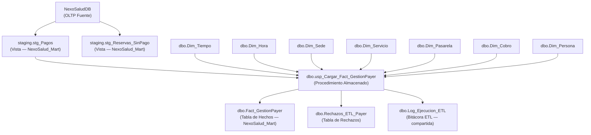
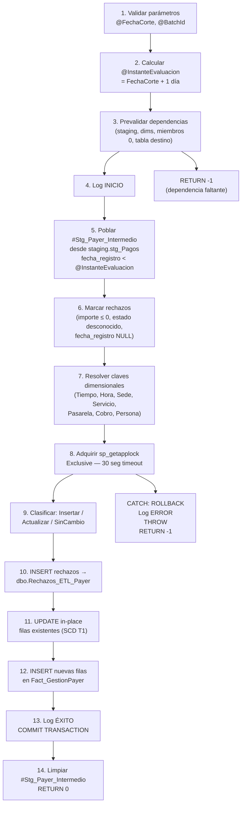

# Entregable 19 — Guía Técnica del ETL PAYER y Diccionario Analítico

**Proyecto:** NexoSalud — Data Mart Dimensional, Clínica Luxedent, Trujillo  
**Responsable:** Jesús Daniel Ordóñez Ugarte — Integrante 4 (ETL PAYER, Gestión Financiera)  
**Hito:** H3 — Fase 2: ETL de Hechos — Etapa PAYER  
**Fecha de Elaboración:** 2026-10-21  
**Motor:** SQL Server 2019 LocalDB (`(localdb)\MSSQLLocalDB`)  
**Bases de Datos:** `NexoSaludDB` (OLTP fuente) · `NexoSalud_Mart` (Data Mart destino)  
**Scripts Asociados:**  
- [`18. Staging_payer_h3.sql`](18.%20Staging_payer_h3.sql) — Vistas de staging  
- [`19. ETL_Fact_GestionPayer_h3.sql`](19.%20ETL_Fact_GestionPayer_h3.sql) — DDL + Procedimiento ETL  
- [`19. Pruebas_ETL_Payer_h3.sql`](19.%20Pruebas_ETL_Payer_h3.sql) — Batería de 10 pruebas automatizadas  
- [`20. Conciliacion_monetaria_Payer_h3.sql`](20.%20Conciliacion_monetaria_Payer_h3.sql) — Consultas de conciliación  
**Patrones de Referencia:** [`15. ETL_Fact_CaptacionBuyer_h3.sql`](15.%20ETL_Fact_CaptacionBuyer_h3.sql) (Mario A. Martínez Domínguez)  
**Contrato Base:** [`12. Contrato_y_dependencias_h3_mario.md`](12.%20Contrato_y_dependencias_h3_mario.md)

---

> [!IMPORTANT]
> Todos los importes de esta fase se tratan como **MonedaNoVerificada**. El OLTP no posee campo formal de divisa (`moneda`). Queda estrictamente prohibido asumir PEN, USD o cualquier otra moneda hasta que exista un campo `id_moneda` o equivalente en `NexoSaludDB.dbo.Pagos`.

> [!WARNING]
> **HAL-03:** El endpoint `payer.routes.ts` genera automáticamente un pago ficticio de S/1.00 cuando se valida una reserva sin pago previo. Este registro puede llegar a `Pagos` con importe real > 0 y estado válido, siendo indistinguible de un pago legítimo sin coordinación con el equipo de backend. Ver [Sección 6](#sección-6-advertencias-críticas) para el detalle completo.

> [!NOTE]
> El modelo de `Fact_GestionPayer` representa el **estado actual** de cada pago (1 fila por `id_pago`), no un historial de cambios. Las actualizaciones de estado se aplican in-place (SCD Tipo 1). Para auditoría de cambios históricos se requeriría un diseño SCD Tipo 2, fuera del alcance de este hito.

---

## Sección 1: Objetivo y Arquitectura del ETL PAYER

### 1.1 Objetivo

El ETL PAYER tiene como misión transformar los registros transaccionales de pagos de `NexoSaludDB` hacia la tabla de hechos dimensional `dbo.Fact_GestionPayer` en `NexoSalud_Mart`, garantizando:

- **Idempotencia:** Ejecuciones repetidas con los mismos parámetros producen el mismo resultado final.
- **Trazabilidad:** Cada carga registra eventos de INICIO, ÉXITO o ERROR en `dbo.Log_Ejecucion_ETL`.
- **Integridad referencial:** Todos los registros tienen claves dimensionales válidas (Key = 0 para desconocidos).
- **Conciliación:** El número de pagos OLTP = registros en hecho + registros rechazados, sin pérdidas silenciosas.
- **Exactitud monetaria:** Los importes se propagan sin transformación. No se asume divisa.

### 1.2 Grano del Hecho

> **1 fila exactamente por `id_pago`** (identificador natural de la tabla `Pagos` del OLTP).

Implicaciones del grano:
- Múltiples pagos asociados a la misma reserva generan múltiples filas en el hecho.
- Los pagos parciales son válidos y se cargan de forma independiente.
- Nunca se agrupan pagos de la misma reserva en una sola fila del hecho.
- La columna `id_pago_origen` tiene una restricción `UNIQUE` que garantiza este grano.

### 1.3 Arquitectura de Componentes



### 1.4 Flujo Interno del Procedimiento



---

## Sección 2: Instrucciones de Ejecución

### 2.1 Prerrequisitos Obligatorios

Antes de ejecutar cualquier script de esta fase, verificar:

| # | Prerrequisito | Cómo verificar |
|---|---------------|----------------|
| 1 | `NexoSalud_Mart` existe | `SELECT name FROM sys.databases WHERE name = 'NexoSalud_Mart'` |
| 2 | `NexoSaludDB` existe y tiene datos | `SELECT COUNT(*) FROM NexoSaludDB.dbo.Pagos` |
| 3 | Esquema `staging` existe en Mart | `SELECT name FROM NexoSalud_Mart.sys.schemas WHERE name = 'staging'` |
| 4 | `dbo.Log_Ejecucion_ETL` existe (creada por Entregable 15) | `SELECT OBJECT_ID('NexoSalud_Mart.dbo.Log_Ejecucion_ETL')` |
| 5 | Todas las dimensiones conformadas existen y tienen miembro 0 | Ejecutar prevalidación del Lote 1 de `19. ETL_Fact_GestionPayer_h3.sql` |
| 6 | `staging.stg_Pagos` existe (creada por Entregable 18) | `SELECT OBJECT_ID('NexoSalud_Mart.staging.stg_Pagos', 'V')` |
| 7 | Entorno SQL Server accesible | `sqlcmd -S "(localdb)\MSSQLLocalDB" -E -Q "SELECT @@VERSION"` |

### 2.2 Orden de Ejecución

```
PASO 1 — (Si aún no existe) Ejecutar Entregable 8:
    DDL_modelo_dimensional_mart_h2.sql
    → Crea NexoSalud_Mart y todas las dimensiones

PASO 2 — (Si aún no existe) Ejecutar Entregable 9:
    Poblacion_dimensiones_conformadas_h2.sql
    → Puebla las dimensiones con datos iniciales y miembros desconocidos

PASO 3 — Ejecutar Entregable 15 (si no se ha ejecutado):
    ETL_Fact_CaptacionBuyer_h3.sql
    → Crea dbo.Log_Ejecucion_ETL y dbo.Rechazos_ETL_Buyer

PASO 4 — Ejecutar Entregable 18:
    Staging_payer_h3.sql
    → Crea staging.stg_Pagos y staging.stg_Reservas_SinPago

PASO 5 — Ejecutar Entregable 19 (ETL):
    ETL_Fact_GestionPayer_h3.sql
    → Crea dbo.Fact_GestionPayer, dbo.Rechazos_ETL_Payer
    → Compila dbo.usp_Cargar_Fact_GestionPayer

PASO 6 — Llamar al procedimiento con parámetros de producción:
    EXEC dbo.usp_Cargar_Fact_GestionPayer (ver Sección 2.4)
```

### 2.3 Comandos SQLCMD Exactos

```bash
# PASO 4 — Desplegar staging PAYER
sqlcmd -S "(localdb)\MSSQLLocalDB" -E -d NexoSalud_Mart -b ^
  -i "Entregables\18. Staging_payer_h3.sql"

# PASO 5 — Desplegar DDL + Procedimiento ETL PAYER
sqlcmd -S "(localdb)\MSSQLLocalDB" -E -d NexoSalud_Mart -b ^
  -i "Entregables\19. ETL_Fact_GestionPayer_h3.sql"

# PASO 6 — Ejecutar pruebas automatizadas (entorno aislado)
sqlcmd -S "(localdb)\MSSQLLocalDB" -E -b ^
  -i "Entregables\19. Pruebas_ETL_Payer_h3.sql"

# PASO 7 — Ejecutar conciliación (requiere datos en producción)
sqlcmd -S "(localdb)\MSSQLLocalDB" -E -d NexoSalud_Mart -b ^
  -i "Entregables\20. Conciliacion_monetaria_Payer_h3.sql"
```

### 2.4 Parámetros del Procedimiento `dbo.usp_Cargar_Fact_GestionPayer`

| Parámetro | Tipo | Dirección | Obligatorio | Descripción |
|-----------|------|-----------|-------------|-------------|
| `@FechaCorte` | `DATE` | INPUT | ✅ Sí | Fecha de corte. Se cargan todos los pagos con `fecha_registro` < `@FechaCorte + 1 día`. No puede ser NULL. |
| `@BatchId` | `VARCHAR(50)` | INPUT | ✅ Sí | Identificador único de lote (ej: `'PAYER_20261021_001'`). No puede ser NULL ni vacío. Se almacena en cada fila de la tabla de hechos y en la bitácora. |
| `@Insertados` | `INT` | OUTPUT | — | Número de filas nuevas insertadas en `Fact_GestionPayer`. |
| `@Actualizados` | `INT` | OUTPUT | — | Número de filas existentes actualizadas in-place (SCD Tipo 1). |
| `@SinCambio` | `INT` | OUTPUT | — | Número de filas ya existentes sin ningún cambio detectado. |
| `@Rechazados` | `INT` | OUTPUT | — | Número de pagos enviados a `dbo.Rechazos_ETL_Payer`. |
| `@Pendientes` | `INT` | OUTPUT | — | Número de pagos en estado `'Pendiente'` (clave dimensional no resuelta o fecha no en `Dim_Tiempo`). |

**Ejemplo de invocación:**

```sql
USE [NexoSalud_Mart];
GO

DECLARE
    @ins  INT,
    @act  INT,
    @sc   INT,
    @rech INT,
    @pend INT,
    @ret  INT;

EXEC @ret = dbo.usp_Cargar_Fact_GestionPayer
    @FechaCorte = '2026-10-21',
    @BatchId    = 'PAYER_20261021_001',
    @Insertados  = @ins  OUTPUT,
    @Actualizados = @act  OUTPUT,
    @SinCambio   = @sc   OUTPUT,
    @Rechazados  = @rech OUTPUT,
    @Pendientes  = @pend OUTPUT;

SELECT
    @ret  AS CodigoRetorno,   -- 0 = éxito, -1 = error
    @ins  AS Insertados,
    @act  AS Actualizados,
    @sc   AS SinCambio,
    @rech AS Rechazados,
    @pend AS Pendientes;
```

**Códigos de retorno:**

| Código | Significado |
|--------|-------------|
| `0` | Éxito completo. La transacción fue confirmada. |
| `-1` | Error. La transacción fue revertida. Ver `dbo.Log_Ejecucion_ETL` con `TipoEvento = 'ERROR'`. |

---

## Sección 3: Diccionario Analítico de `dbo.Fact_GestionPayer`

### 3.1 Columnas de Clave Subrogada e Identificación

| Columna | Tipo SQL | Descripción | Origen OLTP | Transformación | Nulidad | Uso Analítico |
|---------|----------|-------------|-------------|----------------|---------|---------------|
| `KeyFactPayer` | `BIGINT IDENTITY(1,1)` | Clave subrogada del hecho. PK físico. Sin significado de negocio. | — | Autogenerado por SQL Server | NOT NULL | Clave interna de tabla; no usar en filtros analíticos |
| `id_pago_origen` | `INT NOT NULL UNIQUE` | Clave natural del pago en el OLTP. Garantiza el grano de 1 fila por pago e impide duplicados. | `Pagos.id_pago` | Ninguna (propagación directa 1:1) | NOT NULL | Clave de conciliación OLTP ↔ Mart. Usar para reconciliar con fuente. |
| `id_reserva_origen` | `INT NOT NULL DEFAULT 0` | Identificador de la reserva asociada al pago. Permite agrupar pagos parciales de la misma reserva. | `Pagos.id_reserva` | 0 si NULL (sin reserva vinculada) | NOT NULL | Filtrar todos los pagos de una misma reserva. Detectar pagos parciales. |

### 3.2 Columnas de Claves Dimensionales (Foreign Keys)

| Columna | Tipo SQL | Descripción | Dimensión | Resolución | Valor 0 | FK |
|---------|----------|-------------|-----------|------------|---------|-----|
| `KeyTiempoPago` | `INT NOT NULL` | Fecha del evento de pago (registro en sistema). | `Dim_Tiempo` | `CAST(CONVERT(VARCHAR(8), fecha_registro, 112) AS INT)` → fecha en `Dim_Tiempo` | Fecha no encontrada en dimensión (pendiente de población H2) | ✅ FK |
| `KeyTiempoValidacion` | `INT NOT NULL DEFAULT 0` | Fecha de acreditación/validación efectiva del pago. 0 si el pago no fue validado aún. | `Dim_Tiempo` | Igual a `KeyTiempoPago` pero sobre `fecha_validacion`. 0 si NULL. | Pago no validado (Pendiente/Rechazado) | ✅ FK |
| `KeyHora` | `INT NOT NULL DEFAULT 0` | Hora del registro del pago (HH*100+MM). | `Dim_Hora` | `DATEPART(HOUR)*100 + DATEPART(MINUTE)` de `fecha_registro` | Hora no encontrada en `Dim_Hora` | ✅ FK |
| `KeySede` | `INT NOT NULL DEFAULT 0` | Sede donde se realizaría la atención. Derivado de `Disponibilidad.id_sede` vía cadena Reserva→Opción→Disponibilidad. | `Dim_Sede` | Lookup por `id_sede`. 0 si NULL o no encontrado (no es causa de rechazo). | Sede no disponible o cadena de JOIN rota | ✅ FK |
| `KeyServicio` | `INT NOT NULL DEFAULT 0` | Tipo de servicio solicitado. Derivado de `Solicitudes.id_servicio`. | `Dim_Servicio` | Lookup por `id_servicio`. 0 si NULL. | Servicio no informado o nullable en OLTP | ✅ FK |
| `KeyFuente` | `INT NOT NULL DEFAULT 0` | Canal de captación/fuente del cliente. Reservado para extensión futura. | `Dim_Fuente` | Siempre 0 en implementación actual (OLTP no tiene campo fuente en Pagos). | No aplicable en esta fase | ✅ FK |
| `KeyCampana` | `INT NOT NULL DEFAULT 0` | Campaña de marketing asociada. Reservado para extensión futura. | `Dim_Campana` | Siempre 0 (OLTP no tiene campo campaña en Pagos). | No aplicable en esta fase | ✅ FK |
| `KeyPasarela` | `INT NOT NULL DEFAULT 0` | Método/canal de pago usado (transferencia, efectivo, tarjeta, etc.). | `Dim_Pasarela` | Lookup por `MetodoPago = UPPER(TRIM(canal_pago))`. 0 si NULL o no encontrado. | Canal de pago desconocido o NULL | ✅ FK |
| `KeyCobro` | `INT NOT NULL DEFAULT 0` | Estado del cobro y presencia de comprobante. Combina estado normalizado + bandera de comprobante. | `Dim_Cobro` | Lookup por `EstadoPago = estado_pago_norm AND ComprobanteAdjunto = 'SI'/'NO'`. 0 si ambiguo. | Estado/comprobante no mapeado en dimensión | ✅ FK |
| `KeyPersona` | `INT NOT NULL DEFAULT 0` | Paciente/persona que realizó el pago. | `Dim_Persona` | Lookup por `id_persona = Pagos.id_persona`. 0 si no encontrado. | Persona no registrada en dimensión | ✅ FK |

### 3.3 Columnas de Métricas (Medidas)

| Columna | Tipo SQL | Descripción | Origen OLTP | Transformación | Nulidad | Uso Analítico |
|---------|----------|-------------|-------------|----------------|---------|---------------|
| `PagosRegistrados` | `INT NOT NULL DEFAULT 1` | Siempre 1 por fila (grano atómico). Permite SUM para contar pagos totales. | — | Constante 1 en INSERT; no cambia en UPDATE | NOT NULL | `SUM(PagosRegistrados)` = total de pagos |
| `PagosValidados` | `INT NOT NULL DEFAULT 0` | 1 si el pago está en estado 'Validado'; 0 en otro caso. | `Pagos.estado` | `CAST(es_pago_validado AS INT)` | NOT NULL | `SUM(PagosValidados)` = pagos acreditados |
| `PagosPendientes` | `INT NOT NULL DEFAULT 0` | 1 si el pago está en estado 'Pendiente'; 0 en otro caso. | `Pagos.estado` | `CAST(es_pago_pendiente AS INT)` | NOT NULL | `SUM(PagosPendientes)` = pagos en espera |
| `PagosRechazados` | `INT NOT NULL DEFAULT 0` | 1 si el pago está en estado 'Rechazado'; 0 en otro caso. | `Pagos.estado` | `CAST(es_pago_rechazado AS INT)` | NOT NULL | `SUM(PagosRechazados)` = pagos anulados |
| `ImporteTotalCobro` | `DECIMAL(10,2) NOT NULL DEFAULT 0.00` | Importe del pago **solo si está Validado**; 0.00 en otro caso. Representa ingresos efectivos. | `Pagos.importe` | `importe` si 'Validado', else 0.00 | NOT NULL | `SUM(ImporteTotalCobro)` = ingresos validados totales. ⚠️ MonedaNoVerificada |
| `ImportePendiente` | `DECIMAL(10,2) NOT NULL DEFAULT 0.00` | Importe del pago **solo si está Pendiente**; 0.00 en otro caso. Representa compromisos sin acreditar. | `Pagos.importe` | `importe` si 'Pendiente', else 0.00 | NOT NULL | `SUM(ImportePendiente)` = monto por acreditar. ⚠️ MonedaNoVerificada |
| `ImporteRechazado` | `DECIMAL(10,2) NOT NULL DEFAULT 0.00` | Importe del pago **solo si está Rechazado**; 0.00 en otro caso. Para análisis de reversiones. | `Pagos.importe` | `importe` si 'Rechazado', else 0.00 | NOT NULL | `SUM(ImporteRechazado)` = monto anulado. ⚠️ MonedaNoVerificada |
| `IndicadorMoneda` | `VARCHAR(30) NOT NULL DEFAULT 'MonedaNoVerificada'` | Indicador de divisa. **SIEMPRE `'MonedaNoVerificada'`** por política obligatoria. El OLTP no tiene campo de moneda. | — | Constante `'MonedaNoVerificada'` | NOT NULL | Filtrar con `WHERE IndicadorMoneda = 'MonedaNoVerificada'` para auditoría de cobertura |
| `TiempoValidacionMin` | `INT NULL` | Tiempo transcurrido en minutos entre `fecha_registro` y `fecha_validacion`. NULL si el pago no fue validado o si hay anomalía cronológica. | `Pagos.fecha_registro`, `fecha_validacion` | `DATEDIFF(MINUTE, fecha_registro, fecha_validacion)` solo si `fecha_validacion >= fecha_registro` | NULL | `AVG(TiempoValidacionMin)` = tiempo promedio de procesamiento de pagos |
| `EsPagoSinAnticipo` | `BIT NOT NULL DEFAULT 0` | Reservado para marcar pagos registrados sin anticipo previo. **Siempre 0 en implementación actual** (requiere fecha de atención efectiva, no disponible en OLTP). | — | Constante 0 + comentario de extensión futura | NOT NULL | Extensión futura: análisis de política de anticipos |

### 3.4 Columnas de Auditoría ETL

| Columna | Tipo SQL | Descripción | Valor en INSERT | Valor en UPDATE |
|---------|----------|-------------|-----------------|-----------------|
| `BatchId` | `VARCHAR(50) NOT NULL` | Identificador del lote de carga que creó o actualizó la fila. | Parámetro `@BatchId` | No se modifica (se mantiene el BatchId de creación) |
| `FechaCarga` | `DATETIME2(7) NOT NULL` | Fecha y hora de la inserción original de la fila. | `GETDATE()` | No se modifica |
| `FechaModificacion` | `DATETIME2(7) NULL` | Fecha y hora de la última actualización in-place. NULL si la fila no ha sido actualizada. | `NULL` | `GETDATE()` |
| `UsuarioCarga` | `VARCHAR(50) NOT NULL` | Usuario SQL Server que ejecutó el ETL. | `SYSTEM_USER` | No se modifica |

---

## Sección 4: Catálogo de Motivos de Rechazo

Los pagos rechazados por el ETL se almacenan en `dbo.Rechazos_ETL_Payer`. No aparecen en `Fact_GestionPayer`.

| Código | `MotivoRechazo` | Causa | Acción Recomendada |
|--------|-----------------|-------|-------------------|
| R-01 | `'ImporteNegativoOCero'` | `Pagos.importe <= 0`. Un pago no puede tener importe cero o negativo. | Revisar el registro en OLTP. Confirmar si es anulación o error de captura. |
| R-02 | `'EstadoPagoDesconocido'` | `estado_pago_norm = 'Desconocido'`. El valor de `Pagos.estado` no es 'Validado', 'Pendiente' ni 'Rechazado'. | Actualizar el OLTP con el estado correcto, o extender la normalización del staging si se introduce un nuevo estado válido. |
| R-03 | `'FechaRegistroNula'` | `Pagos.fecha_registro IS NULL`. Columna NOT NULL en el esquema, pero puede ser NULL en entornos de prueba o por error de migración. | Investigar el origen del registro. La fecha de registro es obligatoria por diseño del OLTP. |

> [!NOTE]
> **Anomalía cronológica no es causa de rechazo.** Si `fecha_validacion < fecha_registro`, el ETL registra la anomalía en la columna `TiempoValidacionMin = NULL` y continúa el procesamiento. No genera un rechazo. Esto es consistente con el patrón de Mario y evita perder datos válidos por errores de sincronización de relojes o ajustes retroactivos.

---

## Sección 5: Catálogo de Estados de Pago

| Estado Original (OLTP) | Estado Normalizado | Contribuye a `ImporteTotalCobro` | Contribuye a `ImportePendiente` | Contribuye a `ImporteRechazado` | Acción ETL |
|------------------------|-------------------|---|----|----|----|
| `'Validado'` | `'Validado'` | ✅ Sí | ❌ No | ❌ No | INSERT o UPDATE normal. `PagosValidados = 1`. `TiempoValidacionMin` calculado si cronología válida. |
| `'Pendiente'` | `'Pendiente'` | ❌ No | ✅ Sí | ❌ No | INSERT o UPDATE normal. `PagosPendientes = 1`. `fecha_validacion` es NULL; `KeyTiempoValidacion = 0`. |
| `'Rechazado'` | `'Rechazado'` | ❌ No | ❌ No | ✅ Sí | INSERT o UPDATE normal. `PagosRechazados = 1`. `fecha_validacion` puede ser NULL. |
| Cualquier otro valor | `'Desconocido'` | ❌ No | ❌ No | ❌ No | **Registro enviado a `dbo.Rechazos_ETL_Payer`**. No aparece en `Fact_GestionPayer`. |

---

## Sección 6: Advertencias Críticas

### 6.1 HAL-03 — Pago Ficticio en `payer.routes.ts`

**Descripción técnica:**  
El endpoint de backend `payer.routes.ts` implementa una lógica de guardia que genera automáticamente un pago de `S/1.00` (`importe = 1.00`, `estado = 'Validado'`) cuando se procesa la validación de una reserva y no existe ningún pago previo registrado en `Pagos`. El registro se crea con `referencia_pago` y `canal_pago` que podrían ser genéricos o nulos.

**Impacto en el Data Mart:**  
- Si `importe = 1.00 > 0` y `estado = 'Validado'`, el ETL procesará el registro como un pago legítimo.
- `ImporteTotalCobro` quedará distorsionado con ingresos ficticios.
- La conciliación OLTP ↔ Mart mostrará balance perfecto pero con datos falsos.

**Acción tomada en esta fase:**  
- El hallazgo está documentado en `18. Matriz_reglas_monetarias_y_diseno_payer_h3.md`, Sección 9.
- **No se modificó `payer.routes.ts`** — requiere autorización específica del equipo de backend.
- **No se filtra** el pago de S/1.00 en el staging, ya que la regla de filtrado requiere coordinación (¿filtrar por importe exacto = 1.00? ¿por `referencia_pago` específica? ¿por ausencia de `canal_pago`?).
- **Estado: 🔴 PENDIENTE DE COORDINACIÓN CON BACKEND.**

**Identificación sugerida para coordinación:**  
El equipo de backend debe definir un campo discriminador (ej: `observaciones = 'AUTO_GENERADO'` o `referencia_pago = 'SYS_GUARDIA'`) para que el staging pueda filtrar estos registros con precisión.

### 6.2 Ausencia de Campo de Moneda en OLTP

**Descripción:**  
`NexoSaludDB.dbo.Pagos` no tiene columna `moneda`, `id_moneda`, ni equivalente. Todos los importes son escalares sin unidad de moneda formal.

**Impacto:**  
- `SUM(ImporteTotalCobro)` no es comparable entre registros si en algún momento la clínica procesa pagos en distintas divisas.
- Los KPIs de ingresos tienen una limitación estructural documentada pero no observable sin datos.

**Acción:**  
- `IndicadorMoneda = 'MonedaNoVerificada'` en el 100% de las filas.
- Se recomienda al equipo de backend agregar `id_moneda INT NOT NULL FK → Monedas(id_moneda)` con valor por defecto = id de PEN en el OLTP.

### 6.3 Modelo de Estado Actual vs. Historial de Reversiones

**Descripción:**  
`Fact_GestionPayer` implementa SCD Tipo 1 (actualización in-place). Cuando un pago cambia de `'Pendiente'` a `'Validado'`, la fila existente se actualiza y el estado anterior se pierde.

**Consecuencia directa:**  
- No es posible consultar "¿cuántos pagos estuvieron en estado Pendiente el día X?"
- No es posible reconstruir el historial completo de reversiones de un pago.

**Qué sí es posible:**  
- Consultar el estado actual de cada pago.
- Ver cuándo fue la última modificación (`FechaModificacion`).
- Ver el `BatchId` que realizó la última actualización.

**Recomendación para Alexis (Integrante 5):**  
Si se requiere historial completo de cambios de estado, implementar una tabla de auditoría `Fact_GestionPayer_Historial` con grano (`id_pago_origen`, `fecha_cambio_estado`), o migrar a SCD Tipo 2 con columnas `FechaInicioVigencia`/`FechaFinVigencia`.

### 6.4 Reservas Sin Anticipo (Política Luxedent)

**Descripción:**  
Luxedent permite confirmar reservas sin exigir un pago anticipado. Una reserva confirmada (`confirmacion_explicita = 1`) puede no tener ningún pago en `Pagos`.

**Impacto en ETL:**  
- `Fact_GestionPayer` no genera filas para reservas sin pagos. Esto es correcto por diseño.
- La vista `staging.stg_Reservas_SinPago` registra estas reservas para análisis.
- El ETL **no genera pagos ficticios** para estas reservas (restricción crítica activa).

---

## Sección 7: KPIs Soportados por `Fact_GestionPayer`

| KPI | Fórmula DAX / SQL | Limitaciones |
|-----|-------------------|--------------|
| **Total de Ingresos Validados** | `SUM(ImporteTotalCobro)` | ⚠️ MonedaNoVerificada — no comparable entre divisas si aplica |
| **Total de Pagos Pendientes (Monto)** | `SUM(ImportePendiente)` | ⚠️ MonedaNoVerificada |
| **Total de Pagos Anulados (Monto)** | `SUM(ImporteRechazado)` | ⚠️ MonedaNoVerificada |
| **Número de Pagos Totales** | `SUM(PagosRegistrados)` | Incluye validados, pendientes y rechazados |
| **Número de Pagos Validados** | `SUM(PagosValidados)` | Solo pagos acreditados |
| **Tasa de Conversión de Pagos** | `SUM(PagosValidados) / SUM(PagosRegistrados) * 100` | Requiere `PagosRegistrados > 0` |
| **Tiempo Promedio de Validación** | `AVG(TiempoValidacionMin)` | NULL para pagos no validados o con anomalía cronológica — excluir NULLs |
| **Ingresos por Sede** | `SUM(ImporteTotalCobro) GROUP BY KeySede → Dim_Sede` | KeySede = 0 agrupa pagos sin sede identificada |
| **Ingresos por Canal de Pago** | `SUM(ImporteTotalCobro) GROUP BY KeyPasarela → Dim_Pasarela` | KeyPasarela = 0 agrupa canales desconocidos o NULL |
| **Ingresos por Servicio** | `SUM(ImporteTotalCobro) GROUP BY KeyServicio → Dim_Servicio` | KeyServicio = 0 agrupa servicios no informados |
| **Ingresos por Persona** | `SUM(ImporteTotalCobro) GROUP BY KeyPersona → Dim_Persona` | KeyPersona = 0 agrupa personas no registradas en dimensión |
| **Pagos Parciales por Reserva** | `COUNT(*) GROUP BY id_reserva_origen WHERE COUNT(*) > 1` | Identifica reservas con múltiples pagos |
| **Saldo Pendiente por Día** | `SUM(ImportePendiente) GROUP BY KeyTiempoPago → Dim_Tiempo.FechaCompleta` | Usando `KeyTiempoPago` (fecha de registro del pago) |
| **Ingresos Efectivos por Día de Acreditación** | `SUM(ImporteTotalCobro) GROUP BY KeyTiempoValidacion → Dim_Tiempo.FechaCompleta WHERE KeyTiempoValidacion <> 0` | Excluir `KeyTiempoValidacion = 0` (pagos no validados) |

---

## Sección 8: Resolución Dimensional — Lógica Detallada

### 8.1 Resolución de `Dim_Tiempo`

```sql
-- Para KeyTiempoPago:
SELECT KeyTiempo
FROM dbo.Dim_Tiempo
WHERE id_fecha = CAST(CONVERT(VARCHAR(8), s.fecha_registro, 112) AS INT)
-- Si la fecha no está en Dim_Tiempo → ClasificacionAccion = 'Pendiente' (no rechazar)
-- Si fecha_registro IS NULL → ClasificacionAccion = 'Rechazada' (MotivoRechazo = 'FechaRegistroNula')

-- Para KeyTiempoValidacion:
-- Si fecha_validacion IS NULL → KeyTiempoValidacion = 0 (miembro desconocido)
-- Si fecha_validacion NOT NULL → mismo lookup que KeyTiempoPago
```

### 8.2 Resolución de `Dim_Pasarela`

```sql
-- Lookup principal:
SELECT KeyPasarela, COUNT(*) AS cnt
FROM dbo.Dim_Pasarela
WHERE MetodoPago = canal_pago_norm  -- UPPER(TRIM(canal_pago))
GROUP BY KeyPasarela

-- Reglas:
-- cnt = 1  → usar ese KeyPasarela
-- cnt = 0  → KeyPasarela = 0 (desconocido, no rechazar)
-- cnt > 1  → KeyPasarela = 0 (ambigüedad en dimensión, advertencia en log)
-- canal_pago IS NULL → canal_pago_norm = 'DESCONOCIDO' → KeyPasarela = 0
```

### 8.3 Resolución de `Dim_Cobro`

```sql
-- Dim_Cobro combina dos atributos:
-- EstadoPago: valor normalizado del estado ('Validado', 'Pendiente', 'Rechazado')
-- ComprobanteAdjunto: 'SI' si Pagos.comprobante IS NOT NULL AND comprobante != '', else 'NO'

SELECT KeyCobro, COUNT(*) AS cnt
FROM dbo.Dim_Cobro
WHERE EstadoPago = estado_pago_norm
  AND ComprobanteAdjunto = CASE WHEN tiene_comprobante = 1 THEN 'SI' ELSE 'NO' END
GROUP BY KeyCobro

-- cnt = 0 o > 1 → KeyCobro = 0
```

---

## Sección 9: Limitaciones Conocidas

| # | Limitación | Impacto | Recomendación |
|---|------------|---------|---------------|
| L-01 | OLTP sin campo `moneda` en `Pagos` | KPIs de ingresos no son fiables en escenarios multidivisa | Agregar `id_moneda INT NOT NULL` en `Pagos` con FK a tabla `Monedas` |
| L-02 | `Fact_MovimientoCaja` no implementada | No hay análisis de egresos, devoluciones ni flujo neto de caja | El OLTP requiere tablas `GastosCaja`, `Devoluciones` o equivalentes |
| L-03 | SCD Tipo 1 (sin historial de cambios de estado) | No es posible reconstruir evolución histórica de un pago | Implementar tabla de auditoría `Fact_GestionPayer_Historial` o SCD Tipo 2 |
| L-04 | HAL-03 no filtrado en staging | Pagos ficticios de S/1.00 pueden distorsionar KPIs de ingresos | Coordinación con backend para campo discriminador en `Pagos` |
| L-05 | `KeyFuente` y `KeyCampana` siempre en 0 | No se puede analizar canal de captación ni campaña para pagos | El OLTP no tiene campo de fuente/campaña en `Pagos`; requiere extensión |
| L-06 | `EsPagoSinAnticipo` siempre en 0 | No es posible identificar pagos sin anticipo para análisis de política | Requiere fecha de atención efectiva, no disponible en esquema actual |
| L-07 | `Dim_Persona` y `Dim_Campana` son propuestas de Mario, no parte del DDL oficial H2 | Pueden no existir en producción real | Verificar antes de desplegar en producción; coordinar con Alessandro |

---

## Sección 10: Tablas Auxiliares ETL

### 10.1 `dbo.Log_Ejecucion_ETL` (compartida con Mario)

Creada por Entregable 15. El ETL PAYER **reutiliza** esta tabla sin modificarla.

| Columna | Tipo | Descripción |
|---------|------|-------------|
| `LogId` | `BIGINT IDENTITY PK` | Identificador del evento de log |
| `Procedimiento` | `VARCHAR(100)` | Nombre del SP (`'dbo.usp_Cargar_Fact_GestionPayer'`) |
| `BatchId` | `VARCHAR(50)` | Lote de carga |
| `TipoEvento` | `VARCHAR(30)` | `'INICIO'`, `'EXITO'`, `'ERROR'`, `'ADVERTENCIA'` |
| `Mensaje` | `VARCHAR(MAX)` | Detalle del evento |
| `LineaError` | `INT NULL` | Línea del error (solo en eventos ERROR) |
| `FechaRegistro` | `DATETIME2(7)` | Timestamp del evento |

### 10.2 `dbo.Rechazos_ETL_Payer` (nueva — creada por Entregable 19)

| Columna | Tipo | Descripción |
|---------|------|-------------|
| `RechazoId` | `BIGINT IDENTITY PK` | Identificador del rechazo |
| `EntidadOrigenId` | `INT NOT NULL` | `id_pago` rechazado |
| `MotivoRechazo` | `VARCHAR(150) NOT NULL` | Código de motivo (ver Sección 4) |
| `DetalleRechazo` | `VARCHAR(MAX) NULL` | Texto libre con contexto adicional |
| `BatchId` | `VARCHAR(50) NOT NULL` | Lote en que fue rechazado |
| `FechaRechazo` | `DATETIME2(7) NOT NULL` | Timestamp del rechazo |

---

## Sección 11: Consulta de Verificación Post-Carga

Ejecutar después de cada llamada al procedimiento para verificar el estado del hecho:

```sql
USE [NexoSalud_Mart];
GO

-- Resumen de la última carga
SELECT
    BatchId,
    MIN(FechaCarga)          AS PrimerRegistroCarga,
    MAX(FechaCarga)          AS UltimoRegistroCarga,
    COUNT(*)                 AS TotalFilasEnHecho,
    SUM(PagosRegistrados)    AS TotalPagosRegistrados,
    SUM(PagosValidados)      AS TotalPagosValidados,
    SUM(PagosPendientes)     AS TotalPagosPendientes,
    SUM(PagosRechazados)     AS TotalPagosRechazados,
    SUM(ImporteTotalCobro)   AS ImporteValidadoTotal,
    SUM(ImportePendiente)    AS ImportePendienteTotal,
    SUM(ImporteRechazado)    AS ImporteRechazadoTotal,
    MIN(IndicadorMoneda)     AS IndicadorMoneda,   -- Debe ser siempre 'MonedaNoVerificada'
    AVG(CAST(TiempoValidacionMin AS FLOAT)) AS PromTiempoValidacionMin
FROM dbo.Fact_GestionPayer
GROUP BY BatchId
ORDER BY PrimerRegistroCarga DESC;

-- Verificación de rechazos del mismo batch
SELECT
    BatchId,
    MotivoRechazo,
    COUNT(*) AS TotalRechazos
FROM dbo.Rechazos_ETL_Payer
GROUP BY BatchId, MotivoRechazo
ORDER BY BatchId DESC, TotalRechazos DESC;

-- Últimos eventos de la bitácora
SELECT TOP 10
    Procedimiento,
    BatchId,
    TipoEvento,
    Mensaje,
    FechaRegistro
FROM dbo.Log_Ejecucion_ETL
WHERE Procedimiento = 'dbo.usp_Cargar_Fact_GestionPayer'
ORDER BY FechaRegistro DESC;
```

---

## Sección 12: Traspaso para el Siguiente Integrante (Alexis — CUSTOMER/TURNED)

> [!IMPORTANT]
> El presente documento y los scripts asociados son el insumo técnico directo para Alexis (Integrante 5), responsable de las etapas CUSTOMER y TURNED del modelo IMPULSE.

**Lo que Alexis puede asumir como disponible:**

1. `dbo.Fact_GestionPayer` poblada con 1 fila por pago procesado.
2. `dbo.Rechazos_ETL_Payer` con los pagos que no pasaron las validaciones del ETL.
3. `dbo.Log_Ejecucion_ETL` con todos los eventos de carga PAYER.
4. `staging.stg_Pagos` y `staging.stg_Reservas_SinPago` disponibles para consulta.
5. Las 7 dimensiones conformadas con miembros desconocidos (Key = 0) garantizados.

**Lo que Alexis debe validar antes de asumir:**

1. Ejecutar `19. Pruebas_ETL_Payer_h3.sql` en entorno aislado y confirmar 10/10 CORRECTO.
2. Ejecutar `20. Conciliacion_monetaria_Payer_h3.sql` y verificar que `DiferenciaImporte = 0.00`.
3. Confirmar que `Dim_Persona` y `Dim_Campana` existen en producción (son propuestas, no parte del DDL oficial H2).
4. Coordinar con backend la resolución de HAL-03 antes de cargar datos de producción.

**Dependencias que Alexis deberá resolver:**

- La etapa CUSTOMER requerirá identificar qué clientes completaron el ciclo PAYER → CUSTOMER.
- Recomendación: usar `id_pago_origen` + `id_reserva_origen` de `Fact_GestionPayer` para trazabilidad hacia las etapas posteriores.
- La ausencia del campo `moneda` seguirá siendo una limitación hasta que se corrija el OLTP.

---

*Fin del documento — Entregable 19 Guía ETL PAYER H3*  
*Autor: Jesús Daniel Ordóñez Ugarte — Integrante 4, NexoSalud H3*
