# NEXOSALUD — MODELO DIMENSIONAL, DIMENSIONES CONFORMADAS Y ARQUITECTURA ETL
## Hito H2: Arquitectura del Data Mart, Catálogos y Rediseño de Hechos
**Proyecto:** NexoSalud (Plataforma de Inteligencia de Negocios Odontológica)  
**Alcance Metodológico:** Metodología IMPULSE (Fases BUYER, LEAD, PAYER, CUSTOMER)  
**Responsable:** Integrante 2 — Marck Alessandro Hermenegildo Pacheco  
**Rol:** Diseñador Dimensional, Especialista en Dimensiones y Arquitecto de Datos ETL  
**Revisor Asignado:** Mario Antonio Martinez Dominguez (Integrante 3 — Foco: Dimensiones y Captación)  
**Destinatarios de Traspaso:** Integrantes 3, 4 y 5 (Desarrollo de Pipelines ETL de Hechos)  
**Ubicación del Entregable:** `Entregables/6. Modelo_dimensional_arquitectura_h2.md`  
**Fecha de Emisión:** Octubre de 2026  

---

## 1. Introducción y Justificación Arquitectural

### 1.1 Contexto y Propósito del Hito H2
El presente documento constituye el entregable principal de arquitectura y diseño dimensional correspondiente al **Hito H2** del proyecto NexoSalud. Partiendo de los contratos de datos, auditoría de calidad y reglas de negocio formalizadas en el **Hito H1** (`Entregables/1. Diagnostico_reglas_negocio.md`, `Entregables/2. Auditoria_calidad_datos_repositorio.md` y `Entregables/3. Contratos_datos_reglas_bi.md`), este trabajo materializa la transición desde el modelo operativo relacional transaccional (`NexoSaludDB`) hacia el almacén analítico estructurado en estrella (`NexoSalud_Mart`).

El diseño dimensional aquí presentado resuelve las inconsistencias críticas detectadas en el esquema preliminar del Anexo C del informe (`Contexto/Anexos.md`), satisfaciendo las directivas docentes del curso de Inteligencia de Negocios y las necesidades estratégicas reales expresadas por el sponsor, el Dr. Jhon Silver Díaz Gamarra, Director de la Clínica Odontológica Luxedent en Trujillo.

---

### 1.2 Diagnóstico Técnico del Esquema Preliminar (Anexo C) vs. Solución Arquitectural H2

La auditoría técnica realizada sobre el script dimensional preliminar provisto en el Anexo C (`Contexto/Anexos.md` L2050-2401) arrojó graves vulnerabilidades que habrían colapsado la analítica de negocio. A continuación se presenta el cuadro comparativo de diagnóstico y corrección arquitectural:

| Componente | Vulnerabilidad Crítica en Esquema Preliminar (Anexo C) | Corrección Arquitectural Implementada en H2 (Integrante 2) | Impacto en la Solución BI |
| :--- | :--- | :--- | :--- |
| **Claves Primarias en Hechos** | Las 4 tablas de hechos (`Fact_CaptacionBuyer`, `Fact_NegociacionLead`, `Fact_GestionPayer`, `Fact_AtencionCustomer`) se definieron como montones (*heaps*) sin `PRIMARY KEY`. | Se implementó una clave subrogada artificial `KeyFact BIGINT IDENTITY(1,1) PRIMARY KEY CLUSTERED` en cada tabla de hechos. | Permite indexación física óptima, unicidad de fila y referenciación unívoca de eventos analíticos. |
| **Idempotencia de Carga ETL** | Ningún hecho poseía identificador del evento origen (`source_id`) ni índices únicos. Una segunda ejecución del ETL duplicaba todas las filas y multiplicaba las medidas. | Se incorporó en cada hecho la columna `id_*_origen INT NOT NULL` y un índice `UNIQUE NONCLUSTERED` sobre dicha clave transaccional. | **Gobernanza de Idempotencia:** El pipeline puede ejecutarse $N$ veces sin duplicar métricas ni alterar los totales contables. |
| **Desacoplamiento Fuente / Campaña** | `Dim_Fuente` combinaba `id_fuente` e `id_campana` en la misma fila, forzando un producto cartesiano (*fan-out*) entre fuentes de contacto y campañas publicitarias. | **Separación en dos entidades independientes:** `Dim_Fuente` (origen del contacto: orgánico, referido, pauta) y `Dim_Campana` (iniciativa de marketing con presupuesto y fechas). | Evita la duplicación artificial de costos publicitarios y permite atribución multicanal exacta. |
| **Tratamiento de Claves Huérfanas** | Las dimensiones no definían registro por defecto y las FKs en los hechos eran *nullables*, descartando eventos con datos incompletos. | Se institucionalizó el **Miembro Desconocido (`Key = 0`)** en todas las dimensiones conformadas con valores canónicos (`"No especificado"`). | Cero pérdida de hechos: transacciones sin sede, canal o profesional asignado se cargan apuntando al miembro `0`. |
| **Claves Naturales en Dimensiones** | Las columnas `id_sede`, `id_servicio`, etc., eran *nullables* y carecían de restricción `UNIQUE`, permitiendo duplicar descriptores. | Se impuso `UNIQUE NONCLUSTERED` sobre las Business Keys de dimensiones maestras, controlando inserciones mediante `MERGE` o patrón `UPSERT`. | Garantía de integridad dimensional e imposibilidad de que una misma entidad operativa genere múltiples llaves sustitutas. |
| **Redundancia Persona / Pagador** | Existían dos dimensiones separadas (`Dim_TipoPersona` y `Dim_Pagador`) ambas basadas en `id_persona`. `Dim_Pagador` inventaba campos no existentes en OLTP (`EstadoCivil`, `NivelIngreso`). | Se unificó en una **dimensión conformada `Dim_Persona`**, preservando atributos reales (`Zona`, `TipoPersona`, `EstadoCalidad`) y eliminando campos ficticios. | Consistencia semántica, menor mantenimiento y eliminación de datos sintéticos no verificables. |
| **Privacidad de Salud (LPDP Ley 29733)** | Riesgo de replicar campos clínicos libres (`alergias`, `diagnostico_basico`, `antecedentes`) al entorno analítico. | **Aislamiento estricto:** El Data Mart solo consume identificadores, tiempos, importes y códigos estructurados. Prohibición total de texto clínico libre. | Cumplimiento estricto del marco legal peruano de protección de datos personales sensibles de salud. |
| **Dimensión Temporal y Horaria** | `Dim_Tiempo` y `Dim_Hora` eran esqueletos DDL vacíos sin scripts de generación ni soporte para turnos clínicos de Luxedent. | Generador procedural determinístico para `Dim_Tiempo` (2024–2030, feriados peruanos) y `Dim_Hora` (1,440 minutos con turnos diurnos/nocturnos). | Soporte para análisis de estacionalidad, ventanas de 14 días y franjas horarias de concurrencia asistencial. |
| **Trazabilidad y Auditoría ETL** | No existían campos para auditar qué lote insertó la fila ni cuándo fue procesada. | Se añadieron las columnas obligatorias de auditoría: `BatchId VARCHAR(50) NOT NULL`, `FechaCarga DATETIME2 NOT NULL` y `UsuarioCarga VARCHAR(50) NOT NULL`. | Auditoría completa de linaje de datos y depuración inmediata ante fallos en lotes ETL. |

---

## 2. Inventario Exhaustivo de Dimensiones y Estrategia de Gestión

El modelo dimensional de NexoSalud se fundamenta en un conjunto de **13 dimensiones** (conformadas, de catálogo y de perfil), diseñadas bajo las mejores prácticas de Ralph Kimball.

### 2.1 Matriz de Especificación de Dimensiones

| Dimensión Mart | Tipo de Dimensión | Clave Subrogada (PK Mart) | Clave de Negocio (Business Key OLTP) | Estrategia SCD | Miembro Desconocido (`Key = 0`) | Justificación de Negocio y Uso Analítico |
| :--- | :--- | :--- | :--- | :--- | :--- | :--- |
| **`Dim_Tiempo`** | Conformada / Calendario | `KeyTiempo INT` (Formato YYYYMMDD) | `Fecha DATE` (Única) | **SCD Tipo 0** (Estática) | `KeyTiempo = 0` (`1900-01-01`, `'Fecha No Definida'`) | Eje temporal maestro para análisis de cohortes a 14 días, ingresos por mes y estacionalidad. |
| **`Dim_Hora`** | Conformada / Horaria | `KeyHora INT` (Formato HHMM) | `Hora CHAR(5)` (00:00 a 23:59) | **SCD Tipo 0** (Estática) | `KeyHora = -1` (`Hora No Especificada`, `Turno No Definido`) | Medición de horas pico, puntualidad en sillón dental y distribución de citas por turno. |
| **`Dim_Sede`** | Conformada Maestra | `KeySede INT IDENTITY(1,1)` | `id_sede INT NOT NULL UNIQUE` | **SCD Tipo 1** (Sobrescritura) | `KeySede = 0` (`Sede = 'Sede No Especificada'`) | Comparación de rendimiento y producción clínica entre sedes (California, Primavera, Centro). |
| **`Dim_Servicio`** | Conformada Maestra | `KeyServicio INT IDENTITY(1,1)` | `id_servicio INT NOT NULL UNIQUE` | **SCD Tipo 1** (Sobrescritura) | `KeyServicio = 0` (`Servicio = 'Servicio No Definido'`) | Agrupación de tratamientos por categoría (Preventiva, Restauradora, Ortodoncia, Implantes). |
| **`Dim_Profesional`** | Conformada Maestra | `KeyProfesional INT IDENTITY(1,1)` | `id_profesional INT NOT NULL UNIQUE` | **SCD Tipo 1** (Sobrescritura) | `KeyProfesional = 0` (`Odontologo = 'Profesional No Asignado'`) | Evaluación de horas en sillón y producción odontológica por cirujano dentista tratante. |
| **`Dim_Canal`** | Conformada Comercial | `KeyCanal INT IDENTITY(1,1)` | `id_canal INT NOT NULL UNIQUE` | **SCD Tipo 1** (Sobrescritura) | `KeyCanal = 0` (`NombreCanal = 'Canal Desconocido'`) | Identificación del punto de contacto (WhatsApp, Web, Llamada, Puerta a la Calle / Presencial). |
| **`Dim_Fuente`** | Desacoplada Comercial | `KeyFuente INT IDENTITY(1,1)` | `id_fuente INT NOT NULL UNIQUE` | **SCD Tipo 1** (Sobrescritura) | `KeyFuente = 0` (`TipoOrigen = 'Fuente No Especificada'`) | Clasificación del tráfico inicial (Búsqueda Orgánica, Redes Sociales, Referidos, Pauta). |
| **`Dim_Campana`** | Desacoplada Marketing | `KeyCampana INT IDENTITY(1,1)` | `id_campana INT NOT NULL UNIQUE` | **SCD Tipo 1** (Sobrescritura) | `KeyCampana = 0` (`Campana = 'Sin Campaña / Tráfico Directo'`) | Trazabilidad del gasto comercial y retorno de inversión publicitaria (ROI/CAC) sin fan-out. |
| **`Dim_Persona`** | Conformada Perfil | `KeyPersona INT IDENTITY(1,1)` | `id_persona INT NOT NULL UNIQUE` | **SCD Tipo 1** (Sobrescritura) | `KeyPersona = 0` (`Zona = 'Desconocida'`, `TipoPersona = 'No Definido'`) | Identidad unívoca del paciente sin datos clínicos; análisis de recurrencia y zonas de Trujillo. |
| **`Dim_Negociador`** | Específica LEAD | `KeyNegociador INT IDENTITY(1,1)` | `id_usuario INT NOT NULL UNIQUE` | **SCD Tipo 1** (Sobrescritura) | `KeyNegociador = 0` (`NombreNegociador = 'Sistema Automático / Bot'`) | Medición de la velocidad de primera respuesta ($\le 15$ min) por asesor comercial. |
| **`Dim_Cobro`** | Específica PAYER | `KeyCobro INT IDENTITY(1,1)` | Compuesta (`EstadoPago`, `Comprobante`) | **SCD Tipo 1** (Catálogo) | `KeyCobro = 0` (`EstadoPago = 'NO DEFINIDO'`, `Comprobante = 'NO'`) | Auditoría contable de cobros: VALIDATED, PENDING, REJECTED y validación de vouchers. |
| **`Dim_Pasarela`** | Específica PAYER | `KeyPasarela INT IDENTITY(1,1)` | Compuesta (`MetodoPago`, `Entidad`) | **SCD Tipo 1** (Catálogo) | `KeyPasarela = 0` (`MetodoPago = 'No Especificado'`, `Tipo = 'Desconocido'`) | Distribución de recaudación financiera (Yape, Plin, Transferencia BCP, POS Físico, Efectivo). |
| **`Dim_EstadoAtencion`** | Específica CUSTOMER | `KeyEstadoAtencion INT IDENTITY(1,1)` | Compuesta (`EstadoFinal`, `Asistencia`) | **SCD Tipo 1** (Catálogo) | `KeyEstadoAtencion = 0` (`EstadoFinal = 'No Definido'`, `Asistencia = 'Pendiente'`) | Control asistencial clínico: citas atendidas, cancelaciones y deserción (*No-Show*). |
| **`Dim_EstadoRegistro`** | Específica BUYER | `KeyStateRegistro INT IDENTITY(1,1)` | Compuesta (`EstadoCalidad`, `Autoriza`) | **SCD Tipo 1** (Catálogo) | `KeyStateRegistro = 0` (`EstadoCalidad = 'Desconocido'`, `Autorizacion = 'NO'`) | Calificación de calidad de base de datos y cumplimiento regulatorio de consentimiento LPDP. |

---

### 2.2 Política de Slowly Changing Dimensions (SCD)
Para el presente ciclo académico y considerando los requerimientos de la clínica Luxedent, se establecen las siguientes políticas formales de versionamiento dimensional:

1. **SCD Tipo 0 (Retención Fija de Atributos Originales):**
   * Se aplica estrictamente a las dimensiones maestras temporales: `Dim_Tiempo` y `Dim_Hora`.
   * Los valores astronómicos y calendáricos son inmutables (el año, mes o feriado de una fecha no muta jamás).
2. **SCD Tipo 1 (Sobrescritura Directa de Atributos):**
   * Se aplica a las dimensiones maestras de infraestructura y catálogos: `Dim_Sede`, `Dim_Servicio`, `Dim_Profesional`, `Dim_Canal`, `Dim_Fuente`, `Dim_Campana`, `Dim_Cobro`, `Dim_EstadoAtencion`, `Dim_Pasarela`, `Dim_Negociador` y `Dim_EstadoRegistro`.
   * **Justificación:** Si se corrige la ortografía de un nombre de servicio o la dirección de una sede, la corrección debe reflejarse retroactivamente en todos los reportes analíticos sin generar duplicidad de llaves sustitutas.
3. **Estrategia sobre `Dim_Persona` (Decisión SCD Tipo 1 vs. Tipo 2):**
   * En el análisis previo se evaluó la posibilidad de aplicar **SCD Tipo 2** (historización con `FechaInicioVigencia`, `FechaFinVigencia` y flag `EsActual`) sobre los cambios de `Zona` o `TipoPersona` del paciente.
   * **Decisión Técnica Adoptada:** Se adopta **SCD Tipo 1** para la versión operativa base del Data Mart. La clínica Luxedent atiende a nivel provincial en Trujillo, y los cambios de residencia declarados son prácticamente nulos. Implementar SCD Tipo 2 incrementaría innecesariamente la complejidad de los joins en los pipelines ETL de los Integrantes 3 al 5 sin aportar valor diferencial al sponsor. No obstante, el DDL deja prevista la estructura para incorporar columnas de vigencia si en una fase futura se requiere trazabilidad de migración interdistrital.

---

### 2.3 Implementación Obligatoria del Miembro Desconocido (`Key = 0`)
En el diseño de almacenes de datos, el tratamiento de valores nulos mediante llaves foráneas `NULL` en las tablas de hechos constituye una mala práctica arquitectural, pues degrada el rendimiento de los índices clúster y rompe las funciones de agregación en herramientas de BI como Power BI o Tableau.

Para garantizar la integridad referencial absoluta:
* Se fuerza `IDENTITY_INSERT ON` durante la inicialización de cada dimensión.
* Se inserta una fila con surrogate key artificial `0` (o `-1` en `Dim_Hora` para mantener la semántica numérica HHMM).
* Todas las descripciones textuales de dicha fila se asignan formalmente a valores legibles como `'No Especificado'`, `'Sin Asignar'` o `'Desconocido'`.
* Las columnas de claves foráneas en las tablas de hechos se declaran `NOT NULL`, obligando al proceso ETL a resolver cualquier `NULL` de origen hacia la llave `0`.

---

## 3. Resolución de Problemas Estructurales Críticos del Anexo C

### 3.1 Desacoplamiento de `Dim_Fuente` y `Dim_Campana`
* **Anomalía Original en Anexo C:**
  ```sql
  -- DDL defectuoso de Anexo C:
  CREATE TABLE Dim_Fuente (
      KeyFuente INT IDENTITY(1,1) PRIMARY KEY,
      id_fuente INT NULL,
      id_campana INT NULL, -- ¡Grave acoplamiento!
      TipoOrigen VARCHAR(100),
      Campana VARCHAR(150)
  );
  ```
  Al incluir `id_campana` dentro de `Dim_Fuente`, si una campaña se promocionaba a través de múltiples fuentes (o viceversa), se generaban múltiples filas en la dimensión. Peor aún, al atribuir el gasto de la campaña (`GastosCampana`) a los hechos a través de `KeyFuente`, los costos se multiplicaban de forma incontrolada por cada contacto.
* **Solución Arquitectural H2:**
  Se crearon dos dimensiones formalmente independientes vinculadas a través de los hechos:
  1. `Dim_Fuente`: Describe exclusivamente la naturaleza del medio emisor (`id_fuente`, `TipoOrigen`: Orgánico, Pauta Meta, Google Ads, Transeúnte, Recomendación).
  2. `Dim_Campana`: Modela la iniciativa de marketing (`id_campana`, `Campana`, `Descripcion`, `FechaInicio`, `FechaFin`, `EstadoActivo`).
  3. En `Fact_CaptacionBuyer`, se alojan dos FKs independientes: `KeyFuente` y `KeyCampana`. Si un contacto no provino de una campaña específica, se le asigna `KeyCampana = 0` (*Sin Campaña*), preservando la exactitud contable del CAC (*Customer Acquisition Cost*).

---

### 3.2 Fusión y Consistencia de Persona: Eliminación de `Dim_Pagador` Redundante
* **Anomalía Original en Anexo C:**
  El Anexo C contemplaba simultáneamente:
  * `Dim_TipoPersona (KeyTipoPersona, id_persona, Ocupacion, RangoEdad)`
  * `Dim_Pagador (KeyPagador, id_persona, Ocupacion, RangoEdad, EstadoCivil, NivelIngreso)`
  Ambas dimensiones compartían la misma clave natural (`id_persona`). Además, como demostró la auditoría del Hito H1 (`Entregables/2. Auditoria_calidad_datos_repositorio.md`), los campos `EstadoCivil` y `NivelIngreso` no existen en la base transaccional `NexoSaludDB` ni son capturados en la recepción de Luxedent.
* **Solución Arquitectural H2:**
  Se consolida una única dimensión conformada: **`Dim_Persona`**.
  * Absorbe los atributos demográficos reales: `id_persona_origen`, `Zona`, `TipoPersona` (Estudiante, Trabajador, Adulto Mayor), `RangoEdad` y `EstadoCalidad`.
  * Se descartan los campos ficticios `EstadoCivil` y `NivelIngreso`.
  * Es compartida de forma conformada por las tablas de hechos que requieren segmentación del paciente: `Fact_CaptacionBuyer`, `Fact_NegociacionLead`, `Fact_GestionPayer` y `Fact_AtencionCustomer`.

---

### 3.3 Protección de Datos Clínicos y Anonimización (Cumplimiento LPDP)
Conforme a la directiva contractual `RN-11` del Hito H1, se prohíbe de manera terminante la presencia de datos médicos sensibles en el Data Mart.
* `Dim_Persona` no almacena nombres propios, apellidos, número de teléfono, correo electrónico ni DNI en texto claro. 
* Opcionalmente, para fines de auditoría cruzada, se almacena un identificador ofuscado o hash de negocio, impidiendo que analistas de BI o usuarios de tableros ejecutivos puedan correlacionar directamente registros con diagnósticos o patologías dentales del paciente.

---

### 3.4 Dimensiones de Rol (Role-Playing Dimensions) para Fechas y Horas
Un mismo evento de negocio atraviesa múltiples momentos cronológicos. En lugar de duplicar tablas físicas de calendario, el modelo H2 implementa **Dimensiones de Rol** que referencian a la misma dimensión física `Dim_Tiempo` mediante diferentes llaves foráneas y nombres de rol:

| Tabla de Hechos | Llave Foránea de Rol | Nombre del Rol Dimensional | Significado de Negocio |
| :--- | :--- | :--- | :--- |
| **`Fact_CaptacionBuyer`** | `KeyTiempoRegistro` | Dimensión Tiempo (Rol: Registro) | Fecha exacta en que el contacto ingresó al sistema. |
| | `KeyTiempoConversion` | Dimensión Tiempo (Rol: Conversión) | Fecha en que el contacto formalizó su primera solicitud a LEAD. |
| **`Fact_NegociacionLead`** | `KeyTiempoSolicitud` | Dimensión Tiempo (Rol: Solicitud) | Fecha de emisión de la solicitud de presupuesto. |
| | `KeyTiempoReserva` | Dimensión Tiempo (Rol: Reserva) | Fecha en que se bloqueó el turno tentativo en agenda. |
| **`Fact_GestionPayer`** | `KeyTiempoRegistroPago`| Dimensión Tiempo (Rol: Pago Registrado)| Fecha en que el paciente reportó la transacción o voucher. |
| | `KeyTiempoValidacion` | Dimensión Tiempo (Rol: Pago Validado) | Fecha en que administración/caja acreditó los fondos. |
| **`Fact_AtencionCustomer`**| `KeyTiempoProgramado` | Dimensión Tiempo (Rol: Cita Programada)| Fecha estipulada en la agenda médica. |
| | `KeyTiempoAtencion` | Dimensión Tiempo (Rol: Acto Médico) | Fecha efectiva en que el paciente se sentó en el sillón dental. |

---

## 4. Rediseño de las Tablas de Hechos (Fact Tables)

A continuación se detalla la reestructuración completa de las 4 tablas de hechos principales del embudo IMPULSE, más la tabla de extensión para seguimiento asistencial.

```
====================================================================================================
ARQUITECTURA DE TABLAS DE HECHOS — GRANOS, CLAVES Y GOBERNANZA DE IDEMPOTENCIA
====================================================================================================

1. Fact_CaptacionBuyer (Fase BUYER)
   ├── Grano: 1 fila por cada PERSONA / CONTACTO registrado en el sistema.
   ├── PK: KeyFactBuyer (BIGINT IDENTITY)
   ├── Natural Key de Origen: id_persona_origen (INT NOT NULL)
   ├── Índice de Idempotencia: UNIQUE NONCLUSTERED (id_persona_origen)
   └── Métricas Clave: ContactosRegistrados, ContactosUtilizables, ConversionesALead14Dias, CostoAtribuido

2. Fact_NegociacionLead (Fase LEAD)
   ├── Grano: 1 fila por cada SOLICITUD FORMAL de evaluación/presupuesto.
   ├── PK: KeyFactLead (BIGINT IDENTITY)
   ├── Natural Key de Origen: id_solicitud_origen (INT NOT NULL)
   ├── Índice de Idempotencia: UNIQUE NONCLUSTERED (id_solicitud_origen)
   └── Métricas Clave: SolicitudesRegistradas, RespuestaEn15Min, LeadsConvertidosPayer14Dias, LeadsAbandonados

3. Fact_GestionPayer (Fase PAYER)
   ├── Grano: 1 fila por cada TRANSACCIÓN DE PAGO (no por reserva).
   ├── PK: KeyFactPayer (BIGINT IDENTITY)
   ├── Natural Key de Origen: id_pago_origen (INT NOT NULL)
   ├── Índice de Idempotencia: UNIQUE NONCLUSTERED (id_pago_origen)
   └── Métricas Clave: PagosRegistrados, PagosValidados, PagosRechazados, ImporteTotalCobro, TiempoValidacionMin

4. Fact_AtencionCustomer (Fase CUSTOMER)
   ├── Grano: 1 fila por cada CITA / ACTO MÉDICO programado en sillón dental.
   ├── PK: KeyFactCustomer (BIGINT IDENTITY)
   ├── Natural Key de Origen: id_atencion_origen (INT NOT NULL)
   ├── Índice de Idempotencia: UNIQUE NONCLUSTERED (id_atencion_origen)
   └── Métricas Clave: CitasProgramadas, AtencionesEfectivas, CitasNoShow, DuracionMinutos, ProduccionValorizada

5. Fact_SeguimientoTurned (Fase TURNED — Extensión P1)
   ├── Grano: 1 fila por cada EVENTO DE SEGUIMIENTO / POSTVENTA realizado.
   ├── PK: KeyFactTurned (BIGINT IDENTITY)
   ├── Natural Key de Origen: id_seguimiento_origen (INT NOT NULL)
   ├── Índice de Idempotencia: UNIQUE NONCLUSTERED (id_seguimiento_origen)
   └── Métricas Clave: ContactosSeguimiento, PacientesReactivados, TasaRetorno
====================================================================================================
```

### 4.1 Especificación Detallada de Hechos

#### 1. `Fact_CaptacionBuyer`
* **Grano:** 1 persona registrada en la base de datos operativa.
* **Propósito:** Evaluar la efectividad de las campañas y canales de atracción, calidad de registros y tasa de conversión inicial hacia solicitud formal (KPI B1 y B2).
* **Columnas de Clave:**
  * `KeyFactBuyer BIGINT IDENTITY(1,1) PRIMARY KEY CLUSTERED`
  * `id_persona_origen INT NOT NULL` (Constraint: `UNIQUE NONCLUSTERED`)
  * `KeyTiempoRegistro INT NOT NULL FOREIGN KEY REFERENCES Dim_Tiempo(KeyTiempo)`
  * `KeyTiempoConversion INT NOT NULL FOREIGN KEY REFERENCES Dim_Tiempo(KeyTiempo)` (Default: `0`)
  * `KeyCanal INT NOT NULL FOREIGN KEY REFERENCES Dim_Canal(KeyCanal)`
  * `KeyFuente INT NOT NULL FOREIGN KEY REFERENCES Dim_Fuente(KeyFuente)`
  * `KeyCampana INT NOT NULL FOREIGN KEY REFERENCES Dim_Campana(KeyCampana)`
  * `KeySede INT NOT NULL FOREIGN KEY REFERENCES Dim_Sede(KeySede)`
  * `KeyPersona INT NOT NULL FOREIGN KEY REFERENCES Dim_Persona(KeyPersona)`
  * `KeyStateRegistro INT NOT NULL FOREIGN KEY REFERENCES Dim_EstadoRegistro(KeyStateRegistro)`
* **Medidas Aditivas y Semi-Aditivas:**
  * `ContactosRegistrados INT NOT NULL DEFAULT 1`
  * `ContactosUtilizables INT NOT NULL DEFAULT 0` (1 si `estado_calidad = 'Valido'` y `autoriza_contacto = 1`)
  * `ConversionesALead INT NOT NULL DEFAULT 0` (1 si formalizó solicitud)
  * `ConversionesALead14Dias INT NOT NULL DEFAULT 0` (1 si la conversión ocurrió en $\le 14$ días)
  * `DiasHastaConversion INT NULL`
  * `CostoAtribuidoCaptacion DECIMAL(10,2) NOT NULL DEFAULT 0.00`
* **Columnas de Auditoría:**
  * `BatchId VARCHAR(50) NOT NULL`, `FechaCarga DATETIME2 NOT NULL DEFAULT GETDATE()`, `UsuarioCarga VARCHAR(50) NOT NULL DEFAULT SYSTEM_USER`

---

#### 2. `Fact_NegociacionLead`
* **Grano:** 1 solicitud de tratamiento o cotización formulada por un prospecto.
* **Propósito:** Medir la eficiencia del equipo comercial/negociador, tiempo de respuesta inicial ($\le 15$ min) y conversión a reserva formal dentro de la ventana de cohorte de 14 días (KPI L1 y L2).
* **Columnas de Clave:**
  * `KeyFactLead BIGINT IDENTITY(1,1) PRIMARY KEY CLUSTERED`
  * `id_solicitud_origen INT NOT NULL` (Constraint: `UNIQUE NONCLUSTERED`)
  * `KeyTiempoSolicitud INT NOT NULL FOREIGN KEY REFERENCES Dim_Tiempo(KeyTiempo)`
  * `KeyTiempoReserva INT NOT NULL FOREIGN KEY REFERENCES Dim_Tiempo(KeyTiempo)` (Default: `0`)
  * `KeySede INT NOT NULL FOREIGN KEY REFERENCES Dim_Sede(KeySede)`
  * `KeyServicio INT NOT NULL FOREIGN KEY REFERENCES Dim_Servicio(KeyServicio)`
  * `KeyProfesional INT NOT NULL FOREIGN KEY REFERENCES Dim_Profesional(KeyProfesional)`
  * `KeyNegociador INT NOT NULL FOREIGN KEY REFERENCES Dim_Negociador(KeyNegociador)`
  * `KeyPersona INT NOT NULL FOREIGN KEY REFERENCES Dim_Persona(KeyPersona)`
* **Medidas:**
  * `SolicitudesRegistradas INT NOT NULL DEFAULT 1`
  * `RequiereRespuesta INT NOT NULL DEFAULT 1`
  * `RespuestaEn15Min INT NOT NULL DEFAULT 0` (1 si `MinutosPrimeraRespuesta <= 15`)
  * `MinutosPrimeraRespuesta INT NULL`
  * `LeadsConvertidosPayer INT NOT NULL DEFAULT 0` (1 si generó reserva)
  * `LeadsConvertidosPayer14Dias INT NOT NULL DEFAULT 0` (1 si generó reserva en $\le 14$ días)
  * `LeadsAbandonados INT NOT NULL DEFAULT 0` (1 si la solicitud se cerró sin reserva)
  * `PrecioCotizadoPromedio DECIMAL(10,2) NOT NULL DEFAULT 0.00`
* **Auditoría:** `BatchId`, `FechaCarga`, `UsuarioCarga`.

---

#### 3. `Fact_GestionPayer`
* **Grano:** 1 transacción monetaria de pago registrada (`id_pago`).
* **Propósito:** Conciliar la caja real de la clínica Luxedent, métodos de cobro, eficacia de validación y control de anticipos (alineado con la política sin anticipo de la entrevista) (KPI P1 a P4).
* **Columnas de Clave:**
  * `KeyFactPayer BIGINT IDENTITY(1,1) PRIMARY KEY CLUSTERED`
  * `id_pago_origen INT NOT NULL` (Constraint: `UNIQUE NONCLUSTERED`)
  * `id_reserva_origen INT NOT NULL`
  * `KeyTiempoPago INT NOT NULL FOREIGN KEY REFERENCES Dim_Tiempo(KeyTiempo)`
  * `KeyTiempoValidacion INT NOT NULL FOREIGN KEY REFERENCES Dim_Tiempo(KeyTiempo)` (Default: `0`)
  * `KeyHora INT NOT NULL FOREIGN KEY REFERENCES Dim_Hora(KeyHora)`
  * `KeySede INT NOT NULL FOREIGN KEY REFERENCES Dim_Sede(KeySede)`
  * `KeyServicio INT NOT NULL FOREIGN KEY REFERENCES Dim_Servicio(KeyServicio)`
  * `KeyPasarela INT NOT NULL FOREIGN KEY REFERENCES Dim_Pasarela(KeyPasarela)`
  * `KeyCobro INT NOT NULL FOREIGN KEY REFERENCES Dim_Cobro(KeyCobro)`
  * `KeyPersona INT NOT NULL FOREIGN KEY REFERENCES Dim_Persona(KeyPersona)`
* **Medidas:**
  * `PagosRegistrados INT NOT NULL DEFAULT 1`
  * `PagosValidados INT NOT NULL DEFAULT 0` (1 si `EstadoPago = 'VALIDATED'`)
  * `PagosRechazados INT NOT NULL DEFAULT 0` (1 si `EstadoPago = 'REJECTED'`)
  * `ImporteTotalCobro DECIMAL(10,2) NOT NULL DEFAULT 0.00` (Monto nominal acreditado en caja)
  * `TiempoValidacionMin INT NULL`
  * `EsPagoSinAnticipo BIT NOT NULL DEFAULT 0` (Bandera para aislar cobros post-atención de Luxedent)
* **Auditoría:** `BatchId`, `FechaCarga`, `UsuarioCarga`.

---

#### 4. `Fact_AtencionCustomer`
* **Grano:** 1 acto médico o cita programada en la agenda clínica (`id_atencion`).
* **Propósito:** Medición de atenciones realizadas en sillón dental, deserción por inasistencia (*No-Show*), ocupación del tiempo del profesional y producción odontológica valorizada (KPI C1 a C4).
* **Columnas de Clave:**
  * `KeyFactCustomer BIGINT IDENTITY(1,1) PRIMARY KEY CLUSTERED`
  * `id_atencion_origen INT NOT NULL` (Constraint: `UNIQUE NONCLUSTERED`)
  * `id_reserva_origen INT NOT NULL`
  * `KeyTiempoAtencion INT NOT NULL FOREIGN KEY REFERENCES Dim_Tiempo(KeyTiempo)`
  * `KeyHora INT NOT NULL FOREIGN KEY REFERENCES Dim_Hora(KeyHora)`
  * `KeySede INT NOT NULL FOREIGN KEY REFERENCES Dim_Sede(KeySede)`
  * `KeyServicio INT NOT NULL FOREIGN KEY REFERENCES Dim_Servicio(KeyServicio)`
  * `KeyProfesional INT NOT NULL FOREIGN KEY REFERENCES Dim_Profesional(KeyProfesional)`
  * `KeyEstadoAtencion INT NOT NULL FOREIGN KEY REFERENCES Dim_EstadoAtencion(KeyEstadoAtencion)`
  * `KeyPersona INT NOT NULL FOREIGN KEY REFERENCES Dim_Persona(KeyPersona)`
* **Medidas:**
  * `CitasProgramadas INT NOT NULL DEFAULT 1`
  * `AtencionesRealizadas INT NOT NULL DEFAULT 0` (1 si el paciente fue atendido)
  * `CitasConInasistencia INT NOT NULL DEFAULT 0` (1 si ocurrió *No-Show*)
  * `CitasCanceladas INT NOT NULL DEFAULT 0`
  * `TiempoEnSillonDentalMin INT NOT NULL DEFAULT 0` (`DATEDIFF(minute, fecha_inicio, fecha_fin)`)
  * `ProduccionOdontologicaValorizada DECIMAL(10,2) NOT NULL DEFAULT 0.00` (Valor del servicio odontológico ejecutado)
* **Auditoría:** `BatchId`, `FechaCarga`, `UsuarioCarga`.

---

## 5. Diagrama Estrella Global y Kimball Enterprise Bus Matrix

### 5.1 Kimball Enterprise Bus Matrix
La siguiente matriz representa la integración del almacén analítico, demostrando que las dimensiones conformadas conectan horizontalmente los procesos de negocio sin crear silos de información:

| Dimensiones Conformadas $\rightarrow$ <br> Procesos de Negocio / Hechos $\downarrow$ | `Dim_Tiempo` | `Dim_Hora` | `Dim_Sede` | `Dim_Servicio` | `Dim_Profesional` | `Dim_Persona` | `Dim_Canal` | `Dim_Fuente` | `Dim_Campana` | `Dim_Negociador` | `Dim_Pasarela` | `Dim_Cobro` | `Dim_EstadoAtencion` | `Dim_EstadoRegistro` |
| :--- | :---: | :---: | :---: | :---: | :---: | :---: | :---: | :---: | :---: | :---: | :---: | :---: | :---: | :---: |
| **`Fact_CaptacionBuyer`** | **X** (Rol) | | **X** | | | **X** | **X** | **X** | **X** | | | | | **X** |
| **`Fact_NegociacionLead`** | **X** (Rol) | | **X** | **X** | **X** | **X** | | | | **X** | | | | |
| **`Fact_GestionPayer`** | **X** (Rol) | **X** | **X** | **X** | | **X** | | | | | **X** | **X** | | |
| **`Fact_AtencionCustomer`** | **X** (Rol) | **X** | **X** | **X** | **X** | **X** | | | | | | | **X** | |
| **`Fact_SeguimientoTurned`** | **X** | | **X** | **X** | **X** | **X** | **X** | | | | | | | |

---

### 5.2 Diagrama Estrella Global (Star Schema en Mermaid)

```mermaid
erDiagram
    Dim_Tiempo ||--o{ Fact_CaptacionBuyer : "KeyTiempoRegistro"
    Dim_Canal ||--o{ Fact_CaptacionBuyer : "KeyCanal"
    Dim_Fuente ||--o{ Fact_CaptacionBuyer : "KeyFuente"
    Dim_Campana ||--o{ Fact_CaptacionBuyer : "KeyCampana"
    Dim_Sede ||--o{ Fact_CaptacionBuyer : "KeySede"
    Dim_Persona ||--o{ Fact_CaptacionBuyer : "KeyPersona"
    Dim_EstadoRegistro ||--o{ Fact_CaptacionBuyer : "KeyStateRegistro"

    Dim_Tiempo ||--o{ Fact_NegociacionLead : "KeyTiempoSolicitud"
    Dim_Sede ||--o{ Fact_NegociacionLead : "KeySede"
    Dim_Servicio ||--o{ Fact_NegociacionLead : "KeyServicio"
    Dim_Profesional ||--o{ Fact_NegociacionLead : "KeyProfesional"
    Dim_Negociador ||--o{ Fact_NegociacionLead : "KeyNegociador"
    Dim_Persona ||--o{ Fact_NegociacionLead : "KeyPersona"

    Dim_Tiempo ||--o{ Fact_GestionPayer : "KeyTiempoPago"
    Dim_Hora ||--o{ Fact_GestionPayer : "KeyHora"
    Dim_Sede ||--o{ Fact_GestionPayer : "KeySede"
    Dim_Servicio ||--o{ Fact_GestionPayer : "KeyServicio"
    Dim_Pasarela ||--o{ Fact_GestionPayer : "KeyPasarela"
    Dim_Cobro ||--o{ Fact_GestionPayer : "KeyCobro"
    Dim_Persona ||--o{ Fact_GestionPayer : "KeyPersona"

    Dim_Tiempo ||--o{ Fact_AtencionCustomer : "KeyTiempoAtencion"
    Dim_Hora ||--o{ Fact_AtencionCustomer : "KeyHora"
    Dim_Sede ||--o{ Fact_AtencionCustomer : "KeySede"
    Dim_Servicio ||--o{ Fact_AtencionCustomer : "KeyServicio"
    Dim_Profesional ||--o{ Fact_AtencionCustomer : "KeyProfesional"
    Dim_EstadoAtencion ||--o{ Fact_AtencionCustomer : "KeyEstadoAtencion"
    Dim_Persona ||--o{ Fact_AtencionCustomer : "KeyPersona"

    Fact_CaptacionBuyer {
        bigint KeyFactBuyer PK
        int id_persona_origen UK
        int KeyTiempoRegistro FK
        int KeyCanal FK
        int KeyFuente FK
        int KeyCampana FK
        int KeySede FK
        int KeyPersona FK
        int KeyStateRegistro FK
        int ContactosRegistrados
        int ContactosUtilizables
        int ConversionesALead14Dias
        decimal CostoAtribuidoCaptacion
        varchar BatchId
        datetime2 FechaCarga
    }

    Fact_NegociacionLead {
        bigint KeyFactLead PK
        int id_solicitud_origen UK
        int KeyTiempoSolicitud FK
        int KeySede FK
        int KeyServicio FK
        int KeyProfesional FK
        int KeyNegociador FK
        int KeyPersona FK
        int SolicitudesRegistradas
        int RespuestaEn15Min
        int LeadsConvertidosPayer14Dias
        int LeadsAbandonados
        varchar BatchId
        datetime2 FechaCarga
    }

    Fact_GestionPayer {
        bigint KeyFactPayer PK
        int id_pago_origen UK
        int id_reserva_origen
        int KeyTiempoPago FK
        int KeyHora FK
        int KeySede FK
        int KeyServicio FK
        int KeyPasarela FK
        int KeyCobro FK
        int KeyPersona FK
        int PagosRegistrados
        int PagosValidados
        int PagosRechazados
        decimal ImporteTotalCobro
        varchar BatchId
        datetime2 FechaCarga
    }

    Fact_AtencionCustomer {
        bigint KeyFactCustomer PK
        int id_atencion_origen UK
        int id_reserva_origen
        int KeyTiempoAtencion FK
        int KeyHora FK
        int KeySede FK
        int KeyServicio FK
        int KeyProfesional FK
        int KeyEstadoAtencion FK
        int KeyPersona FK
        int CitasProgramadas
        int AtencionesRealizadas
        int CitasConInasistencia
        int TiempoEnSillonDentalMin
        decimal ProduccionOdontologicaValorizada
        varchar BatchId
        datetime2 FechaCarga
    }

    Dim_Tiempo {
        int KeyTiempo PK
        date Fecha UK
        int Anio
        int Trimestre
        int Mes
        varchar NombreMes
        int Dia
        varchar NombreDia
        bit EsFinDeSemana
        bit EsFeriado
    }

    Dim_Hora {
        int KeyHora PK
        varchar FranjaTurno
        int Hora
        int Minuto
        varchar TurnoClinico
    }

    Dim_Persona {
        int KeyPersona PK
        int id_persona_origen UK
        varchar Zona
        varchar TipoPersona
        varchar RangoEdad
        varchar EstadoCalidad
    }

    Dim_Sede {
        int KeySede PK
        int id_sede UK
        varchar Sede
        varchar Distrito
        varchar Zona
    }

    Dim_Servicio {
        int KeyServicio PK
        int id_servicio UK
        varchar ServicioOdontologico
        varchar Categoria
    }

    Dim_Profesional {
        int KeyProfesional PK
        int id_profesional UK
        varchar Odontologo
        varchar EspecialidadPrincipal
        varchar NumeroColegiatura
    }

    Dim_Canal {
        int KeyCanal PK
        int id_canal UK
        varchar NombreCanal
        varchar TipoMedio
    }

    Dim_Fuente {
        int KeyFuente PK
        int id_fuente UK
        varchar TipoOrigen
        varchar Descripcion
    }

    Dim_Campana {
        int KeyCampana PK
        int id_campana UK
        varchar Campana
        date FechaInicio
        date FechaFin
    }

    Dim_Cobro {
        int KeyCobro PK
        varchar EstadoPago
        varchar ComprobanteAdjunto
    }

    Dim_Pasarela {
        int KeyPasarela PK
        varchar MetodoPago
        varchar EntidadFinanciera
        varchar TipoMedio
    }

    Dim_EstadoAtencion {
        int KeyEstadoAtencion PK
        varchar EstadoFinal
        varchar Asistencia
    }

    Dim_EstadoRegistro {
        int KeyEstadoRegistro PK
        varchar EstadoCalidad
        varchar AutorizacionContacto
    }

    Dim_Negociador {
        int KeyNegociador PK
        int id_usuario UK
        varchar NombreNegociador
        varchar RolUsuario
    }
```



---

## 6. Arquitectura y Gobernanza del Proceso ETL

### 6.1 Capa de Control y Auditoría (`ctl.ETL_BatchControl` y `ctl.ETL_LogErrores`)
Para garantizar un gobierno de datos robusto, se implementan dos tablas de control de ejecución:
1. **`ctl.ETL_BatchControl`:** Registra cada ejecución del pipeline con su `BatchId`, nombre del paquete, fecha de inicio, fecha de fin, registros leídos, registros insertados, registros actualizados, registros rechazados y estado final (`IN_PROGRESS`, `SUCCESS`, `FAILED`).
2. **`ctl.ETL_LogErrores`:** Captura excepciones en bloques `TRY...CATCH` de T-SQL, almacenando número de error, mensaje nativo, procedimiento emisor y payload que provocó el rechazo.

### 6.2 Patrón de Inserción Idempotente para Integrantes 3, 4 y 5
El diseño garantiza que cualquier procedimiento de carga implementado por los siguientes integrantes cumpla con la regla de oro de la idempotencia:

```sql
-- PATRÓN MANDATARIO DE CARGA IDEMPOTENTE (Ejemplo en Fact_GestionPayer)
BEGIN TRANSACTION;

INSERT INTO NexoSalud_Mart.dbo.Fact_GestionPayer (
    id_pago_origen,
    id_reserva_origen,
    KeyTiempoPago,
    KeyTiempoValidacion,
    KeyHora,
    KeySede,
    KeyServicio,
    KeyPasarela,
    KeyCobro,
    KeyPersona,
    PagosRegistrados,
    PagosValidados,
    PagosRechazados,
    ImporteTotalCobro,
    EsPagoSinAnticipo,
    BatchId,
    FechaCarga,
    UsuarioCarga
)
SELECT 
    p.id_pago,
    p.id_reserva,
    COALESCE(CONVERT(INT, CONVERT(CHAR(8), p.fecha_registro, 112)), 0) AS KeyTiempoPago,
    COALESCE(CONVERT(INT, CONVERT(CHAR(8), p.fecha_validacion, 112)), 0) AS KeyTiempoValidacion,
    COALESCE(DATEPART(HOUR, p.fecha_registro) * 100 + DATEPART(MINUTE, p.fecha_registro), -1) AS KeyHora,
    COALESCE(ds.KeySede, 0) AS KeySede,
    COALESCE(dserv.KeyServicio, 0) AS KeyServicio,
    COALESCE(dp.KeyPasarela, 0) AS KeyPasarela,
    COALESCE(dc.KeyCobro, 0) AS KeyCobro,
    COALESCE(dper.KeyPersona, 0) AS KeyPersona,
    1 AS PagosRegistrados,
    CASE WHEN UPPER(TRIM(p.estado)) IN ('VALIDATED', 'VALIDADO') THEN 1 ELSE 0 END AS PagosValidados,
    CASE WHEN UPPER(TRIM(p.estado)) IN ('REJECTED', 'RECHAZADO') THEN 1 ELSE 0 END AS PagosRechazados,
    CASE WHEN UPPER(TRIM(p.estado)) IN ('VALIDATED', 'VALIDADO') THEN p.importe ELSE 0.00 END AS ImporteTotalCobro,
    CASE WHEN p.referencia_pago LIKE 'PAGO_EN_SEDE%' OR p.canal_pago = 'EFECTIVO' THEN 1 ELSE 0 END AS EsPagoSinAnticipo,
    @BatchId AS BatchId,
    GETDATE() AS FechaCarga,
    SYSTEM_USER AS UsuarioCarga
FROM NexoSaludDB.dbo.Pagos p
INNER JOIN NexoSaludDB.dbo.Reservas r ON p.id_reserva = r.id_reserva
INNER JOIN NexoSaludDB.dbo.Opciones o ON r.id_opcion = o.id_opcion
INNER JOIN NexoSaludDB.dbo.Solicitudes s ON r.id_solicitud = s.id_solicitud
LEFT JOIN NexoSalud_Mart.dbo.Dim_Sede ds ON ds.id_sede = 1 -- o resolución por disponibilidad
LEFT JOIN NexoSalud_Mart.dbo.Dim_Servicio dserv ON dserv.id_servicio = s.id_servicio
LEFT JOIN NexoSalud_Mart.dbo.Dim_Pasarela dp ON UPPER(dp.MetodoPago) = UPPER(p.canal_pago)
LEFT JOIN NexoSalud_Mart.dbo.Dim_Cobro dc ON UPPER(dc.EstadoPago) = UPPER(p.estado)
LEFT JOIN NexoSalud_Mart.dbo.Dim_Persona dper ON dper.id_persona_origen = p.id_persona
WHERE NOT EXISTS (
    SELECT 1 
    FROM NexoSalud_Mart.dbo.Fact_GestionPayer f WITH (UPDLOCK, HOLDLOCK)
    WHERE f.id_pago_origen = p.id_pago
);

COMMIT TRANSACTION;
```

---

## 7. Resumen de Entregables Generados en Hito H2

En conformidad con las directivas docentes y el plan de trabajo para siete integrantes, se deja constancia de los componentes técnicos producidos para el **Hito H2**:

1. **`Entregables/6. Modelo_dimensional_arquitectura_h2.md`:** (Este documento) Especificación funcional y técnica, justificación Kimball, rediseño de dimensiones y hechos, diagramas y gobernanza.
2. **`Entregables/7. Diccionario_mapeo_oltp_mart_h2.md`:** Matriz campo por campo de linaje entre `NexoSaludDB` y `NexoSalud_Mart`, reglas de limpieza, casting y roles de fecha.
3. **`Entregables/8. DDL_modelo_dimensional_mart_h2.sql`:** Script DDL completo, profesional y versionado para SQL Server con esquemas, PKs, FKs, constraints e índices únicos.
4. **`Entregables/9. Poblacion_dimensiones_conformadas_h2.sql`:** Generador procedural de `Dim_Tiempo` (2024–2030), `Dim_Hora` (1,440 min), miembros desconocidos (`Key = 0`), catálogos y procedimientos de sincronización.
5. **`Entregables/10. Pruebas_integridad_y_checklist_h2.md`:** Suite de pruebas automatizadas en SQL (integridad, nulos, miembros desconocidos, rerun idempotente) y checklist de traspaso técnico a H3.
